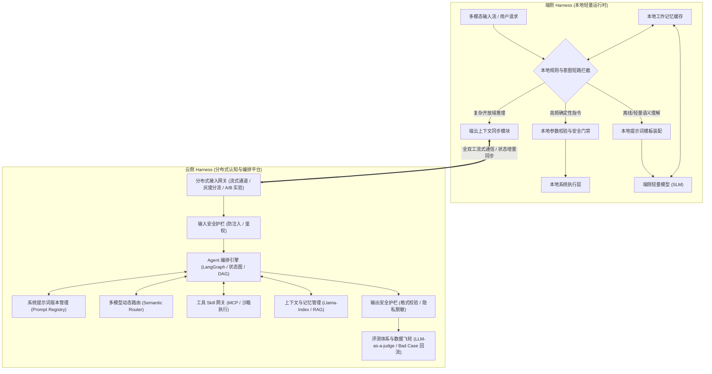

# AI Agent Harness 架构通用知识白皮书

> **文档定位**：本文档面向 AI Agent（智能体）系统工程领域，系统性科普 **AI Agent Harness（智能体运行时与控制底座）** 的核心概念、通用架构层次、云端与端侧核心模块及关键技术机制。  
> **核心关键词**：`C/C++`、`Rust`、`Python`、`LangGraph`、`Llama-Index`、`后端开发经验`、`系统级提示词设计`、`云侧 Harness`（Agent 编排、系统提示词版本管理、工具 Skill 网关、上下文管理、安全护栏、评测体系、多模型路由、分布式服务、灰度与 A/B 实验）、`端侧 Harness`（本地提示词模板、本地规则、意图短路拦截、本地校验、端云上下文同步、算力与内存约束适配、安全控制）。

---

## 一、 核心概念：什么是 AI Agent 领域的 “Harness”？

在软件与系统工程中，**Harness（控制线束与运行时底座）** 指围绕核心计算模型构建的**外围控制框架、通信管道、安全边界与状态管理运行时（Agent Runtime & Middleware Framework）**。

```
+-----------------------------------------------------------------------+
|                        大模型 (LLM / VLM / SLM)                        |
|           职责：概率推理、语义理解、规划生成（无状态、非确定性）            |
+-----------------------------------+-----------------------------------+
                                    | Token / 结构化意图流
+-----------------------------------v-----------------------------------+
|                      AI Agent Harness (智能体运行时底座)                |
|  [提示词管理与动态装配]    [Agent 状态机编排]    [工具 Skill 网关与沙箱]  |
|  [上下文治理与分层记忆]    [意图短路与多模型路由]  [安全护栏与评测飞轮]    |
+-----------------------------------+-----------------------------------+
                                    | 确定性指令 / 标准协议调用
+-----------------------------------v-----------------------------------+
|                     外部系统、客户端环境与底层服务接口                    |
+-----------------------------------------------------------------------+
```

### 1. 为什么大模型需要 Harness？
大模型本质上是**无状态的概率预测器**，无法直接作为生产级系统独立运行：
* **非确定性与幻觉**：模型输出具有随机性，可能伪造参数、违反格式契约或陷入重复生成死循环；
* **缺乏状态与记忆维系**：模型自身不保存跨会话状态，且受限于上下文窗口（Context Window）长度与推理成本；
* **延迟与可用性瓶颈**：复杂推理耗时较长，且受网络波动影响，无法直接满足毫秒级实时响应要求；
* **缺乏执行与安全边界**：模型不能直接、安全地调用外部 API 或底层系统接口，必须经过权限校验、参数验证与沙箱隔离。

### 2. Harness 的核心工程职责
Harness 不改变模型权重，而是通过确定性的软件工程手段将模型封装为高可靠的智能体系统：
1. **提示词工程与装配**：管理系统提示词生命周期、版本演进与动态上下文注入；
2. **流程编排与路由**：控制单步/多步推理状态流转，在规则、小模型与大模型之间动态分流；
3. **工具连接与校验**：提供标准化的外部工具调用协议、强类型参数校验与执行沙箱；
4. **记忆与上下文治理**：通过滑动窗口、语义压缩与检索增强（RAG）维护短期与长期记忆；
5. **安全护栏与观测评测**：拦截恶意输入与越界输出，并通过灰度实验与自动化评测实现持续迭代。

---

## 二、 通用 AI Agent Harness 架构全景

现代高可用 AI Agent 普遍采用**端云协同双环 Harness 架构**，将端侧的低延迟确定性能力与云端的深度认知能力结合：



---

## 三、 云侧 Harness：核心架构模块科普

云侧 Harness 负责承载复杂认知推理、多步工具编排、上下文治理以及高并发分布式服务治理。

### 1. 云端 Agent 编排 (Agent Orchestration)
* **状态图编排（LangGraph / StateGraph）**：
  * 突破早期单向线性链（Linear Chain）的局限，采用有向图（DAG）与状态机模型管理 Agent 生命周期；
  * 原生支持**条件分支（Conditional Edges）、循环迭代（Cycles）、工具调用失败重试以及自我反思纠偏（Reflection）**；
* **状态持久化与中断恢复（Checkpointing & Human-in-the-loop）**：
  * 将编排图的每一步执行状态持久化，支持长耗时任务的断点恢复，以及在关键操作前挂起等待外部确认。

### 2. 系统提示词版本管理 (System Prompt Management)
* **提示词资产化（Prompt Registry）**：
  * 将系统提示词从业务硬编码中解耦，纳入统一的配置与版本管理中心；
  * 采用语义化版本控制（SemVer，如 `v1.2.0`），支持变更历史审计、Diff 比对与秒级一键回滚；
* **模块化与模板继承**：
  * 将系统提示词拆分为：核心角色定义、全局安全约束、工具调用规范、动态环境槽位（Slots），支持多业务线按需组合与模板继承。

### 3. 工具 Skill 网关 (Tool Skill Gateway)
* **标准化工具协议（MCP / Function Calling）**：
  * 基于模型上下文协议（MCP, Model Context Protocol）或 JSON Schema 统一封装内部微服务与第三方 API；
  * 支持工具注册、发现、版本路由与动态 Schema 注入；
* **安全沙箱与稳定性隔离**：
  * 对代码执行或外部插件调用实施容器化/Wasm 沙箱隔离；
  * 内置超时熔断、并发限流、权限鉴权与幂等性控制，防止单一慢工具阻塞整体推理链路。

### 4. 上下文管理 (Context Management)
* **分层记忆与数据索引（Llama-Index）**：
  * 借助 **Llama-Index** 等数据框架，构建结构化的上下文分层体系：
    1. **短期工作记忆（Working Memory）**：维护最近 N 轮完整对话的滑动窗口；
    2. **中期会话摘要（Session Summary）**：当对话超长时，后台异步将早期对话浓缩为精简摘要，释放 Token 空间；
    3. **长期知识与画像（Long-Term Memory & RAG）**：通过向量检索与知识图谱按需召回用户偏好与领域知识；
* **Token 预算控制（Token Budgeting）**：
  * 精确计算各模块占用的 Token 配额，动态裁剪低优上下文，防止超出模型窗口限制并优化推理成本。

### 5. 安全护栏 (Safety Guardrails)
* **输入侧防御（Input Guardrails）**：
  * 识别并拦截提示词注入（Prompt Injection）、越狱攻击（Jailbreak）、系统指令窥探与敏感违规话题；
* **输出侧防御（Output Guardrails）**：
  * **结构化校验**：强制验证模型输出的 JSON 格式与工具参数类型，拦截幻觉字段；
  * **敏感信息脱敏（PII Masking）**：自动识别并掩码处理个人隐私与机密数据。

### 6. 评测体系 (Evaluation System)
* **多维自动化评测**：
  * **确定性指标**：意图分类准确率、工具调用参数精确率、首字响应延迟（TTFT）、端到端耗时；
  * **生成质量评估**：采用 **LLM-as-a-judge** 及 **Ragas** 框架，自动化评估回答的忠实度（Faithfulness）、相关性（Relevance）与遵循指令程度；
* **数据飞轮（Data Flywheel）**：
  * 自动收集线上低置信度、用户打断或执行报错的 Bad Case，经脱敏清洗后回流至评测基准集（Benchmark）与微调数据集。

### 7. 多模型路由 (Multi-Model Routing)
* **语义动态分流（Semantic Router）**：
  * 根据任务复杂度、时延要求与成本预算动态选择模型：简单分类与闲聊路由至轻量高吞吐模型，复杂推理与多步规划路由至旗舰大模型；
* **缓存优化与故障切换（Fallback）**：
  * 统一提示词前缀结构以最大化命中推理引擎的 **Prefix KV Cache**；当主模型服务超时或限流时，自动无缝切换至备用模型节点。

### 8. 分布式服务、灰度与 A/B 实验 (Distributed Infrastructure & A/B Testing)
* **高并发流式服务架构**：
  * 采用无状态网关与分布式缓存解耦会话状态，基于 WebRTC / gRPC / SSE 实现全双工低延迟流式传输；
* **灰度发布与正交 A/B 实验**：
  * 支持按用户比例、特征标签进行细粒度流量切分（Traffic Splitting）；
  * 在生产环境并行对比不同提示词版本、不同路由策略或不同底层模型的核心指标（转化率、打断率、时延、Token 消耗），实现数据驱动的迭代上线。

---

## 四、 端侧 Harness：本地轻量运行时科普

端侧 Harness 运行于本地受限环境（如终端设备、嵌入式系统或边缘节点），核心目标是提供**超低延迟响应、离线高可用、本地隐私保护与安全执行控制**。通常采用 **C/C++** 或 **Rust** 构建核心运行时。

### 1. 本地提示词模板 (Local Prompt Templates)
* **极简结构化设计**：
  * 针对端侧小模型（SLM，如 0.5B~3B 参数）上下文窗口小、注意力易分散的特点，采用紧凑的微提示词模板（Micro-Prompts）；
* **零拷贝动态槽位填充**：
  * 仅按需注入当前必要的本地状态变量，避免冗余文本拼接造成的内存分配与预填充（Prefill）延迟。

### 2. 本地规则与意图短路拦截 (Local Rules & Intent Short-Circuiting)
* **毫秒级快环拦截（Fast-Path Short-Circuiting）**：
  * 在请求发往云端或大模型前，先经过本地高性能规则引擎（基于正则匹配、前缀树或有限状态机 FSM）；
  * 对于明确的高频指令，直接在本地毫秒级完成解析与执行，**短路跳过云端链路**，消除网络延迟与算力消耗；
* **零幻觉与槽位缺失追问**：
  * 当识别到明确意图但缺少必填参数槽位时，直接由本地状态机触发定向澄清追问，严禁模型猜测或填充虚假默认值。

### 3. 本地校验与安全控制 (Local Validation & Safety)
* **强类型参数边界校验**：
  * 对所有准备执行的本地工具调用进行严格的Schema校验、数值范围截断与状态前置检查；
* **执行互锁与看门狗机制（Interlock & Watchdog）**：
  * 检查当前系统状态是否满足安全执行条件（安全互锁）；
  * 内置首字超时看门狗（TTFT Watchdog）与重复生成检测器（N-gram Repetition Breaker），一旦模型推理超时或陷入死循环，立即中止并触发确定性降级回复。

### 4. 端云上下文同步 (Edge-Cloud Context Sync)
* **本地持久化与增量同步**：
  * 端侧快环产生的交互记录与状态变更实时写入本地轻量存储（如 SQLite WAL）；
  * 通过增量同步协议与云端上下文保持对齐，确保端侧执行的操作能够被云端后续的多轮对话感知，并在断网重连后自动合并状态。

### 5. 算力与内存约束适配 (Compute & Memory Adaptation)
* **端侧模型量化与硬件加速**：
  * 采用 INT4 / W4A16 量化技术压缩端侧小模型体积，结合底层硬件加速接口（NPU / GPU / SIMD）提升本地 Token 生成速度；
* **零动态分配与无锁并发**：
  * 使用内存池预分配与单生产者单消费者无锁环形缓冲区（Lock-Free SPSC RingBuffer）处理实时数据流，杜绝高频内存分配引发的碎片化、GC 停顿或内存溢出（OOM）；
* **异构核心调度（CPU Affinity）**：
  * 将常驻轻量监听任务绑定至能效小核以降低功耗，将模型推理与合成任务绑定至性能大核以保障实时性。

---

## 五、 端云协同核心运行机制

| 协同机制 | 核心技术原理 | 解决的核心工程问题 |
| :--- | :--- | :--- |
| **1. 双环竞态仲裁 (Race Arbitration)** | 端侧快环与云端慢环并发处理；若端侧短路器率先命中确定性指令并完成响应，则自动取消或静默丢弃（Drain & Discard）随后到达的云端推流。 | 兼顾本地确定性指令的极致速度与开放域对话的深度智能，避免端云双重响应冲突。 |
| **2. 级联打断熔断 (Cascade Barge-in)** | 用户在系统输出过程中随时插话时，端侧毫秒级清空本地输出缓冲并截断未完成上下文，同时向云端发送中断信令，立即终止云端推理任务。 | 实现自然全双工交互，消除上下文记忆错位（只保留实际已输出内容），节省云端无效算力。 |
| **3. 流式微断句 (Streaming Chunking)** | 对模型流式输出的 Token 进行动态标点检测：首句采用极小阈值（如 4~6 字）立即切分下发，后续句子扩大阈值以保持连贯性。 | 将端到端首字感知延迟（TTFA）压缩至百毫秒级，消除整段生成带来的漫长等待感。 |
| **4. 阶梯退化兜底 (Graceful Degradation)** | 根据网络质量与服务健康度动态切换：`云端旗舰模型 -> 端侧本地小模型 -> 本地确定性规则 -> 安全兜底回复`。 | 保障系统在弱网、断网或云端过载故障时依然具备基础可用性，杜绝系统假死。 |

---

## 六、 核心技术栈与工程师能力要求

构建端云协同 AI Agent Harness 需要跨领域的工程技术栈支撑：

1. **核心开发语言与框架**：
   * **`C / C++` & `Rust`**：构建端侧高性能原生运行时、无锁数据管道、内存安全控制与跨平台底层 SDK；
   * **`Python`**：构建云端 Agent 编排逻辑、评测流水线、算法快速迭代与模型胶水层；
   * **`LangGraph` & `Llama-Index`**：实现复杂状态图编排、多智能体协作、分层上下文治理与高效 RAG 检索；
   * **后端开发技术栈（Go / Java / 分布式系统）**：构建高并发流式网关、微服务治理、分布式缓存、灰度发布与 A/B 实验平台。

2. **关键设计能力**：
   * **系统级提示词设计能力**：精通结构化提示词架构、动态槽位装配、工具契约定义、防注入护栏设计以及基于评测指标的提示词调优；
   * **多背景融合视野**：能够将**大模型算法原理**（上下文、路由、评测）、**客户端/硬件控制工程经验**（状态机、安全校验、资源受限优化）与**智能体编排框架设计**有机结合。
