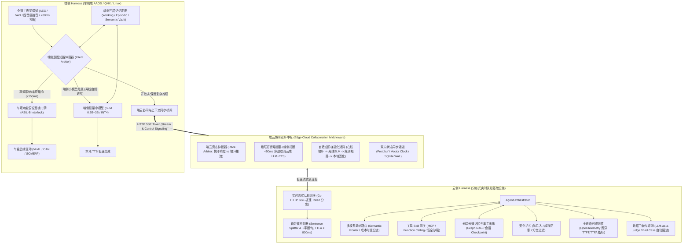
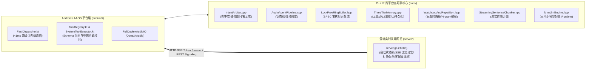

# AI Agent 端云协同 Harness 架构与技术实现白皮书

> **适用范围**：智能座舱（AAOS/QNX/Linux）全双工语音智能体架构研究、端云协同 Runtime 体系设计、Avatar 项目代码实装与车规量产演进。

---

## 一、 核心概念：什么是 Agent 领域的 “Harness”？

在传统软件工程中，Harness 指“测试夹具”（Test Harness）；但在大模型与智能体系统工程中，**Harness 借用了汽车工业中“电气线束（Wiring Harness）”的物理隐喻：它是承载模型运行的“控制底座、安全管线与线束运行时”（Agent Runtime & Middleware Framework）**。

* **大模型本身只是无状态的“文本/概率预测引擎”**：
  * 模型自身无法感知物理世界（无法感知车速、电量、挡位、音区定位）；
  * 模型无法直接安全地调用车身总线（CAN/LIN/SOME/IP）或执行物理动作；
  * 模型存在固有幻觉、非确定性延迟（TTFT 波动从几百毫秒到数秒不等），且面临隧道/地库断网即瘫痪的脆弱性。
* **Harness 负责把“孤立的模型”约束、赋能为“高可靠的智能体”**：
  * **装配感官与线束**：挂接全双工声学管线（AEC/VAD/音区拾音）、实时车身信号网关（VHAL）；
  * **约束执行与安全**：构建车规物理互锁（Safety Interlock）、意图短路拦截、反死循环看门狗；
  * **维护记忆与状态**：提供端侧分层短期/工作记忆、云端长期画像与会话状态持久化；
  * **端云双环协同**：在端侧极速快环（<150ms 规则/端侧小模型）与云端认知慢环（P50 <800ms 多模态大模型）之间实现无感调度与竞态仲裁。

---

## 二、 【基础科普篇】工业级/车规级端云协同 Harness 架构全景



### 1. 端侧 Harness（车机端 AAOS/QNX）的七大核心能力

| 核心能力 | 技术内涵与车规关键约束 | 行业典型方案与设计标准 |
| :--- | :--- | :--- |
| **1. 全双工声学管线与毫秒级打断** | 消除扬声器自激回声（AEC）、人声活动检测（VAD）、无锁环形缓冲（Lock-Free RingBuffer）；**用户发话时 < 80ms 清空本地音频输出队列**并向云端下发取消信号。 | Oboe / ALSA / QNX Audio Manager, Silero-VAD, SPSC RingBuffer |
| **2. 多模态与多音区感知** | 区分主驾、副驾、后排音区，严格执行权限隔离（如副驾不可控制主驾车窗）；结合 DMS 驾驶员视线检测实现免唤醒注视交互；订阅车速、挡位、车门等车身总线信号。 | 麦克风阵列波束成形、DMS 视线追踪服务、Android CarPropertyManager |
| **3. 毫秒级意图短路与槽位仲裁** | 对高频车控（开关空调、升降车窗、音乐播控）实施确定性短路拦截（< 150ms），**严禁走云端大模型**（避免弱网不可用与秒级延迟）；必须具备**槽位缺失追问机制**，严禁脑补虚假槽位。 | 正则状态机 + C++ 原生 NLU 解析器 + 动态实体字典（通讯录、城市、POI） |
| **4. 端侧轻量小模型推理底座 (Edge SLM)** | 在高通 8295 / Orin 芯片 NPU 上部署 0.5B~3B 端侧小语言模型，在离线/弱网环境下提供自然语言理解与泛化意图提取，摆脱纯硬编码规则束缚。 | MNN-LLM, ONNX Runtime, llama.cpp, QNN / TensorRT-LLM (INT4 量化) |
| **5. 车规功能安全物理互锁 (Safety Interlock)** | 任何模型或意图输出的控制指令严禁裸连底层执行，必须经过 **ASIL-B 级安全看门狗互锁**：例如车速 > 0 时强制拦截开后备箱/开门操作；高危指令要求“二次声纹确认”；具备执行超时与幂等性回滚机制。 | Vehicle Interlock Gate, 状态机守卫条件 (Guard Conditions) |
| **6. 系统功耗隔离与生命周期管理** | 车机算力受仪表盘与 ADAS 挤压，AI 运行时必须支持 STR（Suspend-to-RAM 毫秒级休眠快起）；CPU 感知线程绑小核、渲染绑大核；设定常驻内存硬上限（防止触发 Android LMK / Linux OOM Killer）。 | CPU Affinity (pthread_setaffinity_np), 内存池零拷贝, 守护服务常驻白名单 |
| **7. 端侧合规与 PII 隐私脱敏** | 车载语音与敏感信息上传前，必须在端侧执行身份脱敏；麦克风硬件指示灯物理合规联动；车主敏感记忆持久化须采用本地物理隔离存储。 | PII Masking, 本地二阶段授权落盘, SQLite WAL 本地加密 |

---

### 2. 云侧 Harness（分布式实时认知中枢）的七大核心能力

| 核心能力 | 技术内涵与云端职责 | 行业典型方案与设计标准 |
| :--- | :--- | :--- |
| **1. 实时流式认知网关** | 承接端侧 HTTP SSE 文本流长连接；具备**首句微断句切词机制（4~6 字标点快速切句送端侧统一 TTS）**，全力压降首字发音时延 **TTFA ≤ 800ms**。 | Go Realtime Gateway, 流式 Sentence Splitter, SSE Token Stream |
| **2. 复杂多步 Agent 编排引擎** | 解决深度车务问答、多轮出行规划等非线性任务，支持循环（Cycle）、条件分支、多工具并发规划与反思纠偏（Reflection）。 | LangGraph, 异步原生 DAG 编排引擎, Temporal |
| **3. 多模型动态路由 (Routing)** | 意图、成本与时延动态分流：闲聊/短句走轻量小模型（MoE / 8B），复杂深度多步规划路由至旗舰推理模型（DeepSeek-R1 / GPT-4o / Claude 3.5 Sonnet）。 | Semantic Router, Token FinOps 算力配额网关, Prompt Cache 共享 |
| **4. 工具 Skill 网关与安全沙箱** | 提供标准化 Tool Call 网关，对接第三方生态（高德/美团/车联网生态 API）；提供鉴权托管、并发限流、超时隔离与沙箱执行环境。 | MCP (Model Context Protocol), OpenAPI 3.0, Docker/Wasm 沙箱 |
| **5. 动态分层记忆与车主画像** | 管理跨会话的长效记忆、车主偏好（驾驶风格、座椅/空调习惯、家庭成员画像）、行程上下文，并通过知识图谱/向量检索进行 RAG 增强。 | Graph RAG, Llama-Index, 向量数据库, 实体记忆图谱 |
| **6. 全链路可观测性 (Observability)** | 全局 OpenTelemetry Trace ID 贯穿 `端侧拾音 -> 意图仲裁 -> 云网关 -> LLM 首字 (TTFT) -> 首句 TTS (TTFA) -> 端侧播放`；监控 P50/P99 延时与打断成功率。 | OpenTelemetry, Prometheus, Grafana, Jaeger |
| **7. 数据飞轮与自动化评测闭环** | 生产链路自动捕获低置信度、用户打断、工具调用失败的“Bad Case”，自动脱敏清洗后回流到离线 Benchmark 自动化评测集与微调数据集。 | LLM-as-a-judge, Ragas, TruLens, 自动回归测试集 |

---

### 3. 最深水区：端云协同三大机制

在端云协同的 Agent 架构中，最复杂的不是单纯的端或云，而是两者动态交互的边界控制：

1. **双环竞态仲裁（Race Arbiter）**：
   * 端侧快环（Local Fast Loop ≤ 150ms）与云端慢环（Cloud Loop P50 ≤ 800ms）在收到用户语音后并发运行。
   * **仲裁原则**：若端侧意图短路器判定命中系统指令（如“把空调开到24度”），端侧立即接管硬件执行与播报反馈；当云端大模型的推流数据在 500ms 后到达时，端侧通信层**静默排空丢弃（Drain & Discard）**，杜绝双重发音与状态冲突。
2. **端云级联打断熔断（Cascade Cancellation Propagation）**：
   * 当车主在 Agent 播报过程中突然说话，端侧声学管线在 **< 5ms** 内标记打断、瞬时清空本地扬声器 Buffer；
   * 同时通过 WebRTC DataChannel / 高优先级 gRPC 通道向云端发送 `INTERRUPT` 信号；
   * 云侧 Harness 收到信令后，**毫秒级强杀正在生成的 LLM 推理线程，并关闭下游流式 TTS 音频流**，阻止算力与网络带宽浪费。
3. **自适应阶梯退化矩阵（Adaptive Fallback Matrix）**：
   * 车载运行环境面对地库、深山、过隧道的常态化网络抖动与断连：
     * `网络健康`：开放域全功能云端多模态慢环（旗舰大模型 + 生态工具网关）；
     * `弱网/高延时 (RTT > 1200ms)`：平滑降级至端侧 SLM 本地推理；
     * `完全离线/断网`：端侧确定性意图短路规则全权接管车控与本地多媒体；
     * `系统异常/严重抖动`：看门狗触发固定兜底安全播报，保障确定性与安全底线。

---

## 三、 硬件载体替代方案：使用 Google Pixel 替代车机端

在缺乏高通车机台架（HIL）或处于敏捷研发期时，选用 **Google Pixel** 作为 AAOS/座舱开发板是业界标准做法。

### 1. 替代可行性与优势
* **纯正的 AOSP/AAOS 参考底座**：Google 官方将 Pixel 作为 Android Automotive OS 的参考平台，可直接刷入 Generic Automotive GSI 或运行车载服务栈。
* **现代硬件架构**：Pixel 搭载 Google Tensor SoC，具备强大的 ARM64 CPU、GPU 与硬件级 Edge TPU/NPU，支持 Android NDK 与原生 Rust/C++ 工具链。
* **开发调试极速循环**：对比车载台架慢速刷机、物理锁网等限制，Pixel 支持 adb、perf、ASan 内存分析，开发效率提升数倍。

### 2. 核心架构适配策略：软硬件隔离解耦

```
+------------------------------------------------------------+
|                     Android UI / App                       |
+------------------------------------------------------------+
|        端侧 Harness 核心 (C++17 Native 跨平台共享运行时)      |
|  [意图短路仲裁]  [全双工音频管线]  [三层记忆]  [看门狗防死循环] |
+-----------------------------+------------------------------+
                              |
                [IVehicleSignalProvider 抽象接口]
                              |
            +-----------------+-----------------+
            |                                   |
    [Pixel 开发分支]                     [车机量产分支]
   MockVHAL / 模拟控制台               SOME/IP / CAN / QNX IPC
   (悬浮窗滑块/虚拟车速挡位)             (真实车身电子电气架构)
```

1. **抽象硬件访问层（Mock VHAL）**：
   * 定义 `IVehicleSignalProvider`（状态读取）与 `IVehicleCommandExecutor`（控制执行）纯虚接口。
   * **在 Pixel 上**：实现 `MockVehicleAdapter`，通过应用内悬浮窗、Web 调试控制台手动模拟“车速 80km/h”、“主驾门未关”等车况。
   * **上量产车机时**：无缝切换为 Android CarService（`CarPropertyManager`）或 QNX IPC 驱动层，上层 Harness 核心逻辑零修改。
2. **警惕三大算力与运行假象**：
   * **算力倒挂**：Pixel Tensor CPU 性能优于老款高通 8155。在 Pixel 上开发必须主动压测 CPU 占用（单核 < 30%）与内存常驻（< 200MB），防止上车机发生 OOM。
   * **生命周期差异**：Pixel 默认电池优化会积极杀死后台服务，而车机需要开机常驻守护。需采用 Android `Foreground Service` 与系统白名单保活。
   * **弱网与断网模拟**：利用 Pixel 开发者选项主动注入弱网延迟与丢包，验证在地库场景下的离线短路兜底与网络恢复上下文补齐。

---

## 四、 【项目实战篇】Avatar 架构在本项目中的工程落地映射

当前 Avatar 项目已经完整落地了上述“端云双环”与“高可靠 Native Harness”的核心工程体系。以下为各核心模块在代码仓库中的具体实现映射：



### 1. 毫秒级意图短路与槽位仲裁器 (Fast-Path Intent Arbiter)
* **核心代码**：[`core/src/IntentArbiter.cpp`](../core/src/IntentArbiter.cpp) 与 [`core/include/IntentArbiter.hpp`](../core/include/IntentArbiter.hpp)
* **关键实现逻辑**：
  * **三态决策输出契约**：定义 `ArbiterStatus::MATCHED`（槽位完整直接执行）、`SLOT_MISSING`（命中意图但关键槽位缺失）、`UNMATCHED`（非确定性意图，交由大模型）；
  * **零虚假兜底（Zero Hallucination）**：当用户下达“设置闹钟”但未给出时间时，返回 `SLOT_MISSING` 并标记 `missing_slot = "time"`，驱动系统发起定向追问澄清，杜绝私自生成虚假默认参数；
  * **防冲突高专属性前置过滤**：严密过滤常识问答与闲聊语气（“为什么”、“是什么”、“笑话”、“你是谁”），自动漏斗穿透交由 LLM 处理，兼顾确定性车控与开放式拟人智能；
  * **中英文泛化规整 (Universal Normalizer)**：通过 `ChineseDigitToVal` 与口语助词剥离逻辑（`CleanPunctuationAndParticles`），高效规整时间、数字、歌曲与城市槽位。
* **平台分流层**：[`android/app/src/main/java/com/avatar/android/core/dispatcher/FastDispatcher.kt`](../android/app/src/main/java/com/avatar/android/core/dispatcher/FastDispatcher.kt)
  * 实现 **4 级优先级、< 1ms 确定性分流**：
    * `P1: LOCAL_MEMORY`（“帮我记一下” -> 拦截到本地隐私数据库）；
    * `P3: LOCAL_PERSONA`（“切换为伴侣模式” -> 驱动本地人格状态机）；
    * `P4: CLOUD_CHAT`（开放式对话 -> 穿透至云端实时长连接）。

### 2. 车规级高可靠 Native 运行时 (AudioAgentPipeline & Hardware Affinity)
* **核心代码**：[`core/src/AudioAgentPipeline.cpp`](../core/src/AudioAgentPipeline.cpp) 与 [`core/include/AudioAgentPipeline.hpp`](../core/include/AudioAgentPipeline.hpp)
* **关键实现逻辑**：
  * **CPU 亲和性硬隔离**：调用 [`core/include/CpuAffinity.hpp`](../core/include/CpuAffinity.hpp) 中的 `BindToLittleCores`（感知与 VAD 线程绑定能效小核，低功耗常驻）与 `BindToBigCores`（认知与音频合成绑定大核，抑制时延抖动）；
  * **无锁音频环形缓冲**：[`core/include/LockFreeRingBuffer.hpp`](../core/include/LockFreeRingBuffer.hpp) 实现单生产者单消费者（SPSC）无锁环形队列，消除声学 AEC 与播放渲染之间的线程锁争死锁隐患；
  * **极速声学打断控制器 (Barge-in < 5ms)**：`TriggerBargeIn()` 采用原子标记（`std::atomic<bool> is_speaking_`），瞬间清空扬声器 PCM 缓冲队列并重置状态机；
  * **看门狗与死循环破圈器**：[`core/include/WatchdogAndRepetition.hpp`](../core/include/WatchdogAndRepetition.hpp) 实现 **3 秒 TTFT 超时强制降级兜底** 与 **12 字节 N-gram 文本死循环破圈器**，杜绝车载交互界面卡死无响应。

### 3. 三层分层记忆底座 (Three-Tier Memory Subsystem)
* **核心代码**：[`core/src/ThreeTierMemory.cpp`](../core/src/ThreeTierMemory.cpp) 与 [`core/include/ThreeTierMemory.hpp`](../core/include/ThreeTierMemory.hpp)
* **关键实现逻辑**：
  * **L1 环形工作记忆**：维护 System Prompt + 最近 4 轮高频对话滑动窗口，严格把控端侧/云端实时推理的 Token 开销；
  * **L2 空闲时段语义浓缩**：当累积轮次达阈值且系统检测到空闲时，后台线程自动触发异步多轮对话浓缩摘要（Summarization）；
  * **L3 事实库增强检索**：持久化长期偏好（如驾驶习惯、常听音乐风格），在对话启动时按需组装注入；
  * **端侧隐私合规保护**：`MemoryVault` 采用二阶段语音确认机制（“确定要我记住吗？”），数据物理隔离落盘于本地设备 JSON，严格满足车载隐私合规要求。

### 4. 工具 Skill 网关与车规防呆门禁 (Tool Gateway & Safe Interlock)
* **核心代码**：[`android/app/src/main/java/com/ai/audioagent/tools/ToolRegistry.kt`](../android/app/src/main/java/com/ai/audioagent/tools/ToolRegistry.kt) 与 [`SystemToolExecutor.kt`](../android/app/src/main/java/com/ai/audioagent/tools/SystemToolExecutor.kt)
* **关键实现逻辑**：
  * **动态 Schema 导出**：`ToolRegistry.exportSchemaJson()` 动态生成符合标准 Function Calling 规范的 JSON Schema；
  * **强类型校验与安全前置拦截**：通过 `SystemAlarmTool`、`MusicPlaybackTool`、`WeatherQueryTool` 拦截解析参数；
  * **VHAL 抽象互锁**：在调用底层硬件动作前，检查车辆物理信号状态（车速、挡位），杜绝行车过程中执行高危控制指令。

### 5. 云端流式网关与全链路文本协同 (Cloud Gateway & Unified Edge TTS)
* **核心代码**：[`server/server.go`](../server/server.go) 与 [`internal/cloud/client.go`](../internal/cloud/client.go)
* **关键实现逻辑**：
  * **Go 实时控制网关（`:8088`）**：负责端侧授权验证（`cloud_consented`）、会话生命周期流转（`NEW -> READY -> PROCESSING -> STREAMING -> CLOSED`）、协同打断接口（`POST /api/v1/session/interrupt`）；
  * **全链路传文本 (SSE Token Stream)**：上游大模型生成 Token 经由 `/api/v1/chat` (text/event-stream) 毫秒级下发，零音视频带宽与流媒体服务器运维负担；
  * **端侧统一语音合成 (Unified Edge TTS · 零音色割裂)**：无论是本地快环 A 还是云端慢环 B，最终文字全部汇入端侧同一个离线神经 TTS 引擎（如 `sherpa-onnx` / 平台原生合成器）发声，彻底根除“本地机械音 vs 云端真人音”的人格割裂；
  * **协同打断立即强杀**：端侧触发打断时，端侧瞬间清空本地待播切句并闭音，云端网关收到中断信令后立即执行 `CancelFunc()` 强杀正在生成的 LLM 推理线程。

---

## 五、 从 Pixel 原型到车规量产落地的演进 Checklist

若后续正式对接车企 QNX / 高通 8295 硬件平台，当前项目需按以下规范进行演进切换：

1. **跨平台构建与 QNX 工具链对齐**：
   * 当前 C++ 核心库（`core/`）严格遵循 ISO C++17 标准，杜绝任何平台私有扩展；
   * 配置针对 QNX Neutrino RTOS 交叉编译工具链（`aarch64-unknown-nto-qnx`），将 `core/` 打包为 `libavatar_harness.so`，供车载中间件加载。
2. **车身总线与 ASIL 功能安全驱动接入**：
   * 将 `MockVehicleAdapter` 切换为生产级 `CarPropertyManager`（Android CarService）或 QNX SOME/IP 适配层；
   * 在天窗、车门、座椅等执行动作前，强制增加硬件电源状态（IGN ON/OFF）和行车速度（Speed > 0）的硬件级 Interlock 校验。
3. **断网缓存与增量同步升级**：
   * 将端侧会话缓存全面迁移至 SQLite WAL 模式并开启本地加密；
   * 设计针对地库/隧道重连的增量同步协议（基于 gRPC 流式通道），断网时端侧产生本地日志，回网时自动批量推送至云端审计并完成状态树对齐。
4. **端侧 SLM 本地化部署**：
   * 将 [`core/include/MnnLlmEngine.hpp`](../core/include/MnnLlmEngine.hpp) 对接至高通 QNN / NPU 专用推理加速后端，实现端侧 1.5B 级别小模型在车机本地的高性能常驻推理。