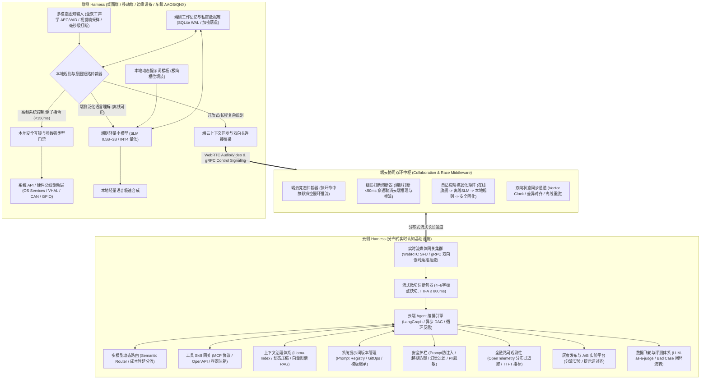
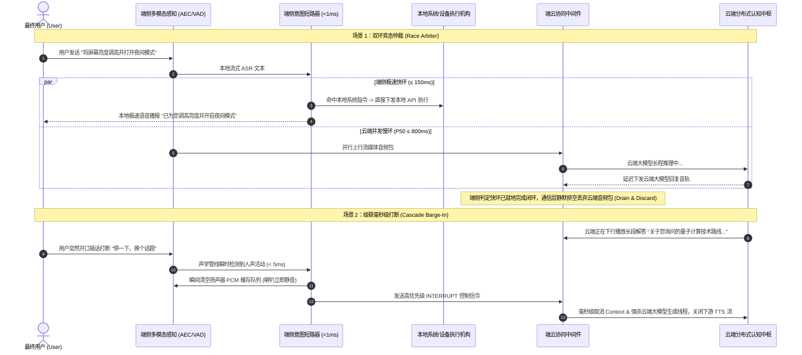

# AI Agent 端云协同 Harness 架构通用知识科普白皮书

> **白皮书定位**：本白皮书面向现代通用人工智能智能体（AI Agent）系统工程领域，旨在系统性科普 **端云协同 AI Agent Harness（线束运行时）** 的行业标准、架构体系、核心技术栈与关键设计原语。  
> **适用领域**：覆盖跨平台端侧设备（桌面端 macOS/Windows、移动端 Android/iOS、智能汽车 AAOS/QNX、边缘硬件与具身智能机器人）以及云端分布式多模态大模型基础设施。  
> **核心关键词体系**：`C/C++`、`Rust`、`Python`、`LangGraph`、`Llama-Index`、`后端开发经验`、`系统级提示词设计`、`大模型/硬件控制App/智能体低代码编排`、`云侧 Harness`（云端 Agent 编排、系统提示词版本管理、工具 Skill 网关、上下文管理、安全护栏、评测体系、多模型路由、分布式服务、灰度与 A/B 实验）、`端侧 Harness`（本地提示词模板、本地规则、意图短路拦截、本地校验、端云上下文同步、算力/内存约束/系统安全适配）。

---

## 一、 核心概念：什么是 Agent 领域的 “Harness”？

在传统软件工程中，Harness 指“测试夹具”（Test Harness）；但在大模型与智能体系统工程中，**Harness 借用了工业工程中的“电气线束（Wiring Harness）与汽车底盘”的物理隐喻：它是承载并约束大模型运行的“控制底座、安全管线、中继运行时与系统外骨骼”（Agent Runtime & Middleware Framework）**。

```
+--------------------------------------------------------------------------+
|                       大模型 (LLM / VLM / SLM)                           |
|        本质：概率文本预测器、无状态纯计算单元、非确定性、高延迟、无直接执行权         |
+-----------------------------------+--------------------------------------+
                                    | (输入 Token 序列 / 输出 Token 序列)
+-----------------------------------v--------------------------------------+
|                     AI Agent Harness (智能体线束运行时)                     |
|  [感官装配: 全双工音频/摄像头感知]     [执行约束: 强类型校验/物理门禁/反死循环] |
|  [时延优化: 意图短路/流式微切词]      [记忆维系: 分层工作记忆/画像库/向量RAG]   |
|  [状态对齐: 端云状态机/增量同步]      [工程兜底: 阶梯降级/本地小模型/确定性规则]|
+-----------------------------------+--------------------------------------+
                                    | (安全信号 / 确定性硬件与系统 API 指令)
+-----------------------------------v--------------------------------------+
|              物理设备与操作系统 (OS APIs / 系统服务 / 硬件驱动总线)           |
|            桌面端 (macOS/Win) · 移动端 (Android/iOS) · 边缘车机 · 机器人      |
+--------------------------------------------------------------------------+
```

### 1. 为什么“裸大模型”无法直接用于生产级系统？
1. **感知脱节**：模型本身无法实时感知物理世界与系统环境（无法直接读取外设状态、传感器音视频输入、地理位置、系统电量与网络质量）；
2. **执行风险与安全真空**：模型直接调用外部接口存在严重的“幻觉参数”隐患，且在涉及金钱交易、文件修改、设备运动或关键硬件控制时，缺乏确定性的物理互锁机制，极易引发严重安全事故；
3. **高延迟与弱网脆弱性**：云端大模型端到端网络 RTT 加首字生成时延（TTFT）通常在数百毫秒至数秒不等；一旦断网或遭遇隧道、电梯、高干扰场景，系统将瞬间瘫痪假死；
4. **状态漂移与死循环**：大模型缺乏跨轮次确定性有限状态机（FSM）的强约束，极易在长程复杂交互中发生意图偏移，或陷入局部自相关导致的文本复读死循环。

### 2. Harness 的核心使命
Harness 本身不负责深度神经网络的权重训练，而是致力于构建模型外部的**高可靠确定性工程基础设施**：
* **装配感官线束**：挂接全双工声学感知、低延时流媒体管线与设备底层状态信号；
* **约束执行与安全**：构建强类型参数门禁、物理安全互锁、高频意图短路过滤与反死循环看门狗；
* **维系分层记忆**：提供端侧极低开销的工作记忆与云端长效多模态知识图谱画像；
* **端云双环协同**：在端侧极速快环（<150ms 本地规则/轻量小模型）与云端认知慢环（P50 <800ms 多模态旗舰大模型）之间建立纳秒级的竞态仲裁与级联打断。

---

## 二、 通用 AI Agent Harness 端云双环架构全景



---

## 三、 云侧 Harness：分布式实时认知中枢深度科普

云侧 Harness 是大模型智能体的大脑宿主与企业级分布式认知基础设施，承担高复杂度推理、长程动态规划、多工具编排与大规模工程运维。

```
+--------------------------------------------------------------------------+
|                     云侧 Harness (Cloud Agent Harness)                   |
+--------------------------------------------------------------------------+
|  1. 云端 Agent 编排 (LangGraph / 异步 DAG / 状态图 / 循环反思 / 多智能体)   |
|  2. 系统提示词版本管理 (Prompt Registry / 语义版本 SemVer / 模板继承回滚) |
|  3. 工具 Skill 网关 (MCP 协议 / Function Calling 规范 / 容器与Wasm沙箱)   |
|  4. 上下文管理 (Llama-Index / 滑动窗口 / 语义浓缩 / Token 预算控制)       |
|  5. 安全护栏 (Safety Guardrails / 注入拦截 / 越狱防御 / 幻觉清洗 / 脱敏)   |
|  6. 评测体系 (LLM-as-a-judge / Ragas / Benchmark / Bad Case 闭环流转)     |
|  7. 多模型动态路由 (Semantic Router / 意图与成本时延分流 / KV Cache 优化) |
|  8. 分布式服务 (WebRTC SFU 流媒体 / gRPC 毫秒信令 / 无状态弹性扩缩)        |
|  9. 灰度与 A/B 实验平台 (Traffic Splitting 流量切分 / 提示词与模型正交对照) |
+--------------------------------------------------------------------------+
```

### 1. 云端 Agent 编排引擎 (LangGraph / 异步 DAG)
* **从单向 Chain 到状态图（StateGraph）**：
  * 早期的智能体（如早期的 ReAct、线性 Chain）仅支持顺次单向流水线，无法胜任非线性推理与错误恢复；
  * 现代云端 Harness 全面转向以 **LangGraph**、Temporal 或异步 DAG 为核心的有向图状态机引擎，原生支持**循环迭代（Cycles）、条件分支（Conditional Routing）、并行多分支（Fan-out/Fan-in）与反思纠偏（Reflection）**；
* **人机共驾与断点恢复（Human-in-the-loop & Checkpointing）**：
  * 在涉及核心资产变动、高危硬件执行或用户权限确认时，编排图可将当前完整的状态快照（State Checkpoint）原子持久化入数据库并进入挂起状态，待外部用户通过 Webhook/消息授权后再无损恢复执行。

### 2. 系统提示词版本管理 (System Prompt Version Management)
* **Prompt as Code 理念**：
  * 杜绝将自然语言提示词硬编码散落在业务代码中；建立集中的 **Prompt Registry（提示词注册中心）**；
  * 严格遵循软件工程规范，为提示词赋予 SemVer 语义化版本号（如 `v2.4.0-rc2`），记录完整的 Git 提交历史、责任人及变更摘要；
* **结构化分层与模板继承**：
  * **基础人设层（Base Persona）**：定义核心风格、全局防御守则；
  * **领域技能层（Domain Skills）**：按业务模块挂载专属工具调用指引；
  * **动态运行插槽（Dynamic Slots）**：预留运行时动态注入槽位（如用户角色、实时环境参数）；
  * 提供秒级 Diff 对比工具与一键回滚能力，保障生产环境提示词迭代风险可控。

### 3. 工具 Skill 网关与安全沙箱 (Tool Skill Gateway)
* **模型上下文协议（MCP, Model Context Protocol）与标准契约**：
  * 建立标准化的 Skill 网关，向下对接多样化第三方生态（OpenAPI、REST、RPC、系统命令行工具）；
  * 基于 MCP 协议或 JSON Schema 动态生成自描述契约，使模型能够实时感知可用工具的输入参数强类型定义与用法约束；
* **容器化隔离与安全沙箱**：
  * 动态代码执行（如 Python 解释器、Bash 执行器）必须置于隔离沙箱（Docker / gVisor / WebAssembly (Wasm) 虚拟沙箱）中运行；
  * 网关强制实施多租户鉴权隔离、并发配额限流与执行超时硬熔断（默认 ≤ 2.5s），杜绝异常工具耗尽集群资源。

### 4. 深度上下文管理 (Context Management & Llama-Index)
* **上下文分层治理模型**：
  * 结合 **Llama-Index** 架构，将上下文划分为多层存储拓扑：
    * `即时窗口 (Working Memory)`：最近 N 轮精确对话文本；
    * `短期状态 (Session State)`：当前任务进行状态、已调用的工具输出暂存；
    * `长期画像与领域知识 (Semantic Memory & RAG)`：通过向量数据库（Milvus / Qdrant）与知识图谱进行混合检索按需召回；
* **Token 预算与动态语义压缩**：
  * 严格监控上下文窗口配额，防止昂贵 Token 浪费；当会话轮次超出安全阈值时，后台触发小模型执行**异步语义摘要（Summarization）**，提炼核心事实并修剪无效冗余寒暄。

### 5. 全链路安全护栏 (Safety Guardrails)
* **输入侧防御**：
  * 前置轻量级分类检测模型与规则护栏，拦截针对系统提示词的窥探诱导（System Prompt Leakage）、越狱注入（Jailbreak）与恶意指令覆盖；
* **输出侧校验与隐私脱敏 (PII Masking)**：
  * 对模型生成的 Tool Call 参数进行严格的 JSON Schema 强类型与边界值校验，拦截幻觉参数；
  * 输出至客户端前，自动针对身份证号、银行卡号、手机号、用户敏感生物特征进行正则表达式与 NER 掩码脱敏。

### 6. 自动化评测体系与数据飞轮 (Evaluation & Data Flywheel)
* **全生命周期评估矩阵**：
  * **确定性指标**：意图识别准确率、工具调用精确率/召回率、JSON 解析成功率、首字时延（TTFT）；
  * **模型打分体系**：基于 **LLM-as-a-judge** 范式（利用 GPT-4 / Claude 等顶尖模型）结合 **Ragas** 评估上下文相关度（Context Precision）、答案忠实度（Faithfulness）与逻辑连贯性；
* **Bad Case 闭环流转机制**：
  * 生产环境一旦发生用户主动打断、工具调用执行失败或满意度负反馈，系统自动打标脱敏并汇入 Bad Case 案例库；
  * 驱动自动化离线回归测试套件扩充与端到端小模型微调（Fine-Tuning），实现算法飞轮持续自进化。

### 7. 多模型动态路由 (Multi-Model Routing)
* **语义路由器（Semantic Router）**：
  * 识别用户请求的复杂度维度：通用闲聊、确定性查询分流至轻量、超低时延、极高吞吐的开源模型（MoE / 8B 级别），首字时延降至 200ms 以内，推理成本压降 80% 以上；
  * 多步推理、长程规划与代码编写分流至旗舰推理大模型（DeepSeek-R1 / GPT-4o / Claude 3.5 Sonnet）；
* **Prompt Cache 最大化**：
  * 路由调度层对齐所有模型的 System Prompt 头部格式，最大化激活云端推理后端（vLLM / TensorRT-LLM）的 Prefix KV Cache，大幅节省预填充（Prefill）算力开销。

### 8. 分布式实时服务架构 (Distributed Services)
* **动静流信分离**：
  * **流媒体传输网关**：基于 WebRTC SFU（Selective Forwarding Unit）分布式集群（如 LiveKit 集群），实现全双工双向音频/视频流毫秒级转发，支持动态 JitterBuffer 与 40% 弱网丢包抗抖动；
  * **控制信令通道**：基于高并发双向 gRPC 或 WebSocket 长连接承载打断控制、状态同步与元数据交互；
* **无状态微服务与高弹性**：
  * 服务端核心无状态化，会话状态落地至高可用分布式缓存（Redis Cluster），支撑百万级并发设备常驻连接。

### 9. 灰度发布与 A/B 实验平台 (Canary & A/B Testing)
* **多维度流量切分（Traffic Splitting）**：
  * 支持按用户组织、设备平台、地域分片或百分比随机分配策略；
* **多模型与多提示词正交对比**：
  * 线上环境并发验证“Prompt A vs Prompt B”或“Model X vs Model Y”；
  * 仪表盘实时汇聚观测各分流组的核心业务指标（任务达成率、对话轮次、用户打断率、P95 TTFT 时延与单会话 Token 成本），以置信度数据驱动策略决策。

---

## 四、 端侧 Harness：边缘与设备端嵌入式运行时深度科普

无论运行在桌面端操作系统（macOS / Windows / Linux）、移动终端（Android / iOS）、边缘嵌入式硬件还是现代智能座舱（AAOS / QNX），端侧设备普遍受到**计算算力受限、电池功耗敏感、低内存查杀（LMK / OOM）与物理安全**的严格制约。端侧 Harness 必须完全采用系统级高性能语言（**C/C++** 或 **Rust**）精简构建。

```
+--------------------------------------------------------------------------+
|                  端侧 Harness (Client & Edge Embedded Runtime)            |
+--------------------------------------------------------------------------+
|  1. 本地动态提示词模板 (动态槽位高效填装 / 离线微提示词 / 低内存低开销)      |
|  2. 本地确定性规则引擎 (正则/状态机 / 零网络依赖 / 零幻觉绝对确定性响应)     |
|  3. 毫秒级意图短路拦截 (<150ms 本地执行 / 避免无效上云 / 高频原子操作秒开)  |
|  4. 本地强类型校验与安全门禁 (物理安全互锁 / 硬件参数边界防御 / 越权隔离)    |
|  5. 端云上下文双向增量同步 (Vector Clock / 差异对齐 / 弱网断网离线缓存重放) |
|  6. 算力与内存深度适配 (端侧 SLM 量化 / 内存池零动态分配 / 无锁环形缓冲)     |
+--------------------------------------------------------------------------+
```

### 1. 本地动态提示词模板设计 (On-Device Prompt Templates)
* **轻量级微系统提示词（Micro-Prompts）**：
  * 端侧轻量小模型（0.5B ~ 3B 参数）显存极小且算力有限，严禁照搬云端冗长繁琐的 Prompt；
  * 采用针对小模型优化的轻量标签结构（如 `<|system|>`, `<|user|>`, `<|assistant|>`），严格精简规则表述；
* **动态插槽按需填装**：
  * 仅动态提取当前设备运行态的关键属性（如网络状态、前台活跃应用、电量与传感器关键数值），严格规避无节制全量环境变量广播，保护模型推理上下文吞吐。

### 2. 本地确定性规则引擎 (Local Rules Engine)
* **有限状态机（FSM）与高性能模式匹配**：
  * 针对基础系统开关、音量调节、媒体播放控制（暂停/继续/下一首）等确定性原子操作，优先采用本地 C++/Rust 原生正则表达式或状态机决策；
* **零延迟与绝对确定性**：
  * 规避大模型固有概率误差与网络抖动，做到按键级/口令级的绝对确定性与极低资源消耗。

### 3. 毫秒级意图短路拦截 (Intent Short-Circuiting)
* **端侧极速快环（Local Fast Loop ≤ 150ms）**：
  * 声学或文本输入到达后，短路器以 < 1ms 完成模式评估；一旦命中系统级明确指令，**端侧立即就地接管执行并播报反馈，严禁将此类简单请求推入云端慢环**；
* **槽位缺失主动追问机制（Zero Hallucination）**：
  * 若用户下达“设置闹钟”或“发送消息”，短路器识别到时间或接收人等必选槽位缺失，必须立即发起本地定向口语反问（“请问设置在几点？”），**严禁私自脑补虚假默认参数**；
  * 严密识别泛化闲聊语气（“为什么”、“讲个故事”），穿透放行交由云端大模型，确保快慢分流两不误。

### 4. 本地强类型校验与安全门禁 (Local Safety Interlocks)
* **物理安全互锁门禁（Physical Safety Gate）**：
  * 任何来自模型（无论是云端大模型还是端侧小模型）的执行意图，**绝对严禁直接裸连系统驱动或执行机构**；
  * 必须经过端侧安全看门狗校验设备当前的物理状态：
    * 场景 1（智能设备/车载）：当设备处于运动或高速行驶状态时，强制硬件级拦截高危动作（如硬件锁止、大角度姿态重构）；
    * 场景 2（智能家居/机器人）：运动执行前强制扫描红外与防跌落碰撞传感器，任何异常距离即刻硬触发急停断电；
    * 场景 3（系统管理）：敏感系统级重置或资产变更操作，强制要求生物识别（指纹/声纹/FaceID）二次鉴权；
* **参数边界强类型防御**：
  * 对模型抽取的浮点数、整数实施硬边界截断，防止非法参数引发底层系统服务崩溃或执行机构机械磨损。

### 5. 端云上下文双向增量同步 (Edge-Cloud Context Sync)
* **断网弱网离线持久化**：
  * 弱网、离线状态下，端侧所有交互事实与用户修改记录原子写入本地 **SQLite WAL 模式持久化存储**（配合硬件级密钥加密）；
* **基于矢量时钟（Vector Clock）的增量对齐**：
  * 网络恢复后，端侧通信中继主动发起增量同步握手，使用矢量时钟机制检测冲突并进行差量合并（Delta Merge），确保离线期间的事实不被覆盖，云端长期画像与本地状态精确一致。

### 6. 端侧算力、内存与系统工程深度适配 (Edge System Engineering)
* **算力适配与端侧 SLM 极致量化**：
  * 面对设备芯片算力限制，端侧伴生模型（SLM）普遍采用 **INT4 / W4A16 权重量化** 与专用 NPU 加速库接入，保证在 2~4GB 内存受限设备上达成首字 < 200ms 推理；
* **内存硬约束与防崩溃设计**：
  * 移动端与嵌入式系统均有极严厉的内存查杀策略（Android LMK / Linux OOM Killer）；
  * 端侧核心底层采用现代 C++17 或 Rust 编写，全链路构建**单生产者单消费者（SPSC）无锁环形队列（Lock-Free RingBuffer）与内存池**，杜绝运行时频繁动态分配导致的堆内存碎片化与 GC 停顿；
* **CPU 亲和性绑核与低功耗生命周期**：
  * 线程级 CPU Affinity 绑定：将感知拾音与 VAD 线程绑定至能效小核（LITTLE Cores）实现毫秒级超低功耗常驻；将认知计算与音频合成绑定至高性能大核（BIG Cores）；
  * 深度支持操作系统的快速休眠与瞬时唤醒（STR, Suspend-to-RAM），在休眠态毫秒级释放资源，唤醒时瞬时热起。

---

## 五、 端云协同深水区核心原语与关键机制

端云协同体系的技术精髓在于动态交互时的边界控制与实时竞态仲裁。



### 1. 双环竞态仲裁机制 (Dual-Loop Race Arbiter)
* **并发探针原则**：用户输入产生时，端侧本地规则引擎与云端大模型长连接并发感知；
* **就地截断与静默排空（Drain & Discard）**：
  * 若端侧在 150ms 内确认指令命中本地确定性控制，端侧立即锁定播报权与执行权；
  * 当云端慢环在数百毫秒后下推重复的大模型生成结果时，端侧网络层直接**静默丢弃（Drain & Discard）**，坚决杜绝“双重发音”与“控制状态冲突”。

### 2. 级联毫秒级打断与算力熔断 (Cascade Barge-In Cancellation)
* **端侧即刻静音（Barge-In < 5ms）**：声学感知管线一旦捕获人声插话，立即通过原子标记清空扬声器音频环形缓冲，实现按键般的瞬间静音；
* **穿透强杀云端算力**：端侧通过数据通道向云端发送最高优先级的 `INTERRUPT` 信号，云端网关即刻取消上下文（`context.Cancel()`），强杀正在进行的 LLM 矩阵计算与流式 TTS 合成，彻底避免昂贵云端算力与通信带宽的空耗。

### 3. 全链路流式微断句优化 (Streaming Sentence Splitting)
* **首字发音时延（TTFA ≤ 800ms）攻坚**：
  * 大模型完全生成完整回答通常需要数秒，必须采用流式分块断句输出；
  * **微断句策略**：对大模型首批吐出的 Token，设定极其敏锐的阈值（4~6 个字符检测到标点符号立即切句），将第一小句抢先灌入流式 TTS 引擎合成推流；
  * **平滑扩展策略**：第二句起将断句阈值放大至 15~25 字符，在极速首字反馈与自然语言语调连贯性之间达成最优平衡。

### 4. 自适应阶梯退化矩阵 (Adaptive Degradation Matrix)

无论设备处于弱网抖动、高延迟还是完全离线工况，系统自适应阶梯矩阵确保底线确定性：

| 运行环境与网络指标 | 协同模式 | 核心承载能力与表现 | 降级与切换策略 |
| :--- | :--- | :--- | :--- |
| **优良网络 (RTT < 300ms)** | **云端全功能慢环** | 复杂开放多轮对话、长程规划、多模态多图推理、复杂 Skill 网关编排 | 充分释放云端旗舰推理模型算力上限 |
| **弱网/高抖动 (300ms ≤ RTT < 1500ms)** | **云端轻量/微断句快切** | 压缩 Prompt、限制生成 Token 上限、激进首句微切词（4 字符切句送 TTS） | 全力保住首字发音时延 (TTFA ≤ 800ms) |
| **严重网络恶化 (RTT ≥ 1500ms / 持续丢包)** | **端侧 SLM 本地推理** | 降级至本地 1.5B 伴生小模型推理，支持中等自然语言泛化意图与本地工具 | 物理断开云端长连接，杜绝界面假死与转圈 |
| **完全断网/离线 (Offline)** | **本地规则短路引擎** | 高频系统设置、硬件动作、本地媒体播放、已缓存事实检索 | 100% 确定性保证，零幻觉、零延迟 |
| **极端故障/异常死循环** | **看门狗安全固化兜底** | 3 秒首 Token 看门狗强制介入，执行安全复位或播放固定兜底口语安抚 | 强制破圈打断复读，保障系统永不死机 |

---

## 六、 跨领域人才画像与关键工程能力要求

在端云协同 AI Agent Harness 这一新兴的深度系统工程领域，合格的核心工程师往往呈现出复合交叉背景：

```
                    ┌───────────────────────────────────────────────┐
                    │       AI Agent Harness 跨界复合人才架构        │
                    └───────────────────────┬───────────────────────┘
            ┌───────────────────────────────┼───────────────────────────────┐
            │                               │                               │
┌───────────▼───────────┐       ┌───────────▼───────────┐       ┌───────────▼───────────┐
│     大模型算法背景      │       │     硬件/端侧系统背景   │       │   AI 智能体低代码背景   │
├───────────────────────┤       ├───────────────────────┤       ├───────────────────────┤
│* 系统级提示词工程设计   │       │* C/C++ / Rust 原生底层 │       │* LangGraph / DAG 图编排│
│* 模型动态路由与评测体系 │       │* 硬件安全互锁与总线驱动 │       │* MCP 工具网关协议规范  │
│* Token 成本与时延平衡  │       │* 内存/算力/LMK 严密规约 │       │* 低代码 DSL 与沙箱设计 │
└───────────────────────┘       └───────────────────────┘       └───────────────────────┘
```

### 1. 核心编程语言与技术栈分工
* **C / C++ (ISO C++17 / C++20)**：端侧/嵌入式高性能核心、音频声学管线、无锁环形队列、CPU 绑核隔离、系统级 SDK 与跨平台 JNI/NDK 原生桥接；
* **Rust**：下一代内存安全边缘运行时、高吞吐流媒体代理、零开销网络 IO 与安全容器隔离；
* **Python**：云端 Agent 原型快速验证、复杂图编排（LangGraph）、数据评估流水线（Ragas）与算法数据飞轮；
* **后端高并发技术栈 (Go / Java / Node.js)**：高性能分布式实时网关、WebRTC SFU 流媒体信令交互、微服务集群弹性伸缩与持久化。

### 2. 必备的核心工程设计能力
1. **系统级提示词工程（System-level Prompt Engineering）**：
   * 不仅是编写简单的自然语言对话，而是设计带有结构化插槽、少样本引导（Few-shot）、防注入护栏以及支持版本化继承与 Diff 回滚的工业级系统资产；
2. **严密的确定性状态机建模能力**：
   * 能够在全双工并发交互中准确设计状态转移条件（Idle <-> Listening <-> Thinking <-> Speaking），彻底根治状态竞争、死锁与孤儿线程；
3. **软硬件抽象解耦（Hardware Abstraction）**：
   * 具备定义清晰硬件抽象层（HAL）与模拟控制台（Mock Gateway）的能力，实现敏捷软件演进与底层物理硬件接入的完全解耦。

---

## 七、 典型硬件与系统落地范式对比

端云协同 Harness 的通用设计原则在不同物理形态与操作系统上的特化映射：

| 设备形态与典型系统 | 核心算力与内存特征 | 端侧 Harness 核心偏重点 | 典型工具/动作范畴 |
| :--- | :--- | :--- | :--- |
| **桌面端 (macOS / Windows)** | 算力充裕、内存充足、常驻电源 | 窗口透明浮动交互、本地伴生进程管理、全局快捷键与原生系统级 API 深度联动 | 系统设置、日历/手账偏好记录、本地文件与应用调度 |
| **移动端 (Android / iOS)** | 算力中等、电池功耗敏感、后台常驻易被查杀（LMK） | 前台常驻保活服务、全双工麦克风音频隐私门禁（麦克风指示灯联动）、双模 VAD | 通讯录电话拨打、日程闹钟、生活服务查询、本地隐私两阶段加密确认 |
| **智能座舱 (AAOS / QNX)** | 芯片算力受限（8155/8295）、车规功能安全严苛（ASIL） | ASIL 物理安全互锁（车速门禁）、四音区声学隔离、CAN/SOME/IP 硬件总线适配 | 车窗/空调/车身控制、导航路径规划、音乐播控、弱网离线短路兜底 |
| **边缘计算与具身机器人** | 实时性要求极高（微秒/毫秒级）、高震动弱网环境 | 实时操作系统（RTOS/ROS）原生集成、急停碰撞安全看门狗、断网纯本地控制接管 | 机械臂运动控制、雷达/超声波避障、GPIO 物理开关 |

---

> **结语**：大模型决定了智能体“思考的上限”，而端云协同 Harness 则决定了智能体在物理与软件世界落地时“安全、实时、稳定与可靠的底线”。
