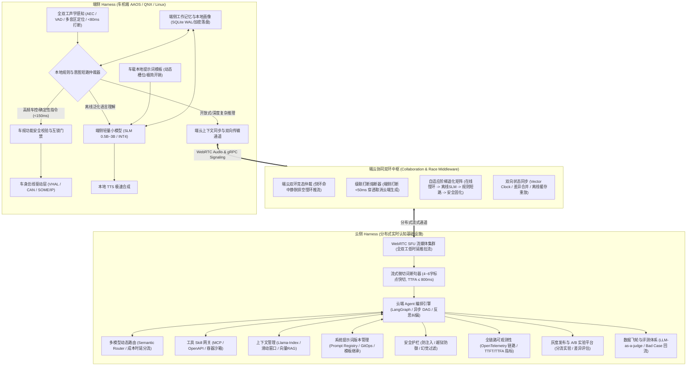
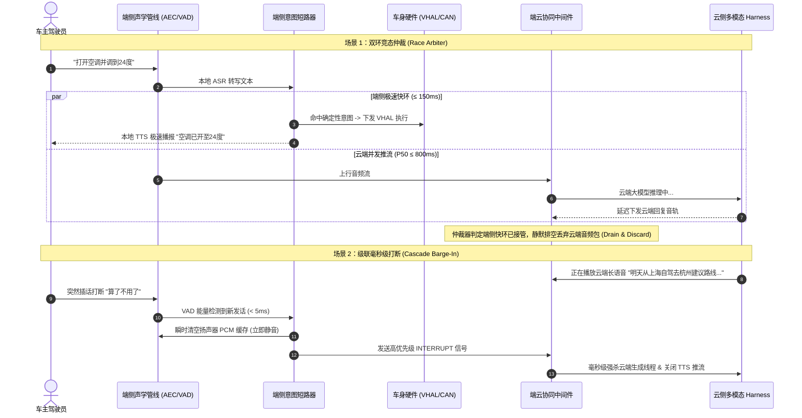

# AI Agent 端云协同 Harness 架构通用知识科普白皮书

> **文档定位**：本白皮书面向智能座舱（AAOS / QNX / Linux）与实时多模态系统领域，旨在系统性科普 **端云协同 AI Agent Harness（线束运行时）** 的行业标准、架构演进、核心技术栈与关键设计原语。  
> **核心关键词体系**：`C/C++`、`Rust`、`Python`、`LangGraph`、`Llama-Index`、`系统级提示词设计`、`大模型/车控App/智能体低代码`、`云侧 Harness`（Agent 编排、提示词版本管理、Skill 网关、上下文管理、安全护栏、评测体系、多模型路由、分布式服务、灰度/AB实验）、`端侧 Harness (车机端 AAOS/QNX)`（车载本地提示词模板、本地规则、意图短路拦截、本地校验、端云上下文同步、车机算力/内存约束/车规安全适配）。

---

## 一、 核心概念：什么是 Agent 领域的 “Harness”？

在传统软件工程中，Harness 指“测试夹具”（Test Harness）；但在大模型与具身/车载智能体系统工程中，**Harness 借用了汽车与航天工程中“电气线束（Wiring Harness）”的物理隐喻：它是承载并约束大模型运行的“控制底座、安全管线、中继运行时与系统外骨骼”（Agent Runtime & Middleware Framework）**。

```
+--------------------------------------------------------------------------+
|                       大模型 (LLM / VLM / SLM)                           |
|        本质：概率预测器、无状态纯计算单元、非确定性、高延迟、无直接执行权         |
+-----------------------------------+--------------------------------------+
                                    | (输入 Token / 输出 Token)
+-----------------------------------v--------------------------------------+
|                     AI Agent Harness (智能体线束运行时)                     |
|  [感官装配: AEC/VAD/音区拾音]      [执行约束: 车规互锁/物理门禁/反死循环]   |
|  [时延优化: 意图短路/微切句断词]    [记忆维系: 端侧工作记忆/云端画像/向量RAG] |
|  [状态同步: 端云状态机/增量补齐]    [工程兜底: 阶梯降级/本地SLM/确定性规则]  |
+-----------------------------------+--------------------------------------+
                                    | (安全信号 / 确定性总线指令)
+-----------------------------------v--------------------------------------+
|                   物理世界与车载总线 (CAN / LIN / SOME/IP)                 |
+--------------------------------------------------------------------------+
```

### 1. 为什么“裸大模型”无法直接上车或直接用于生产级系统？
1. **感知脱节**：模型自身无法实时感知物理世界（无法读取车速、电量、挡位、四音区定位与车门开闭状态）；
2. **执行风险**：模型无法直接、安全地操作底层执行机构，极易产生“虚假参数”或在危险工况（如高速行车）执行致命操作；
3. **延迟与可用性脆弱**：端到端网络往返与大模型首字延迟（TTFT）波动在数百毫秒到数秒，且在地库、隧道断网时直接瘫痪；
4. **状态与幻觉不可控**：模型缺乏跨轮次确定性状态机约束，容易在非线性指令中发生逻辑漂移或文本复读死循环。

### 2. Harness 的核心使命
Harness 不参与底层神经网络参数的训练，而是专注于构建外围的**确定性工程管线**：
* **装配感官与线束**：挂接全双工声学管线、车机属性总线与环境感知信号；
* **约束执行与安全**：构建 ASIL 功能安全物理互锁、确定性短路过滤与反死循环看门狗；
* **维护记忆与状态**：维护轻量端侧分层短期/工作记忆与云端长效画像上下文；
* **端云双环协同**：在端侧极速快环（<150ms 规则/端侧小模型）与云端认知慢环（P50 <800ms 多模态大模型）之间实现无感调度与竞态仲裁。

---

## 二、 工业级/车规级端云协同 Harness 架构全景



---

## 三、 云侧 Harness：分布式实时认知中枢深度科普

云侧 Harness 是整个智能体大脑的分布式宿主与编排底座，承担高复杂度推理、长程规划、生态工具调用与全生命周期运维保障。

```
+--------------------------------------------------------------------------+
|                     云侧 Harness (Cloud Agent Harness)                   |
+--------------------------------------------------------------------------+
|  1. 云端 Agent 编排 (LangGraph / 异步 DAG / 循环反思 / 多智能体协作)       |
|  2. 系统提示词版本管理 (Prompt Registry / 语义版本 SemVer / 模板继承回滚) |
|  3. 工具 Skill 网关 (MCP 协议 / Function Calling 规范 / 权限隔离沙箱)     |
|  4. 上下文管理 (Llama-Index 架构 / 动态压缩 / Token 配额管理)             |
|  5. 安全护栏 (Guardrails / 越狱与注入拦截 / 幻觉清洗 / PII 脱敏)          |
|  6. 评测体系 (LLM-as-a-judge / Ragas / Bad Case 回流与闭环演进)          |
|  7. 多模型路由 (Semantic Router / 意图与时延成本分流 / Prompt Cache 共享) |
|  8. 分布式服务 (WebRTC SFU / gRPC / 跨区域集群 / 低抖动弹性扩缩)          |
|  9. 灰度发布与 A/B 实验平台 (提示词对比实验 / 模型 Traffic Splitting)    |
+--------------------------------------------------------------------------+
```

### 1. 云端 Agent 编排引擎 (LangGraph / 异步 DAG)
* **从线性 Chain 到图状态机（StateGraph）**：
  * 早期的智能体多采用线性的 ReAct 或 Chain 范式，无法应对复杂的非线性任务；
  * 现代云侧 Harness 普遍采用 **LangGraph** 或基于异步 DAG 的图状态机架构，原生支持**条件分支（Conditional Edges）、循环迭代（Cycles）与反思纠偏（Reflection）**；
* **人机共驾与中断恢复（Human-in-the-loop & Checkpointing）**：
  * 在涉及支付、车辆越权控制或敏感出行变更时，编排图可主动持久化当前 State Checkpoint 并进入挂起状态，等待外部授权事件唤醒恢复。

### 2. 系统提示词版本管理 (System Prompt Version Management)
* **Prompt as Code & 提示词注册中心 (Prompt Registry)**：
  * 杜绝将提示词散落硬编码在业务代码中；建立集中的 Prompt Registry（如基于 GitOps 或专有配置中心）；
  * 引入语义化版本规范（如 `v1.2.0-rc1`），将系统提示词、少样本（Few-shot）示例、工具描述解耦为不同组件；
* **模板继承与动态装配**：
  * 基础层（System Base Persona）+ 业务插件层（Domain Skill Rules）+ 车辆状态动态插槽（Car Status Injection）；
  * 提供完善的 Diff 对比工具与秒级一键回滚能力，保障生产环境提示词更新风险可控。

### 3. 工具 Skill 网关与安全沙箱 (Tool Skill Gateway)
* **模型上下文协议（MCP, Model Context Protocol）与 Function Calling**：
  * 标准化统一工具接口定义，通过 OpenAPI 3.0 或 JSON Schema 动态导出工具契约；
  * 无论是车联网服务（远程寻车、充电规划）、生活服务（高德导航、美团外卖）还是系统查询，均通过标准网关中继；
* **安全沙箱隔离与并发限流**：
  * 第三方或动态代码工具必须在沙箱容器（如 Wasm 沙箱或轻量 Docker/gVisor）中运行；
  * 网关强制施加超时熔断（默认 ≤ 2.5s）、频次限流与鉴权校验，防止恶意或故障工具拖垮整个推理链路。

### 4. 深度上下文管理 (Context Management & Llama-Index)
* **分层上下文治理与 Token 预算控制**：
  * 面对有限的上下文窗口与高并发成本，采用类似 **Llama-Index** 的数据索引与检索结构；
  * 将上下文严格划分为：核心角色定义（固定缓存）、实时车辆/会话状态（动态更新）、最近 N 轮对话历史（滑动窗口）、长效用户偏好与知识库（向量 RAG 检索按需召回）；
* **动态语义浓缩与修剪**：
  * 当会话轮次超过阈值时，后台异步触发摘要模型提取“关键事实表”，并丢弃冗余寒暄，始终将上下文控制在最优 Token 成本区间。

### 5. 安全护栏与合规过滤 (Safety Guardrails)
* **输入侧防注入与越狱防御**：
  * 在用户输入进入大模型前，通过轻量级分类器或 Guardrail 规则库检测“忽略之前指令”、“System Prompt 泄露尝试”等恶意 Prompt 注入；
* **输出侧幻觉检测与 PII 合规脱敏**：
  * 对模型生成的工具调用参数实施强类型断言校验；
  * 对涉及用户隐私（手机号、车牌号、实时精准坐标）的敏感信息进行自动化掩码脱敏（Masking），杜绝违规出境或违规留存。

### 6. 自动化评测体系与数据飞轮 (Evaluation & Data Flywheel)
* **综合指标评测矩阵**：
  * 结合 **LLM-as-a-judge**（利用 GPT-4/Claude 等顶尖模型对生成质量打分）与确定性指标（工具调用准确率、槽位抽取召回率、意图识别准确率）；
  * 结合 **Ragas / TruLens** 评估检索上下文的相关性（Context Relevance）与答案忠实度（Faithfulness）；
* **Bad Case 闭环流转**：
  * 生产环境被用户打断、工具调用报错、置信度低于阈值的请求自动打标流入 Bad Case 队列；
  * 经过脱敏与标注后，自动注入离线回归测试集与微调训练集，驱动模型与提示词持续演进。

### 7. 多模型动态路由 (Multi-Model Routing)
* **语义路由器（Semantic Router）与分流策略**：
  * 闲聊与通用寒暄（“你好”、“今天天气真好”）路由至轻量高并发小模型（如 MoE 架构或开源 8B 级别模型），首字延迟压降至 300ms 以内，成本降低 90%；
  * 深度长程推理与复杂多工具编排（如跨城多节点自驾游规划）路由至旗舰推理大模型（DeepSeek-R1 / GPT-4o / Claude 3.5 Sonnet）；
* **Prompt Cache 最大化利用**：
  * 统一路由调度器对齐 System Prompt 头部格式，提高云端推理引擎（vLLM / TensorRT-LLM）的 KV Cache 命中率。

### 8. 高并发分布式服务架构 (Distributed Services)
* **双通道分离架构**：
  * **流媒体通道**：基于 WebRTC SFU 集群（如 LiveKit）实现全双工双向音频流传输，抗弱网抖动能力达 40% 丢包；
  * **信令与控制通道**：基于 gRPC 双向流或 WebSocket 承载毫秒级打断、状态同步与元数据交互；
* **分布式状态解耦与微服务编排**：
  * 无状态 Gateway + 分布式会话缓存（Redis Sentinel）+ 事件流总线（Kafka），支持横向线性扩容与故障自动迁移。

### 9. 灰度发布与 A/B 实验平台 (Canary & A/B Testing)
* **细粒度流量切分（Traffic Splitting）**：
  * 支持按用户 ID、车系车型、地域或百分比进行灰度分流；
* **多维对比实验验证**：
  * 针对“新版系统提示词 vs 老版提示词”、“模型 A vs 模型 B”进行正交 A/B 实验；
  * 实时对比两个分流组的核心指标：任务完成率、平均首字响应时延（TTFT）、用户发话打断率及单次会话 Token 成本。

---

## 四、 端侧 Harness：车机端 (AAOS/QNX) 嵌入式运行时深度科普

智能座舱与车机环境面临严苛的硬件算力制约、车规功能安全标准与断网高可用要求。端侧 Harness 必须完全由高性能系统级语言（**C/C++** 或 **Rust**）打造，深度适配 Android Automotive OS (AAOS) 或 QNX Neutrino RTOS。

```
+--------------------------------------------------------------------------+
|                  端侧 Harness (In-Vehicle AAOS / QNX)                    |
+--------------------------------------------------------------------------+
|  1. 车载本地提示词模板 (动态槽位高效填装 / 离线微提示词 / 低开销)           |
|  2. 本地确定性规则引擎 (正则状态机 / 零幻觉 / 绝对确定性执行)              |
|  3. 毫秒级意图短路拦截 (<150ms 本地快环 / 严禁无意义上云 / 高频车控秒开)     |
|  4. 本地强类型参数校验与车规安全门禁 (ASIL-B 物理互锁 / 车速挡位门禁)       |
|  5. 端云上下文双向增量同步 (Vector Clock / 差异合并 / 离线缓存与断网对齐)   |
|  6. 车机软硬件约束适配 (高通 8155/8295 算力适配 / 内存零泄漏 / 绑核防抖)  |
+--------------------------------------------------------------------------+
```

### 1. 车载本地提示词模板设计 (In-Vehicle Prompt Templates)
* **轻量级与结构化占位**：
  * 车载端侧小模型（0.5B~3B）显存与算力极度受限，严禁堆砌长篇大论的云端提示词；
  * 采用针对小模型量身定制的**微系统提示词（Micro-Prompts）**，结合清晰的结构化标签（如 `<system>`, `<context>`, `<tools>`）；
* **动态槽位填装与上下文修剪**：
  * 仅注入当前必须的车况槽位（如 `speed: 65km/h`, `gear: D`, `zone: DRIVER`），杜绝全量广播导致 Token 爆炸与推理降速。

### 2. 本地确定性规则引擎 (Local Deterministic Rules)
* **纯确定性状态机**：
  * 对于音乐播控（播放、暂停、下一首）、基础车窗升降等原子操作，使用高效的正则匹配器与有限状态机（FSM）直接决策；
* **零幻觉与零网络依赖**：
  * 规避大模型固有概率误差与网络抖动，做到按键级/口令级的绝对确定性与极低资源消耗。

### 3. 毫秒级意图短路拦截 (Intent Short-Circuiting)
* **端侧极速快环（Local Fast Loop ≤ 150ms）**：
  * 当声学 ASR 识别出明确车控意图时，端侧短路器立刻切断后续上云流程，直接在端侧下发执行指令；
* **槽位缺失主动追问与防冲突过滤**：
  * 若车主发出“帮我设个闹钟”，短路器识别到时间槽位缺失，必须立即发起本地追问（“请问设置几点的闹钟？”），**严禁擅自脑补虚假参数**；
  * 严格过滤“为什么”、“你是谁”等泛化问答与闲聊语气，穿透放行给云端大模型，实现快慢分流。

### 4. 本地强类型参数校验与车规功能安全门禁 (Local Safety Interlock)
* **ASIL-B/D 级物理互锁门禁（Vehicle Safety Interlock）**：
  * 任何源自大模型、小模型或本地意图的动作指令，**严禁直连底层车身执行机构**；
  * 必须通过安全门禁检查车身物理状态：
    * 示例 1：车速 `speed > 0 km/h` 时，强制拦截“开启后备箱”、“打开车门”指令；
    * 示例 2：副驾或后排音区发起的指令，物理隔离主驾驶座椅调节与核心驾驶辅助配置；
    * 示例 3：高危操作（如系统恢复出厂设置）强制要求声纹二次身份确认；
* **参数边界强类型断言**：
  * 空调温度强制截断在 16°C~32°C 之间，风量限制在 1~7 档，杜绝异常数值引发硬件执行错误。

### 5. 端云上下文双向增量同步 (Edge-Cloud Context Sync)
* **弱网与断网环境下的离线保证**：
  * 在地库、深山或隧道中，端侧所有对话记录与用户偏好修改写入本地 **SQLite WAL 模式持久化**（支持物理加密）；
* **基于矢量时钟（Vector Clock）的增量对齐**：
  * 网络恢复后，端侧通信模块与云端建立增量对齐握手，采用差异合并（Delta Merge）策略同步会话树，既不丢失离线期间的交互事实，又避免重复覆盖云端长期记忆。

### 6. 车机软硬件约束适配与系统工程 (Compute & Memory Constraints)
* **算力适配与端侧 SLM 量化**：
  * 车载主力芯片（高通 8155 / 8295 / Orin）的 CPU 算力需优先保障仪表与安全功能，AI 运行时必须通过 **INT4/W4A16 量化** 运行 0.5B~3B 小模型，并调用 NPU/DSP 加速；
* **内存硬约束与防 OOM 设计**：
  * Android Automotive OS 具有严厉的低内存查杀机制（LMK, Low Memory Killer）；
  * 端侧 Harness 核心代码采用 **C++17 / Rust** 编写，使用**内存池预分配与 SPSC 无锁环形队列（Lock-Free RingBuffer）**，避免频繁动态内存分配导致的堆碎片化与 GC 停顿；
* **CPU 亲和性隔离与快速休眠恢复（STR）**：
  * 线程级 CPU Affinity 绑定：音频感知与 VAD 线程绑定能效小核（LITTLE Cores）实现超低功耗常驻；TTS 合成与模型推理绑定高性能大核（BIG Cores）；
  * 深度支持车机快速唤醒（STR, Suspend-to-RAM），在整车下电挂起时毫秒级释放资源，上电瞬时热恢复。

---

## 五、 端云协同三大最深水区机制

端云协同体系的核心难点在于“端”与“云”动态交互时的边界竞态控制。



### 1. 双环竞态仲裁机制 (Dual-Loop Race Arbiter)
* **并发探针机制**：用户发话后，端侧快环与云端慢环并行监听；
* **仲裁与排空原则**：一旦端侧快环在 150ms 内确认指令命中车控短路，立即锁定播报权与控制权。当云端推理在 600ms 后返回长文本或音频时，端侧通信门禁执行**静默排空（Drain & Discard）**，坚决杜绝“双重发音”与“状态错乱”。

### 2. 级联打断与算力熔断 (Cascade Cancellation Propagation)
* **端侧即刻静音（Barge-In < 5ms）**：声学管线一旦检测到用户打断，原子变量切断本地播放并丢弃缓冲队列；
* **云端级联强杀**：通过 DataChannel 发送高优先级中断报文，云端网关收到后立即取消上下文上下文（`context.Cancel()`），强杀正在执行的 LLM 推理与 TTS 合成，避免昂贵云端算力与车机下行流量的无效浪费。

### 3. 自适应阶梯退化矩阵 (Adaptive Degradation Matrix)

面对地库、深山、过隧道的常态化网络抖动与断连，系统根据网络探测器实时 RTT 自动执行阶梯降级：

| 网络环境与指标 | 运行模式 | 承接能力与表现 | 降级与切换策略 |
| :--- | :--- | :--- | :--- |
| **优良网络 (RTT < 300ms)** | **云端全功能慢环** | 开放式多轮对话、复杂长程规划、实时多模态识别、丰富生态工具调用 | 优先发挥旗舰大模型智力上限 |
| **弱网/高延时 (300ms ≤ RTT < 1500ms)** | **云端降级/快切断句** | 压缩 Prompt、调低生成 Token 长度、开启激进微切词（4 字符切句送 TTS） | 优先保障首字发音时延 (TTFA ≤ 800ms) |
| **严重恶化 (RTT ≥ 1500ms / 持续丢包)** | **端侧 SLM 本地推理** | 切换至本地 1.5B 伴生模型，支持中等自然语言泛化理解与本地工具控制 | 物理切断云端长连接，杜绝界面假死转圈 |
| **完全断网/离线 (Offline)** | **本地规则短路引擎** | 高频车控、系统设置、本地音乐、已缓存事实检索 | 100% 确定性保证，零幻觉、零延迟 |
| **极端故障/异常死循环** | **看门狗安全固化兜底** | 3 秒超时看门狗自动介入，播报固定安抚语或执行安全复位 | 触发安全看门狗破圈，杜绝界面冻结 |

---

## 六、 跨领域人才画像与关键工程能力要求

在端云协同 Harness 这一新兴复合领域，顶尖系统工程人选往往具备跨界知识背景：

```
                    ┌───────────────────────────────┐
                    │    AI Agent Harness 复合人才   │
                    └───────────────┬───────────────┘
            ┌───────────────────────┼───────────────────────┐
            │                       │                       │
┌───────────▼───────────┐ ┌─────────▼───────────┐ ┌─────────▼───────────┐
│     大模型背景        │ │     车控 App 背景     │ │   AI 智能体低代码背景  │
├───────────────────────┤ ├─────────────────────┤ ├─────────────────────┤
│* 系统级提示词工程设计   │ │* 车规功能安全 (ASIL) │ │* 图编排 / DAG 状态机  │
│* 模型动态路由与评测   │ │* 车身总线与 VHAL 驱动 │ │* MCP 工具标准化网关  │
│* Token 成本与时延优化 │ │* 严格内存/算力/LMK 规约│ │* 低代码 DSL 与沙箱设计│
└───────────────────────┘ └─────────────────────┘ └─────────────────────┘
```

### 1. 核心编程语言与技术栈分工
* **C / C++ (ISO C++17/C++20)**：端侧车机高可靠核心、音频管线、无锁环形队列、CPU 绑核、车规中间件与 JNI/NDK 原生桥接；
* **Rust**：下一代内存安全端侧运行时、高性能流式数据代理、低延迟安全沙箱；
* **Python**：云端 Agent 原型快速验证、复杂 DAG 编排（LangGraph）、评测流（Ragas）与算法数据飞轮；
* **Go / Java (Kotlin)**：高并发分布式实时网关、WebRTC SFU 信令交互、Android Automotive 系统级常驻服务开发。

### 2. 必备的核心工程设计能力
1. **系统级提示词工程（System-level Prompt Engineering）**：不仅是撰写用户 Prompt，而是设计带有动态插槽、结构化防注入防御、少样本对齐与版本继承的系统级 Prompt 资产；
2. **确定性状态机设计**：严密的生命周期管理，杜绝状态竞争、并发死锁与孤儿线程；
3. **软硬件抽象解耦（Hardware Abstraction）**：
   * 在台架匮乏阶段，能熟练使用 Android 原生平台（如 Google Pixel）构建 Mock VHAL 与悬浮调试控制台进行高保真敏捷迭代；
   * 在量产阶段，能无缝切换至 QNX Neutrino RTOS、高通 8295 芯片与车身 CAN / SOME/IP 总线生态。

---

> **结语**：大模型决定了智能体“思考的上限”，而端云协同 Harness 则决定了智能体在物理世界落地时“安全、实时、稳定与可靠的底线”。
