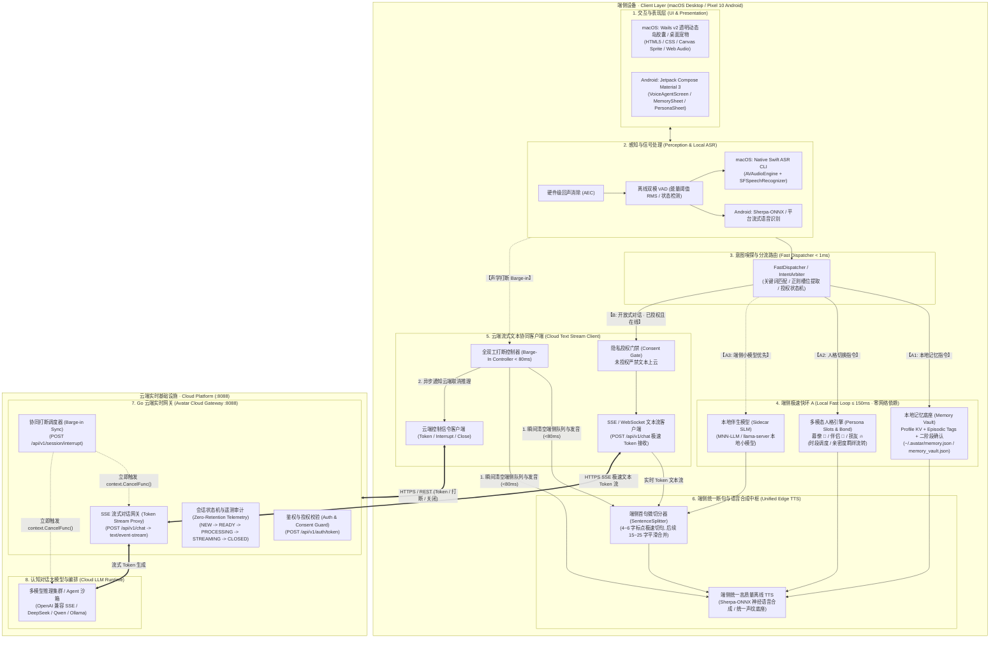
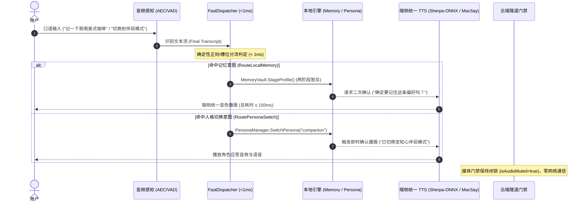
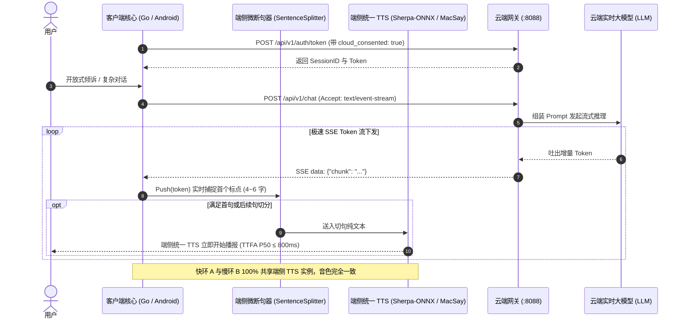
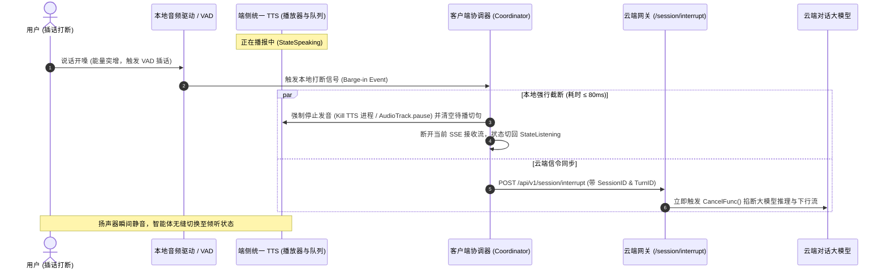
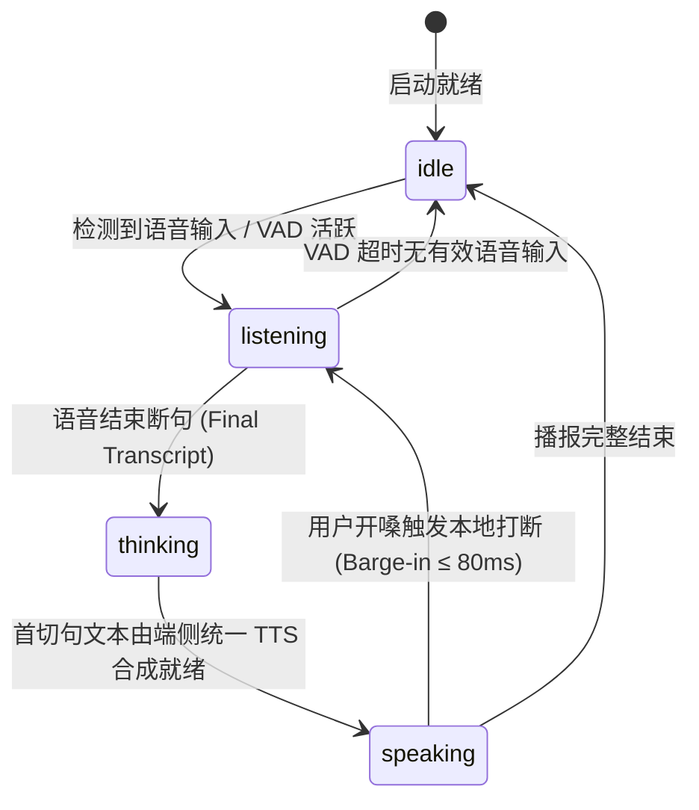
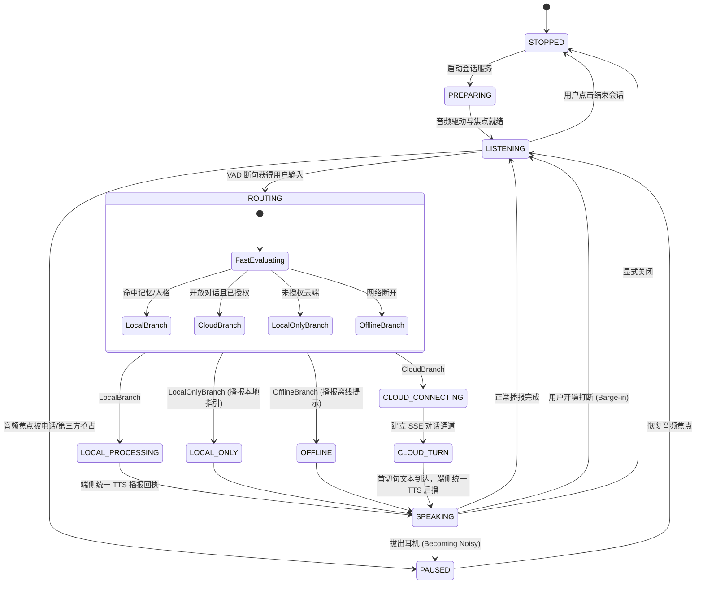
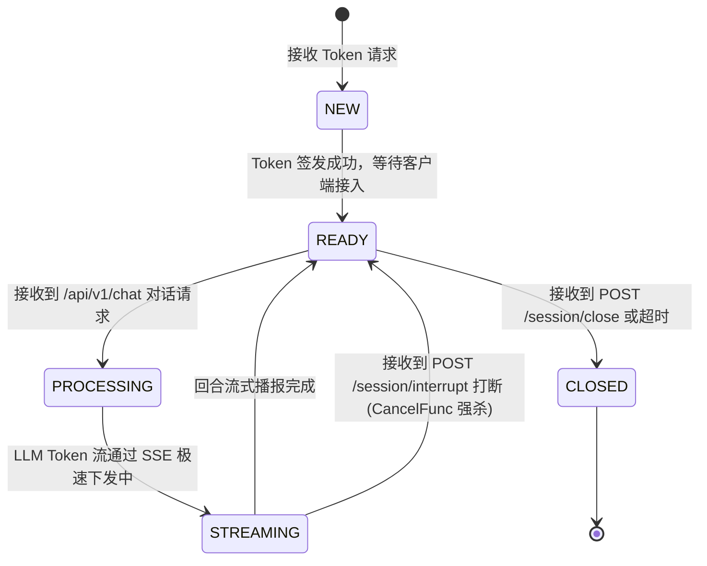

# Avatar 系统工程架构文档 (System Architecture)

> **版本**：v2.1 (Unified Edge TTS & End-to-End Text Streaming Specification)  
> **适用范围**：macOS Desktop (Go + Wails + Swift Native ASR)、Android Mobile / In-Vehicle AAOS (Pixel 参考样机 & 车规 QNX 抽象层)、C++17 跨平台高可靠核心运行时 (`core/`)、Cloud Realtime Agent Gateway (Go SSE Streaming Gateway)

---

## 1. 系统全景架构图 (System Architecture Panorama)

Avatar 采用**端云双环 + 全链路传文本 + 端侧统一语音合成（Dual-Loop + End-to-End Text Streaming + Unified Edge TTS）**架构：
- **端侧极速快环 Harness（Local Fast Loop ≤ 150ms）**：端侧声学感知、毫秒级意图短路拦截与分流路由器（Intent Arbiter & Fast Dispatcher）、本地车控安全看门狗（Safety Guardrail）、三层分层记忆底座（Three-Tier Memory Vault）、多模态人格引擎（Persona Engine）与端侧伴生小模型（Sidecar SLM），断网物理隔离可用；
- **云端认知慢环 Harness（Cloud Realtime Loop P50 ≤ 800ms）**：在用户显式授权前提下，客户端通过轻量级 HTTP SSE / WebSocket 通道（`POST /api/v1/chat`）向 Go 云端实时网关发起对话，云端仅负责将大模型的 **Token 文本流**以最快速度推回端侧，不再下发重型音视频流；
- **端侧统一合成（Unified Edge TTS，根除音色割裂）**：无论是**端侧快环（A）**产出的本地回复，还是**云端慢环（B）**流式推回的文本 Token（经端侧 `SentenceSplitter` 首句 4~6 字微切分），**100% 统一收口到端侧同一个高质量离线 TTS 引擎（基于 `sherpa-onnx` 本地神经 TTS / 平台合成器）发声**。从根源上保证端云音色绝对一致，同时让毫秒级打断（Barge-in ≤ 80ms）直接在端侧清空播报队列即可闭环。



---

## 2. 客户端分层架构 (Client Subsystems)

### 2.1 macOS 桌面端架构 (Go + Wails + Swift Native)

macOS 桌面端采用单二进制 Go 核心驱动，通过 Wails v2 绑定透明无边框前端，借助独立的 Swift 伴生 CLI 处理原生 CoreAudio/SFSpeech 信号。

```
Avatar (macOS Desktop)
├── Presentation Layer (Wails Frontend)
│   ├── index.html / main.css (透明悬浮窗、药丸胶囊、呼吸动效)
│   ├── main.js (Wails 运行时事件侦听: avatar:state, avatar:speech, avatar:mic_energy)
│   └── sprite-orb.js / pet-renderer.js (桌面宠物精灵帧渲染引擎)
│
├── Coordination Layer (internal/orchestrator & internal/engine)
│   ├── Pipeline (对外整合协调器、交互管理器、任务执行器与工具箱)
│   ├── Coordinator (会话单轮生命周期状态机: idle -> listening -> thinking -> speaking)
│   └── InteractionManager (0.1ms 极速快路径拦截、时段调度、语音中断)
│
├── Routing & Verification Layer
│   └── FastDispatcher (internal/dispatcher: 意图分流路由器，< 1ms 决策)
│
├── Execution & Storage Layer
│   ├── MemoryVault (internal/memory: Profile KV + Episodic 事实，~/.avatar/memory.json)
│   ├── PersonaManager (internal/persona: 3 大卡槽 Jarvis/Companion/Roaster + 羁绊等级)
│   ├── TaskRunner (internal/task: 异步多步推理执行体、System Prompt 组装)
│   └── SkinManager (internal/skin: 桌宠外观换装与动画清单管理)
│
├── Perception & Audio Synthesis Adapters
│   ├── NativeMacASR (internal/asr: 管道管理 cmd/avatar-asr 伴生 Swift 进程)
│   │   └── cmd/avatar-asr/main.swift (AVAudioEngine + SFSpeechRecognizer + 能量计算)
│   ├── SentenceSplitter (internal/splitter: 标点断句算法，4 字符阈值微切句)
│   ├── TTSSynthesizer (internal/tts: 端侧统一语音合成器，实现 VoiceConfigurable，快环 A 与慢环 B 100% 共享发声底座)
│   └── SidecarManager (internal/sidecar: 探测并拉起本地 llama-server GGUF 小模型)
│
└── Cloud Integration Client (internal/cloud)
    └── Client (Token 交换、/api/v1/chat SSE 极速文本流拉取、云端打断同步、会话终止管理)
```

### 2.2 Android 移动端与车机端架构 (Pixel 10 / AAOS 参考平台)

Android 端面向 Android 16 (Pixel 10) 平台定制，并作为车载信息娱乐系统（AAOS）与端侧 Harness 的参考原型平台。采用单向数据流（UDF）、系统级前台常驻服务与 JNI Native 桥接。

```
Avatar (Android / AAOS Client)
├── UI & Presentation Layer (com.avatar.android.ui)
│   ├── MainActivity (动态权限申请、沉浸式窗口)
│   ├── VoiceAgentScreen / VoiceAgentViewModel (状态感知与事件分发)
│   ├── AudioWaveformView / StateVisualizerView (波形与状态可视化)
│   └── components/ (MemorySheet 记忆管理面板、BondSheet 人格与羁绊面板)
│
├── Background Service & IPC Layer (com.avatar.android.service & com.ai.audioagent.service)
│   ├── VoiceSessionService (Foreground Service: microphone | mediaPlayback)
│   ├── AudioAgentService (常驻系统服务，实现 IAudioAgentService AIDL IPC)
│   └── AudioFocusHelper (系统电话/第三方音频抢占与释放)
│
├── Tool Skill Gateway & Safety Guardrail (com.ai.audioagent.tools)
│   ├── ToolRegistry (动态管理整机已启用工具，导出符合 ChatML/OpenAI 的 Function Calling JSON Schema)
│   ├── SystemToolExecutor (车控/系统动作前置参数校验与安全门禁拦截)
│   └── impl/ (SystemAlarmTool, SystemPhoneDialTool, WeatherQueryTool, MusicPlaybackTool)
│
├── Native JNI Bridge (com.ai.audioagent.nativebridge)
│   └── AudioAgentNative (通过 NDK JNI 桥接 C++17 原生高可靠 Harness 引擎 core/)
│
├── Core State Machine (com.avatar.android.core.state)
│   └── SessionStateMachine (11 状态严密状态机，杜绝非法状态跳跃)
│
├── Routing & Local Loop (com.avatar.android.core)
│   ├── FastDispatcher (dispatcher: 4 级优先级确定性分流器，< 1ms 决策)
│   └── MemoryVault (memory: 两阶段口语确认本地隐私记忆隔离存储)
│
└── Cloud & Diagnostics (com.avatar.android.core)
    ├── CloudClient (cloud: /api/v1/chat SSE 文本流接收与 /api/v1/ 协同信令)
    └── DiagnosticLogger (diagnostics: 脱敏运行指标与错误审计 diagnostics.log)
```

### 2.3 车规级 / 端侧 C++17 原生高可靠 Harness 运行时 (`core/`)

针对车机算力受限（高通 8155/8295）、内存硬约束与车规安全要求，底座采用现代 ISO C++17 纯原生构建，杜绝 GC 停顿与内存泄漏：

```
core (C++17 High-Reliability Native Harness)
├── Orchestration Pipeline (AudioAgentPipeline.cpp / .hpp)
│   ├── 全双工交互编排流水线 (IDLE <-> LISTENING <-> THINKING <-> SPEAKING)
│   ├── CpuAffinity: 线程 CPU 亲和性绑定 (Perception 绑能耗小核，Cognition/TTS 绑高性能大核)
│   ├── LockFreeRingBuffer: 单生产者单消费者 (SPSC) 无锁环形缓冲，音频流零锁阻塞
│   └── Barge-in 打断: 原子标记瞬间截断播放队列与 KV 状态回滚 (< 5ms)
│
├── Intent Short-Circuiting Engine (IntentArbiter.cpp / .hpp)
│   ├── CleanPunctuationAndParticles: 毫秒级文本首尾语气助词与标点清洗
│   ├── ParseChineseNumber: 鲁棒中文口语数字/时间解析 (如 "七点半" -> "07:30")
│   ├── 系统动作抽槽与短路: 音乐播控 (暂停/继续/切歌/点歌)、闹钟设置、天气查询
│   └── 冲突前置阻断: 严格过滤 "为什么"、"笑话" 等开放式问答，穿透放行至云端 LLM
│
├── Safety Watchdog & Loop Breaker (WatchdogAndRepetition.cpp / .hpp)
│   ├── TTFT Watchdog: 3 秒首 Token 超时看门狗，超时强制触发降级口语安抚
│   └── N-gram Repetition Breaker: 12 字节滑动窗口检测，瞬时打断大模型死循环吐字
│
├── Three-Tier Memory Subsystem (ThreeTierMemory.cpp / .hpp)
│   ├── L1 Ring Working Memory: 固定系统提示词 + 最近 4 轮工作记忆滑动窗口
│   ├── L2 Background Summarizer: 6 轮淘汰 + 10 秒空闲异步语义浓缩
│   └── L3 Long-term Facts Store: 静态持久化事实库检索与 Prompt 动态注入
│
└── Inference & Perception Engines
    ├── MnnLlmEngine: 阿里 MNN 端侧轻量级大模型推理接入
    └── SherpaOnnxPerceptionEngine: 新一代 Kaldi/Sherpa-ONNX 流式本地离线感知
```
---

## 3. 云端实时网关与基础设施架构 (Cloud Architecture)

在**「全链路传文本 + 端侧统一 TTS」**架构下，云端聚焦于**认知推理与极速 Token 流分发**，由轻量化 Go 实时网关承载：

```
Cloud Infrastructure (:8088)
└── Go Realtime Gateway (:8088)
    ├── Routes (/health, /api/v1/auth/token, /api/v1/chat, /api/v1/session/interrupt, /api/v1/session/close)
    ├── TokenService (server/auth.go: 验证 cloud_consented，签发短效会话凭证)
    ├── CloudServer (server/server.go: 维护 ActiveSession 状态机、SSE 流式 Token 代理、并发打断 CancelFunc 强杀)
    └── Zero-Retention Telemetry (仅记录 SessionID、耗时、平台、错误码；零音频/零转写持久化)
```

---

## 4. 关键交互流程与时序图 (Key Sequence Flows)

### 4.1 端侧极速快环时序图 (Local Fast Loop ≤ 150ms)

当用户发起本地记忆管理（如偏好记录）或人格流转指令时，系统在端侧直接完成全流程，网络媒体门禁物理锁闭，数据绝对不出端，并由**端侧统一 TTS** 输出播报。



---

### 4.2 云端深度对话流与首字切句时序图 (Cloud Deep Loop)

当用户提出开放式问题且已完成云端显式授权时，**全链路仅传输文本**：端侧将文本发送给网关，云端采用 SSE 极速下发 LLM Token 流，端侧采用 `SentenceSplitter` 实时断句并送入**端侧同一个 TTS 引擎**合成发声，达成 TTFA P50 ≤ 800ms 且端云音色 100% 一致。



---

### 4.3 端云协同毫秒级打断时序图 (Barge-In ≤ 80ms)

在智能体播报过程中，一旦用户开嗓插话，端侧在 80ms 内强制掐断本地发音并清空队列，同时向云端同步发送打断信令，强杀云端大模型流式生成。



---

## 5. 核心状态机生命周期 (State Machines)

系统在不同平台与模块间定义了严密的状态迁移规则，杜绝非法调用与并发竞争。

### 5.1 桌面端会话协调状态机 (`internal/orchestrator.State`)



### 5.2 Android 客户端严密状态机 (11 状态模型)



### 5.3 云端网关会话生命周期 (`server.SessionState`)



---

## 6. 安全边界、存储拓扑与合规设计 (Security & Storage Topology)

### 6.1 存储拓扑分布

| 平台 | 存储组件 | 文件路径 / 格式 | 内容与边界 |
| :--- | :--- | :--- | :--- |
| **macOS** | **Memory Vault** | `~/.avatar/memory.json` (JSON) | 用户事实画像（Identity, Preference, Habit）及时间衰减情景日志，纯本地保存 |
| **macOS** | **Persona Storage** | `~/.avatar/personas.json` (JSON) | 自定义人设卡槽参数、语速及音色覆盖配置 |
| **Android** | **Memory Vault** | `context.filesDir/memory_vault.json` | 隔离存储于 Android 内部私有目录，支持双阶段口语确认 |
| **Android** | **Diagnostics Log** | `context.filesDir/diagnostics.log` | 仅记录时延、状态跳转与错误码，杜绝用户敏感内容 |
| **Cloud** | **Ephemeral Gateway** | 纯内存映射 (`sync.RWMutex`) | **零磁盘持久化**。会话随用随毁，严禁留存用户原始音频与完整对话文本 |

### 6.2 核心安全防御边界

1. **媒体门禁（Audio Track Gating）**：
   - 客户端音频采集层与云端推流层之间设置物理门禁；
   - 默认状态 `isAudioMuted = true`。只有在分流器判定为 `CLOUD_CHAT`、会话处于 `CLOUD_TURN` 且网络在线时，音轨才临时开锁推流。
2. **防断网重放机制（Anti-Replay Guard）**：
   - 断网或弱网阻断后，系统立即将当前会话转入 `OFFLINE` 状态，未竟请求直接丢弃，严禁建立本地离线重试队列，避免网络恢复后突然重放旧音频引发惊吓或隐私外泄。

---

## 7. 代码模块与目录物理映射表 (Codebase Mapping)

| 架构层级 | 核心模块 | 对应源码路径 | 核心职责与关键符号 |
| :--- | :--- | :--- | :--- |
| **桌面端表现层** | 前端界面 | `frontend/src/` | `index.html`, `main.js`, `sprite-orb.js`, `pet-renderer.js` |
| **桌面端应用胶水** | Wails 绑定 | `app.go`, `main.go` | `App.startup()`, `App.Chat()`, 事件广播 `runtime.EventsEmit` |
| **桌面端感知层** | Swift 原生 ASR | `cmd/avatar-asr/main.swift`, `internal/asr/` | `NativeMacEngine`, `SFSpeechRecognizer`, `AVAudioEngine` |
| **分流路由引擎** | 极速分流器 | `internal/dispatcher/dispatcher.go` | `FastDispatcher.Evaluate()`, `RouteTarget` |
| **记忆与人格** | 记忆/人设/羁绊 | `internal/memory/`, `internal/persona/` | `Vault`, `PersonaManager`, `BondManager`, `FastPathHandler` |
| **桌面编排核心** | 协调状态机 | `internal/orchestrator/`, `internal/engine/` | `Coordinator`, `Pipeline`, `Manager`, `TaskRunner` |
| **微切词断句** | 流式断句器 | `internal/splitter/splitter.go` | `SentenceSplitter.Push()`, 4 字符首句快速切割 |
| **端侧统一合成** | 统一离线 TTS | `internal/tts/tts.go`, `android/app/libs/sherpa-onnx-2.0.1.aar` | `Synthesizer`, `VoiceConfigurable`, 快环 A 与慢环 B 100% 共享发声底座 |
| **移动端应用** | Android 整体 | `android/app/src/main/java/com/avatar/android/` | 原生 Pixel 10 实现，Compose UI + Foreground Service |
| **移动端状态机** | 11 状态机 | `android/.../core/state/SessionStateMachine.kt` | `SessionState`, 严格状态校验与转移监听 |
| **移动端隐私** | 音频隐私防护 | `android/.../core/audio/` | `AudioPrivacyGuard`, `AudioFocusHelper`, `AudioPlaybackController` |
| **云端实时网关** | 实时流式文本服务 | `server/server.go`, `server/auth.go` | `CloudServer`, `TokenService`, `/api/v1/chat` (SSE), `/api/v1/session/interrupt` |
| **集成验收套件** | 端到端打断测试 | `cmd/e2e-test/main.go`, `server/server_test.go` | 验证双环时延、全链路纯文本传输、端侧统一 TTS 音色一致性、Barge-in 打断与合规护栏 |

---

## 8. 云端服务接口规范与信令协议 (Cloud Gateway API & Signaling Specifications)

### 8.1 基础设施与端口拓扑

云端实时基础设施采用极简轻量网关架构：
- **Go 云端实时网关 (Avatar Cloud Gateway :8088)**：负责设备接入鉴权、动态会话 Token 签发、上游大模型 SSE Token 极速代理（`/api/v1/chat`）、端云打断信令协同（CancelFunc 强杀生成）与 Zero-Retention 遥测审计。

```
                         ┌───────────────────────────────────────────────┐
                         │           客户端 (Client Application)         │
                         │   [端侧 ASR] + [SentenceSplitter] + [统一 TTS] │
                         └───────────────────────┬───────────────────────┘
                                                 │
                               HTTPS REST / SSE  │ :8088 (纯文本 Token 流与信令)
                                                 ▼
                                 ┌───────────────────────────────┐
                                 │  Go Realtime Gateway (:8088)  │
                                 │  • GET  /health               │
                                 │  • POST /api/v1/auth/token    │
                                 │  • POST /api/v1/chat (SSE)    │
                                 │  • POST /api/v1/session/interrupt
                                 │  • POST /api/v1/session/close │
                                 └───────────────┬───────────────┘
                                                 │
                                                 ▼
                                 ┌───────────────────────────────┐
                                 │ Upstream LLM Inference Server │
                                 │ (vLLM / Ollama / OpenAI API)  │
                                 └───────────────────────────────┘
```

#### 环境变量配置规范

| 环境变量 | 默认值 | 作用范围 | 说明 |
| :--- | :--- | :--- | :--- |
| `PORT` | `8088` | 云端网关 | 网关监听的 HTTP REST & SSE 服务端口 |
| `LLM_BASE_URL` | `http://127.0.0.1:1234/v1` | 云端网关 | 上游 OpenAI 兼容大模型推理服务端点 |
| `LLM_API_KEY` | `""` | 云端网关 | 上游大模型服务 API 密钥（由网关安全托管，严禁下发客户端） |
| `LLM_MODEL` | `default` | 云端网关 | 默认调用的云端大模型名称 |

---

### 8.2 核心 REST API 详细定义

#### 1. 服务健康检查 (`GET /health`)
- **Path**: `/health`
- **Method**: `GET`
- **Response**: `200 OK`
  ```json
  {
    "status": "ok",
    "service": "avatar-cloud-realtime"
  }
  ```

#### 2. 会话鉴权与 Token 签发 (`POST /api/v1/auth/token`)
- **Path**: `/api/v1/auth/token`
- **Method**: `POST`
- **Request Headers**: `Content-Type: application/json`
- **Request Body**:
  ```json
  {
    "user_id": "usr_001",
    "device_id": "dev_mac_01",
    "client_type": "mac",
    "cloud_consent": true
  }
  ```
- **参数说明**：
  - `user_id` (string, required): 匿名化用户唯一标识符；
  - `device_id` (string, required): 客户端设备唯一硬件指纹；
  - `client_type` (string, required): 客户端类型，取值 `"mac"` 或 `"pixel"`；
  - `cloud_consent` (bool, required): **隐私显式授权开关**。
- **安全与合规行为 (Consent Guard)**：
  - 若 `cloud_consent == false`，网关**立即阻断请求**，返回 `403 Forbidden`：
    ```
    ERR_CLOUD_NOT_CONSENTED: user has not consented to cloud processing
    ```
    同时网关记录一条脱敏审计事件 `cloud_session_rejected`，杜绝未授权文本上云。
- **Success Response**: `200 OK`
  ```json
  {
    "session_id": "room_usr_001_1730000000",
    "room_name": "room_usr_001_1730000000",
    "token": "eyJhbGciOiJIUzI1NiIsInR5cCI6IkpXVCJ9...",
    "expires_in_seconds": 300
  }
  ```
  Token 有效期默认强制设定为 **5 分钟 (300s)** 短时凭证，降低泄露风险。

#### 3. 极速流式文本对话 (`POST /api/v1/chat`)
- **Path**: `/api/v1/chat`
- **Method**: `POST`
- **Request Headers**:
  - `Content-Type: application/json`
  - `Accept: text/event-stream`（启用 SSE 极速 Token 流推送）
- **Request Body**:
  ```json
  {
    "session_id": "room_usr_001_1730000000",
    "turn_id": "turn_1024",
    "user_id": "usr_001",
    "device_id": "dev_mac_01",
    "message": "为什么海水是蓝色的？",
    "persona": "companion",
    "stream": true
  }
  ```
- **SSE 流式响应格式 (`text/event-stream`)**：
  ```text
  data: {"turn_id":"turn_1024","chunk":"海水呈现蓝色，"}

  data: {"turn_id":"turn_1024","chunk":"是因为光散射。"}

  data: {"turn_id":"turn_1024","done":true,"latency_ms":380}
  ```
  客户端收到 Token 后实时经由端侧 `SentenceSplitter` 切句，并在本地统一 TTS 中播放。

#### 4. 端侧协同打断通知 (`POST /api/v1/session/interrupt`)
- **Path**: `/api/v1/session/interrupt`
- **Method**: `POST`
- **Request Body**:
  ```json
  {
    "session_id": "room_usr_001_1730000000",
    "turn_id": "turn_1024",
    "reason": "user_barge_in"
  }
  ```
- **服务端处理机制**：
  1. 根据 `session_id` 检索内存活跃会话 `ActiveSession`；
  2. 立即重置 `ActiveTurn = ""` 并将状态机切回 `SessionStateReady`；
  3. 立即触发生成 Context 的 `CancelFunc()`，强杀正在进行的 LLM 推理并截断 SSE 推送；
  4. 记录脱敏事件 `cloud_turn_cancelled`。
- **Success Response**: `200 OK`
  ```json
  {
    "status": "cancelled",
    "discarded": true
  }
  ```

#### 5. 会话显式关闭与资源清理 (`POST /api/v1/session/close`)
- **Path**: `/api/v1/session/close`
- **Method**: `POST`
- **Request Body**:
  ```json
  {
    "session_id": "room_usr_001_1730000000"
  }
  ```
- **服务端处理机制**：
  - 将会话状态标记为 `SessionStateClosed`；
  - 立即从内存 map 中剔除该会话对象（Ephemeral Purge），释放所有上下文关联资源；
  - 记录脱敏事件 `cloud_session_closed`。
- **Success Response**: `200 OK`
  ```json
  {
    "status": "closed"
  }
  ```

---

### 8.3 Zero-Retention 遥测审计事件模型

为了满足严格的隐私安全要求，云端网关仅允许记录结构化运维事件，**严禁在服务端持久化任何用户原始语音切片、PCM 帧或转写文本**：

```go
type ServerEvent struct {
    EventName  string `json:"event_name"`            // 例如: cloud_session_started, cloud_turn_cancelled
    SessionID  string `json:"session_id"`            // 会话 Room 标识
    TurnID     string `json:"turn_id,omitempty"`     // 轮次标识
    Platform   string `json:"platform"`              // "mac" | "pixel"
    DurationMS int64  `json:"duration_ms,omitempty"` // 纯耗时度量 (ms)
    ErrorCode  string `json:"error_code,omitempty"`  // 错误分类码 (如 ERR_CLOUD_NOT_CONSENTED)
    Timestamp  string `json:"timestamp"`             // RFC3339 时间戳
}
```

---

## 9. 核心技术机制与端云协同原语 (Core Mechanisms)

### 9.1 全双工毫秒级打断协同机制 (Barge-In Pipeline)

传统的语音交互系统往往采用半双工或单端打断，容易造成发音未停、云端继续算力浪费以及用户体验割裂。Avatar 实现端云闭环毫秒级打断机制：

1. **声学信号快速捕获（端侧）**：
   - 本地基于硬件级回声消除（AEC）过滤自身扬声器音频；
   - 伴生 ASR / 能量 VAD 在检测到用户说话开嗓瞬间，触发本地声学事件；
2. **端侧物理硬截断（耗时 ≤ 80ms）**：
   - 桌面端直接调用系统 kill 掐断 macOS `say` 播放子进程；
   - Android 端通过 `AudioTrack.pause()` 与音频焦点重置清空播放缓冲；
   - 界面胶囊即刻切回 `倾听 (Listening)` 状态；
3. **云端信令异步拦截**：
   - 端侧异步非阻塞调用 `POST /api/v1/session/interrupt`；
   - 云端实时取消正在执行的 LLM 生成 Context 与 TTS 发音下行流；
   - 即使用户在打断前网络有滞后下发的音频包，客户端 JitterBuffer 亦根据失效的 `TurnID` 自动丢弃，彻底杜绝回声或串音。

### 9.2 流式微切词断句算法 (SentenceSplitter)

在全双工语音交互中，首字发音时延（TTFA）决定了伴侣的反应灵敏度。
`SentenceSplitter`（`internal/splitter/splitter.go`）设计如下：
- **微切分阈值**：针对流式吐出的 Tokens，设定首句 4~6 字标点敏感规则（`，`、`。`、`！`、`？`、`\n`）；
- **动态长度自适应**：
  - 第一句识别到满足 4 字符以上的断句标点，立即切割首包进入 TTS 渲染与推流，达成 **TTFA P50 ≤ 800ms**；
  - 后续长句动态合并至 15~25 字符平滑输出，兼顾语法自然度与音调起伏连贯性。

### 9.3 端侧小模型优先 (SLM-First) 与双环调度

- **本地伴生守护 (Sidecar SLM)**：
  - 客户端启动时通过 `SidecarManager` 嗅探本地推理引擎（如 `llama-server` GGUF 或本地 Ollama）；
  - 若本地推理可用且意图适合端侧处理，优先走本地伴生模型完成推理，断网状态仍具备完备思考能力；
- **智能平滑降级**：
  - 遇到开放式长文本分析、代码生成或复杂逻辑时，分流器根据在线状态与隐私授权，平滑升级至云端深度慢环；
  - 云端不可用或断网时，无缝回退至本地快速语音反馈，不出现任何应用崩溃或长时间假死。

### 9.4 极简透明悬浮胶囊与原生桌面集成

- **动态岛药丸胶囊 (Dynamic Island Pill)**：
  - 基于 Wails v2 构建的完全透明窗口（`transparent: true, frameless: true, always_on_top: true`）；
  - 支持全屏幕任意位置无感拖拽与位置记忆；
- **四态声波呼吸渲染**：
  - `待命 (Idle) 🎙️`：低频呼吸脉冲，静默省电；
  - `倾听 (Listening) 👂`：麦克风 RMS 音量实时驱动声波振幅扩散；
  - `思考 (Thinking) 💭`：内部双环光点交替旋转，反馈计算中；
  - `说话 (Speaking) 🔊`：根据下发音频能量波形动态共振跳动。


---

## 10. 未来演进与架构优化路线 (Future Roadmap & Optimization)

### 10.1 原生端侧轻量神经推理集成 (llama.cpp / MNN Runtime)

* **当前落地状态 (Current Simulation)**：
  * 现阶段采用 **LM Studio 双模型并发加载模拟方案**（或 LM Studio + Ollama 双端口）：
    * **端侧小模型 (SLM)**：`qwen2.5-0.5b-instruct` 或 `1.5b`，监听同端口或本地端口，负责短句闲聊、情绪安抚、日常寒暄（TTFT < 100ms）；
    * **云端大模型 (LLM)**：`qwen2.5-7b-instruct` / `14b` / `DeepSeek` 等，负责深度推理、代码与长文本生成；
    * 通过 `FastDispatcher` 与 `IntentArbiter` 进行意图复杂度自动分流。

* **后续深度优化方案 (Future Native Integration)**：
  1. **原生嵌入式推理引擎替换**：
     * 在 macOS 桌面端直接静态链接 `llama.cpp` (Metal 加速)；
     * 在 Android / 车机端直接链接阿里 `MNN` (`libllm.so` / Vulkan / QNN 专用加速后端)，彻底摆脱对外部 LM Studio / Ollama 独立进程与 HTTP 端口的依赖。
  2. **量化端侧小模型常驻**：
     * 部署量化版 `Qwen2.5-0.5B-Q4_K_M` / `1.5B-Q4_K_M`，整机常驻内存控制在 350MB~800MB，断网物理离线可用。
  3. **系统级前缀缓存预热 (System Prefix KV Cache Warmup)**：
     * 在应用启动或空闲阶段，预先将固定的人格设定与安全 System Prompt 灌入端侧模型完成 Prefill 计算并冻结 KV Cache；
     * 后续多轮交互仅计算用户输入的增量 Token，将端侧首 Token 延迟降至 30~50ms；
     * 打断时执行轻量级 KV Rollback 截断，瞬时恢复待命。
