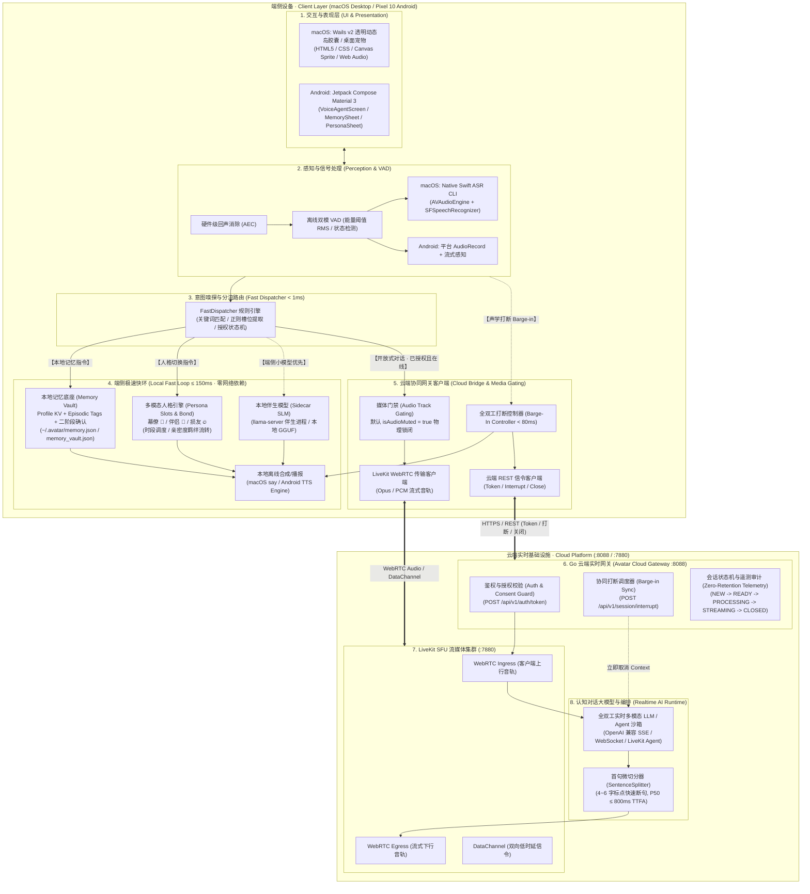
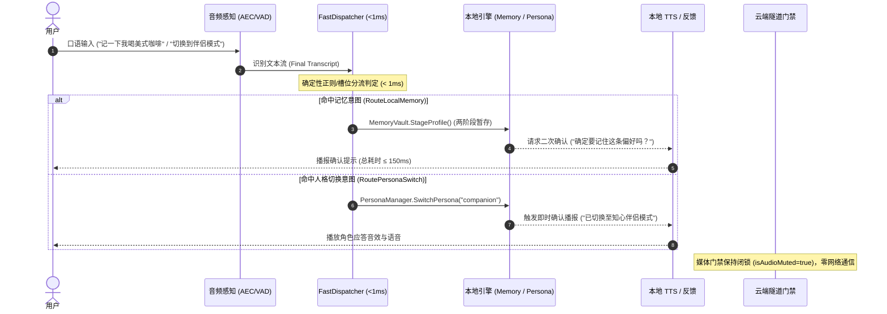
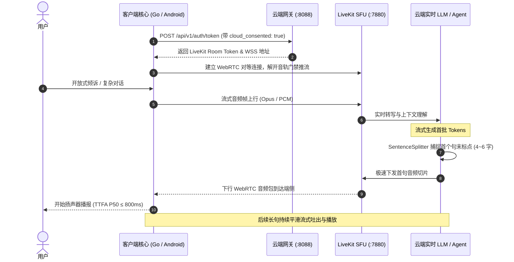
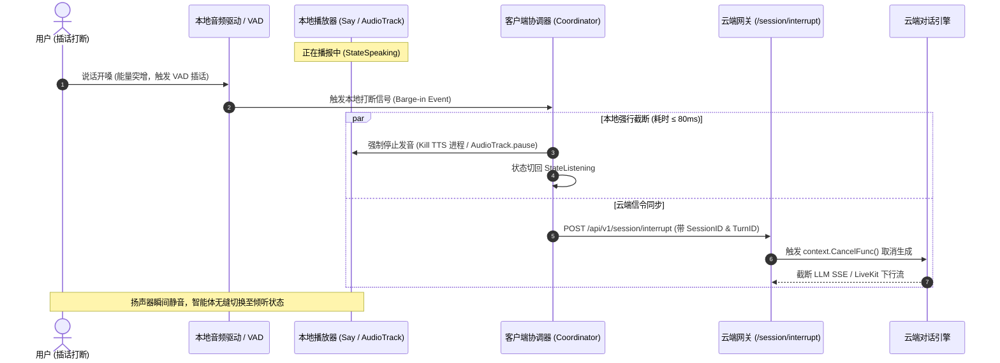
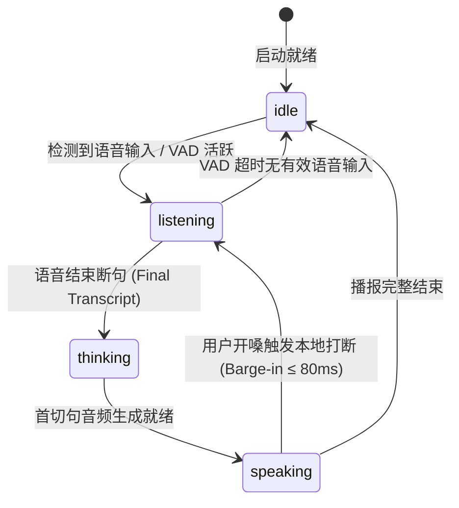
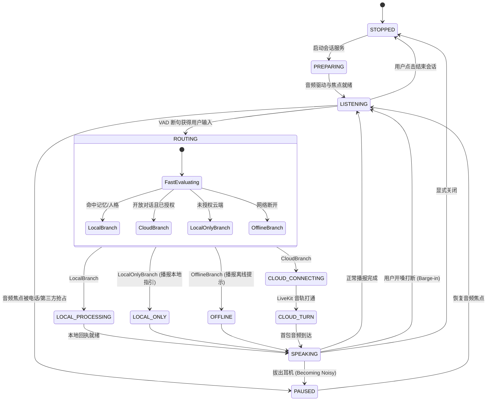
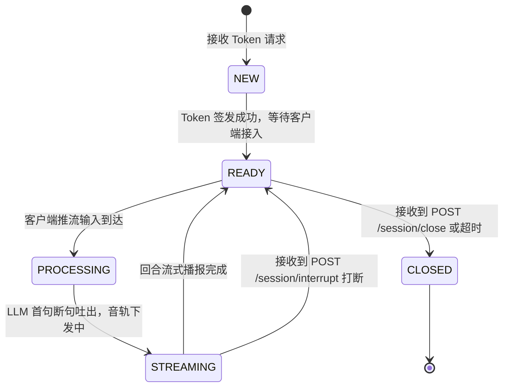

# Avatar 系统工程架构文档 (System Architecture)

> **版本**：v1.0 (Current Implementation)  
> **适用范围**：macOS Desktop (Go + Wails + Swift Native ASR)、Android Mobile (Pixel 10 / Android 16)、Cloud Realtime Service (Go + LiveKit SFU)

---

## 1. 系统全景架构图 (System Architecture Panorama)

Avatar 采用**端云双环架构（Dual-Loop Architecture）**：
- **端侧极速快环（Local Fast Loop ≤ 150ms）**：端侧感知、毫秒级意图分流路由器（Fast Dispatcher）、本地记忆底座（Memory Vault）、多模态人格引擎（Persona Engine）、离线发音与本地伴生模型（Sidecar SLM），断网物理隔离可用；
- **云端认知慢环（Cloud Realtime Loop P50 ≤ 800ms）**：在用户显式授权的前提下，通过 LiveKit SFU 与 Go 网关建立全双工实时音视频通道，承接开放式多轮对话、深度推理与流式播报，并支持毫秒级协同打断（Barge-in）。



---

## 2. 客户端分层架构 (Client Subsystems)

### 2.1 macOS 桌面端架构 (Go + Wails + Swift Native)

macOS 桌面端采用单二进制 Go 核心驱动，通过 Wails v2 绑定透明无边框前端，借助独立的 Swift 伴生 CLI 处理原生 CoreAudio/SFSpeech 信号。

```
Avatar (macOS Desktop)
├── Presentation Layer (Wails Frontend)
│   ├── index.html / main.css (透明悬浮窗、药丸胶囊、呼吸动效)
│   ├── main.js (Wails 运行时事件侦听: avatar:state, avatar:speech, avatar:mic_energy)
│   └── sprite-orb.js / pet-renderer.js (桌面宠物精灵帧渲染引擎)
│
├── Coordination Layer (internal/orchestrator & internal/engine)
│   ├── Pipeline (对外整合协调器、交互管理器、任务执行器与工具箱)
│   ├── Coordinator (会话单轮生命周期状态机: idle -> listening -> thinking -> speaking)
│   └── InteractionManager (0.1ms 极速快路径拦截、时段调度、语音中断)
│
├── Routing & Verification Layer
│   └── FastDispatcher (internal/dispatcher: 意图分流路由器，< 1ms 决策)
│
├── Execution & Storage Layer
│   ├── MemoryVault (internal/memory: Profile KV + Episodic 事实，~/.avatar/memory.json)
│   ├── PersonaManager (internal/persona: 3 大卡槽 Jarvis/Companion/Roaster + 羁绊等级)
│   ├── TaskRunner (internal/task: 异步多步推理执行体、System Prompt 组装)
│   └── SkinManager (internal/skin: 桌宠外观换装与动画清单管理)
│
├── Perception & Audio Synthesis Adapters
│   ├── NativeMacASR (internal/asr: 管道管理 cmd/avatar-asr 伴生 Swift 进程)
│   │   └── cmd/avatar-asr/main.swift (AVAudioEngine + SFSpeechRecognizer + 能量计算)
│   ├── SentenceSplitter (internal/splitter: 标点断句算法，4 字符阈值微切句)
│   ├── TTSSynthesizer (internal/tts: 调用系统 mac_say，支持音色/语速动态覆盖)
│   └── SidecarManager (internal/sidecar: 探测并拉起本地 llama-server GGUF 小模型)
│
└── Cloud Integration Client (internal/cloud)
    └── Client (Token 交换、云端实时打断同步、会话终止管理)
```

### 2.2 Android 移动端架构 (Pixel 10 / Kotlin Jetpack Compose)

Android 端面向 Android 16 (Pixel 10) 平台定制，采用单向数据流（UDF）与系统级前台服务。

```
Avatar (Android Client)
├── UI & ViewModel Layer (com.avatar.android.ui)
│   ├── MainActivity (动态权限申请、沉浸式窗口)
│   ├── VoiceAgentScreen / VoiceAgentViewModel (状态感知与事件分发)
│   └── components/ (MemorySheet 记忆管理面板、BondSheet 人格与羁绊面板)
│
├── Background Service Layer (com.avatar.android.service)
│   └── VoiceSessionService (Foreground Service: microphone | mediaPlayback)
│
├── Core State Machine (com.avatar.android.core.state)
│   └── SessionStateMachine (11 状态严密状态机，杜绝非法状态跳跃)
│
├── Routing & Local Loop (com.avatar.android.core)
│   ├── FastDispatcher (dispatcher: 4 级优先级确定性分流器)
│   └── MemoryVault (memory: 两阶段确认本地记忆隔离存储)
│
├── Audio & Privacy Safeguards (com.avatar.android.core.audio)
│   ├── AudioPrivacyGuard (监听 ACTION_AUDIO_BECOMING_NOISY，拔耳机瞬时静音)
│   ├── AudioFocusHelper (系统电话/第三方音频抢占与释放)
│   └── AudioPlaybackController (媒体门禁 isAudioMuted 状态控制、Barge-in 截断)
│
└── Cloud & Diagnostics (com.avatar.android.core)
    ├── CloudClient (cloud: LiveKit 媒体推流与 /api/v1/ 协同信令)
    └── DiagnosticLogger (diagnostics: 脱敏运行指标与错误审计 diagnostics.log)
```

---

## 3. 云端实时网关与基础设施架构 (Cloud Architecture)

云端作为认知慢环基础设施，由 Go 实时网关与 LiveKit SFU 配合构成：

```
Cloud Infrastructure (:8088 & :7880)
├── Go Realtime Gateway (:8088)
│   ├── Routes (/health, /api/v1/auth/token, /api/v1/session/interrupt, /api/v1/session/close)
│   ├── TokenService (server/auth.go: 验证 cloud_consented，签发 LiveKit JWT Token)
│   ├── CloudServer (server/server.go: 维护 ActiveSession 状态机与中断信号分发)
│   └── Zero-Retention Telemetry (仅记录 SessionID、耗时、平台、错误码；零音频/零转写持久化)
│
└── LiveKit SFU Media Server (:7880 / :7881 / :7882)
    ├── WebRTC Ingress (接收端侧已授权语音流)
    ├── DataChannel (低延时双向实时控制)
    └── WebRTC Egress (流式广播合成音频包至端侧 JitterBuffer)
```

---

## 4. 关键交互流程与时序图 (Key Sequence Flows)

### 4.1 端侧极速快环时序图 (Local Fast Loop ≤ 150ms)

当用户发起本地记忆管理（如偏好记录）或人格流转指令时，系统在端侧直接完成全流程，网络媒体门禁物理锁闭，数据绝对不出端。



---

### 4.2 云端深度对话流与首字切句时序图 (Cloud Deep Loop)

当用户提出开放式问题且已完成云端显式授权时，端侧开启推流，云端采用 SentenceSplitter 流式断句，确保首字发音时延 (TTFA) 达成 P50 ≤ 800ms。



---

### 4.3 端云协同毫秒级打断时序图 (Barge-In ≤ 80ms)

在智能体播报过程中，一旦用户开嗓插话，端侧在 80ms 内强制掐断本地发音，并向云端同步发送打断信令，中止云端流式生成。



---

## 5. 核心状态机生命周期 (State Machines)

系统在不同平台与模块间定义了严密的状态迁移规则，杜绝非法调用与并发竞争。

### 5.1 桌面端会话协调状态机 (`internal/orchestrator.State`)



### 5.2 Android 客户端严密状态机 (11 状态模型)



### 5.3 云端网关会话生命周期 (`server.SessionState`)



---

## 6. 安全边界、存储拓扑与合规设计 (Security & Storage Topology)

### 6.1 存储拓扑分布

| 平台 | 存储组件 | 文件路径 / 格式 | 内容与边界 |
| :--- | :--- | :--- | :--- |
| **macOS** | **Memory Vault** | `~/.avatar/memory.json` (JSON) | 用户事实画像（Identity, Preference, Habit）及时间衰减情景日志，纯本地保存 |
| **macOS** | **Persona Storage** | `~/.avatar/personas.json` (JSON) | 自定义人设卡槽参数、语速及音色覆盖配置 |
| **Android** | **Memory Vault** | `context.filesDir/memory_vault.json` | 隔离存储于 Android 内部私有目录，支持双阶段口语确认 |
| **Android** | **Diagnostics Log** | `context.filesDir/diagnostics.log` | 仅记录时延、状态跳转与错误码，杜绝用户敏感内容 |
| **Cloud** | **Ephemeral Gateway** | 纯内存映射 (`sync.RWMutex`) | **零磁盘持久化**。会话随用随毁，严禁留存用户原始音频与完整对话文本 |

### 6.2 核心安全防御边界

1. **媒体门禁（Audio Track Gating）**：
   - 客户端音频采集层与云端推流层之间设置物理门禁；
   - 默认状态 `isAudioMuted = true`。只有在分流器判定为 `CLOUD_CHAT`、会话处于 `CLOUD_TURN` 且网络在线时，音轨才临时开锁推流。
2. **防断网重放机制（Anti-Replay Guard）**：
   - 断网或弱网阻断后，系统立即将当前会话转入 `OFFLINE` 状态，未竟请求直接丢弃，严禁建立本地离线重试队列，避免网络恢复后突然重放旧音频引发惊吓或隐私外泄。

---

## 7. 代码模块与目录物理映射表 (Codebase Mapping)

| 架构层级 | 核心模块 | 对应源码路径 | 核心职责与关键符号 |
| :--- | :--- | :--- | :--- |
| **桌面端表现层** | 前端界面 | `frontend/src/` | `index.html`, `main.js`, `sprite-orb.js`, `pet-renderer.js` |
| **桌面端应用胶水** | Wails 绑定 | `app.go`, `main.go` | `App.startup()`, `App.Chat()`, 事件广播 `runtime.EventsEmit` |
| **桌面端感知层** | Swift 原生 ASR | `cmd/avatar-asr/main.swift`, `internal/asr/` | `NativeMacEngine`, `SFSpeechRecognizer`, `AVAudioEngine` |
| **分流路由引擎** | 极速分流器 | `internal/dispatcher/dispatcher.go` | `FastDispatcher.Evaluate()`, `RouteTarget` |
| **记忆与人格** | 记忆/人设/羁绊 | `internal/memory/`, `internal/persona/` | `Vault`, `PersonaManager`, `BondManager`, `FastPathHandler` |
| **桌面编排核心** | 协调状态机 | `internal/orchestrator/`, `internal/engine/` | `Coordinator`, `Pipeline`, `Manager`, `TaskRunner` |
| **微切词断句** | 流式断句器 | `internal/splitter/splitter.go` | `SentenceSplitter.Feed()`, 4 字符首句快速切割 |
| **移动端应用** | Android 整体 | `android/app/src/main/java/com/avatar/android/` | 原生 Pixel 10 实现，Compose UI + Foreground Service |
| **移动端状态机** | 11 状态机 | `android/.../core/state/SessionStateMachine.kt` | `SessionState`, 严格状态校验与转移监听 |
| **移动端隐私** | 音频隐私防护 | `android/.../core/audio/` | `AudioPrivacyGuard`, `AudioFocusHelper`, `AudioPlaybackController` |
| **云端实时网关** | 实时服务 | `server/server.go`, `server/auth.go` | `CloudServer`, `TokenService`, `/api/v1/session/interrupt` |
| **云端基础设施** | LiveKit 容器编排 | `server/docker-compose.yaml` | LiveKit SFU (端口 7880/7881/7882) |
| **集成验收套件** | 端到端打断测试 | `cmd/e2e-test/main.go`, `server/server_test.go` | 验证双环时延、Barge-in 打断与合规护栏 |

---

## 8. 云端服务接口规范与信令协议 (Cloud Gateway API & Signaling Specifications)

### 8.1 基础设施与端口拓扑

云端实时基础设施采用两层架构：
1. **LiveKit SFU 节点集群**：负责 WebRTC 音视频与数据通道（DataChannel）的极速流式分发；
2. **Go 云端实时网关 (Avatar Cloud Gateway)**：负责设备接入鉴权、动态 Room Token 签发、端云打断信令协同与 Zero-Retention 遥测审计。

```
                         ┌───────────────────────────────────────────────┐
                         │           客户端 (Client Application)         │
                         └───────┬───────────────────────────────┬───────┘
                                 │                               │
                      HTTPS REST │ :8088              WebRTC WSS │ :7880
                                 ▼                               ▼
                 ┌───────────────────────────────┐  ┌───────────────────────────────┐
                 │  Go Realtime Gateway (:8088)  │  │    LiveKit SFU (:7880)        │
                 │  • /health                    │  │    • WebRTC TCP (:7881)       │
                 │  • /api/v1/auth/token         │  │    • WebRTC UDP (:7882/udp)   │
                 │  • /api/v1/session/interrupt  │  │    • DataChannel 信令隧道     │
                 │  • /api/v1/session/close      │  │                               │
                 └───────────────────────────────┘  └───────────────────────────────┘
```

#### 环境变量配置规范

| 环境变量 | 默认值 | 作用范围 | 说明 |
| :--- | :--- | :--- | :--- |
| `PORT` | `8088` | 云端网关 | 网关监听的 HTTP REST 服务端口 |
| `LIVEKIT_URL` | `ws://localhost:7880` | 云端网关 | 内部或公网指向 LiveKit SFU 的信令连接地址 |
| `LIVEKIT_API_KEY` | `devkey` | 云端网关 & SFU | LiveKit 访问密钥（需与 SFU 保持一致） |
| `LIVEKIT_API_SECRET` | `secret` | 云端网关 & SFU | LiveKit 签名秘钥（需与 SFU 保持一致） |

---

### 8.2 核心 REST API 详细定义

#### 1. 服务健康检查 (`GET /health`)
- **Path**: `/health`
- **Method**: `GET`
- **Response**: `200 OK`
  ```json
  {
    "status": "ok",
    "service": "avatar-cloud-realtime"
  }
  ```

#### 2. LiveKit 房间 Token 签发 (`POST /api/v1/auth/token`)
- **Path**: `/api/v1/auth/token`
- **Method**: `POST`
- **Request Headers**: `Content-Type: application/json`
- **Request Body**:
  ```json
  {
    "user_id": "usr_001",
    "device_id": "dev_mac_01",
    "client_type": "mac",
    "cloud_consent": true
  }
  ```
- **参数说明**：
  - `user_id` (string, required): 匿名化用户唯一标识符；
  - `device_id` (string, required): 客户端设备唯一硬件指纹；
  - `client_type` (string, required): 客户端类型，取值 `"mac"` 或 `"pixel"`；
  - `cloud_consent` (bool, required): **隐私显式授权开关**。
- **安全与合规行为 (Consent Guard)**：
  - 若 `cloud_consent == false`，网关**立即阻断请求**，返回 `403 Forbidden`：
    ```
    ERR_CLOUD_NOT_CONSENTED: user has not consented to cloud processing
    ```
    同时网关记录一条脱敏审计事件 `cloud_session_rejected`，杜绝未授权音频上云。
- **Success Response**: `200 OK`
  ```json
  {
    "livekit_url": "ws://localhost:7880",
    "room_name": "room_usr_001_1730000000",
    "token": "eyJhbGciOiJIUzI1NiIsInR5cCI6IkpXVCJ9...",
    "expires_in_seconds": 300
  }
  ```
  Token 有效期默认强制设定为 **5 分钟 (300s)** 短时凭证，降低泄露风险。

#### 3. 端侧协同打断通知 (`POST /api/v1/session/interrupt`)
- **Path**: `/api/v1/session/interrupt`
- **Method**: `POST`
- **Request Body**:
  ```json
  {
    "session_id": "room_usr_001_1730000000",
    "turn_id": "turn_1024",
    "reason": "user_barge_in"
  }
  ```
- **服务端处理机制**：
  1. 根据 `session_id` 检索内存活跃会话 `ActiveSession`；
  2. 立即重置 `ActiveTurn = ""` 并将状态机切回 `SessionStateReady`；
  3. 广播触发关联 LLM 生成协程的 `context.CancelFunc()`，中断正在合成与排队的音频切片；
  4. 记录脱敏事件 `cloud_turn_cancelled`。
- **Success Response**: `200 OK`
  ```json
  {
    "status": "cancelled",
    "discarded": true
  }
  ```

#### 4. 会话显式关闭与资源清理 (`POST /api/v1/session/close`)
- **Path**: `/api/v1/session/close`
- **Method**: `POST`
- **Request Body**:
  ```json
  {
    "session_id": "room_usr_001_1730000000"
  }
  ```
- **服务端处理机制**：
  - 将会话状态标记为 `SessionStateClosed`；
  - 立即从内存 map 中剔除该会话对象（Ephemeral Purge），释放所有上下文关联资源；
  - 记录脱敏事件 `cloud_session_closed`。
- **Success Response**: `200 OK`
  ```json
  {
    "status": "closed"
  }
  ```

---

### 8.3 Zero-Retention 遥测审计事件模型

为了满足严格的隐私安全要求，云端网关仅允许记录结构化运维事件，**严禁在服务端持久化任何用户原始语音切片、PCM 帧或转写文本**：

```go
type ServerEvent struct {
    EventName  string `json:"event_name"`            // 例如: cloud_session_started, cloud_turn_cancelled
    SessionID  string `json:"session_id"`            // 会话 Room 标识
    TurnID     string `json:"turn_id,omitempty"`     // 轮次标识
    Platform   string `json:"platform"`              // "mac" | "pixel"
    DurationMS int64  `json:"duration_ms,omitempty"` // 纯耗时度量 (ms)
    ErrorCode  string `json:"error_code,omitempty"`  // 错误分类码 (如 ERR_CLOUD_NOT_CONSENTED)
    Timestamp  string `json:"timestamp"`             // RFC3339 时间戳
}
```

---

## 9. 核心技术机制与端云协同原语 (Core Mechanisms)

### 9.1 全双工毫秒级打断协同机制 (Barge-In Pipeline)

传统的语音交互系统往往采用半双工或单端打断，容易造成发音未停、云端继续算力浪费以及用户体验割裂。Avatar 实现端云闭环毫秒级打断机制：

1. **声学信号快速捕获（端侧）**：
   - 本地基于硬件级回声消除（AEC）过滤自身扬声器音频；
   - 伴生 ASR / 能量 VAD 在检测到用户说话开嗓瞬间，触发本地声学事件；
2. **端侧物理硬截断（耗时 ≤ 80ms）**：
   - 桌面端直接调用系统 kill 掐断 macOS `say` 播放子进程；
   - Android 端通过 `AudioTrack.pause()` 与音频焦点重置清空播放缓冲；
   - 界面胶囊即刻切回 `倾听 (Listening)` 状态；
3. **云端信令异步拦截**：
   - 端侧异步非阻塞调用 `POST /api/v1/session/interrupt`；
   - 云端实时取消正在执行的 LLM 生成 Context 与 TTS 发音下行流；
   - 即使用户在打断前网络有滞后下发的音频包，客户端 JitterBuffer 亦根据失效的 `TurnID` 自动丢弃，彻底杜绝回声或串音。

### 9.2 流式微切词断句算法 (SentenceSplitter)

在全双工语音交互中，首字发音时延（TTFA）决定了伴侣的反应灵敏度。
`SentenceSplitter`（`internal/splitter/splitter.go`）设计如下：
- **微切分阈值**：针对流式吐出的 Tokens，设定首句 4~6 字标点敏感规则（`，`、`。`、`！`、`？`、`\n`）；
- **动态长度自适应**：
  - 第一句识别到满足 4 字符以上的断句标点，立即切割首包进入 TTS 渲染与推流，达成 **TTFA P50 ≤ 800ms**；
  - 后续长句动态合并至 15~25 字符平滑输出，兼顾语法自然度与音调起伏连贯性。

### 9.3 端侧小模型优先 (SLM-First) 与双环调度

- **本地伴生守护 (Sidecar SLM)**：
  - 客户端启动时通过 `SidecarManager` 嗅探本地推理引擎（如 `llama-server` GGUF 或本地 Ollama）；
  - 若本地推理可用且意图适合端侧处理，优先走本地伴生模型完成推理，断网状态仍具备完备思考能力；
- **智能平滑降级**：
  - 遇到开放式长文本分析、代码生成或复杂逻辑时，分流器根据在线状态与隐私授权，平滑升级至云端深度慢环；
  - 云端不可用或断网时，无缝回退至本地快速语音反馈，不出现任何应用崩溃或长时间假死。

### 9.4 极简透明悬浮胶囊与原生桌面集成

- **动态岛药丸胶囊 (Dynamic Island Pill)**：
  - 基于 Wails v2 构建的完全透明窗口（`transparent: true, frameless: true, always_on_top: true`）；
  - 支持全屏幕任意位置无感拖拽与位置记忆；
- **四态声波呼吸渲染**：
  - `待命 (Idle) 🎙️`：低频呼吸脉冲，静默省电；
  - `倾听 (Listening) 👂`：麦克风 RMS 音量实时驱动声波振幅扩散；
  - `思考 (Thinking) 💭`：内部双环光点交替旋转，反馈计算中；
  - `说话 (Speaking) 🔊`：根据下发音频能量波形动态共振跳动。

