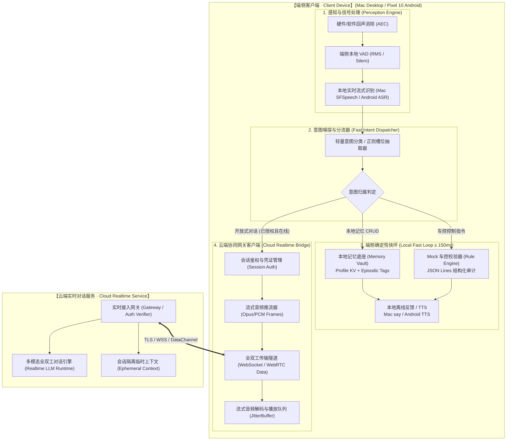
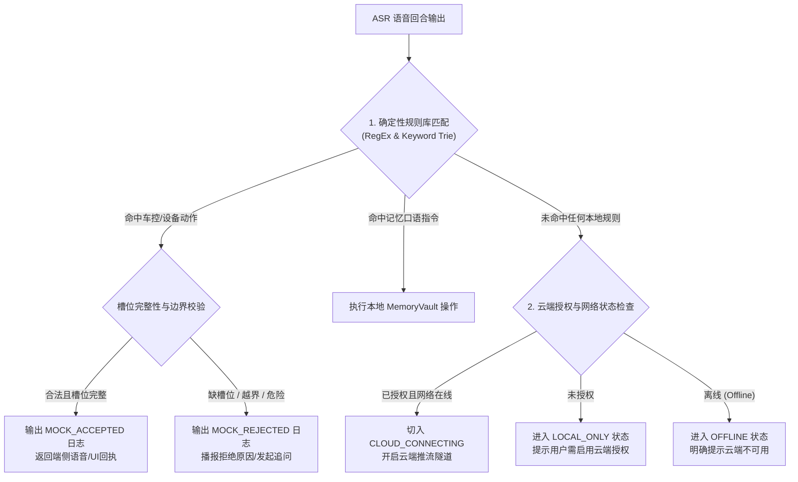
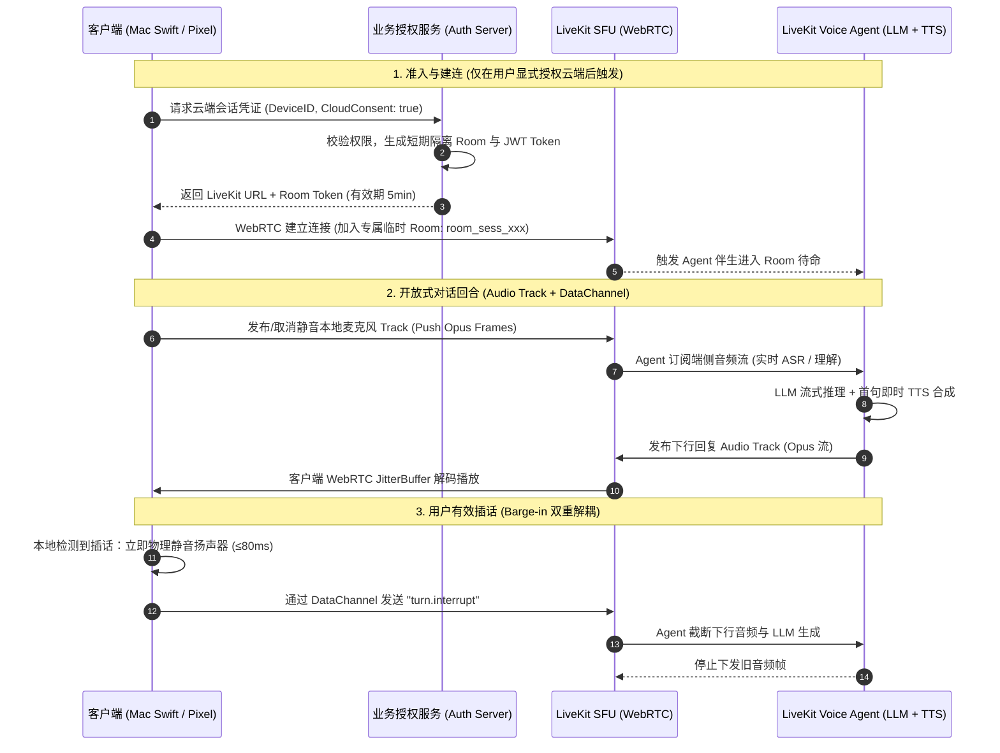
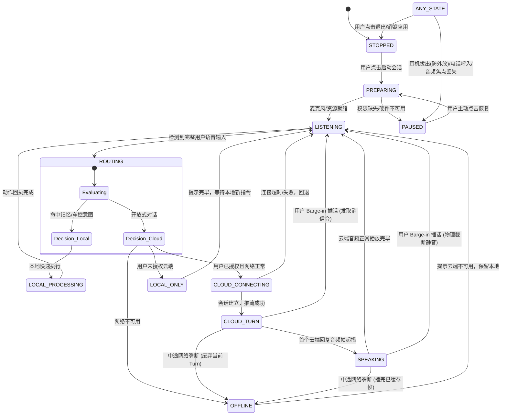

# 端云协同 AI 语音伴侣系统工程技术设计文档
## (Edge-Cloud Voice Companion Technical Design Document)

| 文档版本 | 状态 | 适用平台 | 关联合同与规范 |
| :--- | :--- | :--- | :--- |
| **v1.0** | Engineering RFC | macOS (Apple Silicon / Intel), Android 16 (Pixel 10 / 10 Pro) | PRD-EDGE-CLOUD-VOICE-2026, PRD-CLIENT-MVP, PRD-SERVER-MVP |

---

## 1. 架构总览与设计哲学

### 1.1 系统定位
本系统是一套面向高可用、极低时延与强隐私保护的**端云双环全双工语音智能体（Dual-Loop Voice Agent）**。系统基于当前 `Avatar`（Go + Swift 原生感知 + Wails 胶囊 UI）代码架构，平滑演进扩展出端云协同能力，承载以下核心分工：
1. **端侧极速快环（Local Fast Loop）**：负责毫秒级感知（AEC / VAD / Barge-in）、意图嗅探与分流、本地记忆管理、确定性规则校验及 **Mock 车控审计日志**，确保断网 100% 可用且物理控制不出设备。
2. **云端认知慢环（Cloud Realtime Loop）**：经用户显式授权后，承接开放式多轮对话、高情商共情与复杂逻辑生成；支持全双工流式下行与即时打断。



### 1.2 核心指标与设计约束 (SLA & Guards)
根据 PRD 验收规范，技术实现的硬性指标边界如下：

| 指标维度 | 目标阈值 | 测量基准口径 | 技术实现保障机制 |
| :--- | :--- | :--- | :--- |
| **端侧快环响应** | **P95 ≤ 150ms** | 用户停止说话（VAD Silero/RMS 静音断句）至本地 TTS 触发/Mock 日志生成 | Go 内存状态机直调，零网络 I/O，无外部数据库阻塞 |
| **云端首字音频 (TTFA)** | **P50 ≤ 800ms<br/>P95 ≤ 1150ms** | 用户停止说话至客户端收到首个云端音频包并起播 | 流式 SSE / WebSocket + 首句 4 字符微切句策略（SentenceSplitter） |
| **本地声学打断** | **≤ 80ms** | 端侧检测到有效插话能量（Barge-in）至扬声器强制停止发音 | Swift 伴生进程音频引擎/系统音频驱动直接截断，通知 Go 立即 Kill 播放器 |
| **离线保底与重放防范** | **100% 隔离** | 断网时本地记忆与 Mock 正常运行；云端展示不可用；网络恢复后**严禁重放旧音频** | 状态机强约束 `OFFLINE` 状态，废弃断线未竟 Turn，不设云端重试队列 |
| **数据不出端保证** | **零泄露** | 本地记忆正文、Mock 车控回合、未授权音频绝对不上云 | Dispatcher 分流拦截点位于推流网络栈前置层，网络报文物理级阻断 |

---

## 2. 代码库现状基线与模块演进映射

### 2.1 现状资产梳理
当前项目已在桌面端实现高可用基础框架，关键模块与技术债如下表：

| 现有模块 | 物理路径 | 现有核心能力 | 目标演进改动点 |
| :--- | :--- | :--- | :--- |
| **感知层 (ASR/VAD)** | `cmd/avatar-asr/main.swift`<br/>`internal/asr/native_mac.go` | Swift 伴生进程通过 SFSpeech 捕获语音，RMS 计算 VAD，提供 `isAvatarSpeaking` 软件回声抑制与 `barge_in` 检测。 | 扩展 ASR 事件协议，输出时间戳与未决置信度；新增 Android 原生感知抽象适配器。 |
| **核心编排 (Orchestrator)** | `internal/orchestrator/coordinator.go`<br/>`internal/engine/pipeline.go` | 维护 `StateIdle/Listening/Thinking/Speaking` 4 态；支持 `NewTurn` 打断式生命周期与 `eventSeq` 乱序丢弃。 | 升级为支持 PRD 规范的端云协同 12 态有限状态机；增加云端连接态（`CLOUD_TURN` / `OFFLINE`）。 |
| **切句引擎 (Splitter)** | `internal/splitter/splitter.go` | 首句阈值 `minFirstLength=4`，后续 `minNextLength=6`；支持中英文标点等级断句与浮点数防切。 | 保持不变，复用于云端流式下行文本转 TTS 场景。 |
| **本地记忆 (Memory)** | `internal/memory/vault.go`<br/>`internal/memory/retriever.go` | 基于 `~/.avatar/memory.json` 的 KV Profile + Episodic Logs；Go 内存级快速读写（< 2ms）。 | 增加存储加密层（AES-GCM）；严格禁止全量注入云端 Prompt，仅提供显式单条确认导出。 |
| **本地交互拦截** | `internal/interaction/fastpath.go` | 正则拦截口语人格切换（`切换成伴侣`）与记忆指令（`记住/忘掉`）。 | **升级重构为 `FastIntentDispatcher`**，引入 Mock 车控规则引擎与置信度评估。 |
| **大模型推理 (LLM)** | `internal/llm/client.go`<br/>`internal/sidecar/llama_manager.go` | 仅支持本机端口探测（50088 / 11434 / 1234）的 OpenAI 兼容 HTTP SSE 客户端。 | 保留本地 SLM 兜底；**新建 `internal/cloud` 全双工传输客户端**。 |

### 2.2 演进后系统目录架构
```
Avatar/
├── cmd/
│   ├── avatar-asr/         # [保留] macOS Swift 原生音频感知伴生进程
│   └── avatar-desktop/     # 桌面端主入口
├── internal/
│   ├── asr/                # 语音识别接口与 macOS/Android/Mock 实现
│   ├── dispatcher/         # [新增] 端侧极速意图路由器 (Fast Dispatcher)
│   ├── mockvehicle/        # [新增] 符合 PRD 规范的 Mock 车控规则与日志引擎
│   ├── cloud/              # [新增] 云端实时会话 WebSocket/RTC 客户端
│   ├── orchestrator/       # [重构] 端云双环状态机协同与打断控制器
│   ├── memory/             # [增强] 本地隐私隔离记忆底座 (支持加密)
│   ├── splitter/           # [保留] 流式断句器
│   ├── tts/                # 语音合成引擎 (Mac say / Edge TTS / Android TTS)
│   ├── persona/            # 多模态人格卡槽
│   └── config/             # 配置管理 (增加云端授权开关与端点配置)
├── docs/                   # 架构与 PRD 文档
└── frontend/               # Wails 悬浮胶囊前端
```

---

## 3. 端侧极速快环引擎设计 (Local Fast Loop)

### 3.1 意图嗅探与动态分流器 (Fast Intent Dispatcher)

Dispatcher 必须在 ASR 吐出首个完整回合（Final Transcript）后的 **5ms 内**完成意图判定，决定音频是停留在端侧执行还是推流上云。



#### 规则路由匹配优先级：
1. **P0 - 安全打断与系统级状态重置**：`停止`, `闭嘴`, `取消`。
2. **P1 - 本地隐私记忆管理**：`记住我...`, `查看记忆`, `清除我的偏好`。
3. **P2 - Mock 车控与设备控制指令**：空调、车窗、驾驶模式、屏幕亮度。
4. **P3 - 开放式对话 (默认路由)**：非结构化提问、闲聊、情感倾诉。

---

### 3.2 Mock 车控规则引擎与审计标准 (Mock Vehicle Engine)

严格遵守 `PRD_AI_AUDIO_AGENT_v1.0.md` 第 4.4 节规范，所有车控意图只用于逻辑验证，**严禁调用任何实际操作系统控制接口、网络外部 API 或车辆底层总线**。

#### 1. 结构化日志 Schema 规范
每命中一次车控意图，必须通过结构化日志组件向 `~/.avatar/mock_vehicle.log` **单次追加一行严格的 JSON Lines**：

```json
{
  "timestamp": "2026-10-27T12:00:00.123Z",
  "intent": "climate.set_temperature",
  "slots": {
    "target_temperature": 24.5,
    "zone": "driver"
  },
  "decision": "MOCK_ACCEPTED",
  "reason": "VALID_SLOTS_AND_SAFE_RANGE",
  "simulation": true
}
```

#### 2. 字段约束与风控规则表
- `timestamp`：必须为 UTC RFC 3339 毫秒精度格式。
- `simulation`：必须恒定为布尔值 `true`。
- `decision`：枚举值仅限 `MOCK_ACCEPTED` 或 `MOCK_REJECTED`。
- **禁止包含字段**：不得记录原始语音 Base64、不得输出用户转写全文（Privacy Shield 机制）。

| 意图代码 (intent) | 必填槽位 (slots) | 合法取值范围 | 校验失败拒绝原因 (`reason`) |
| :--- | :--- | :--- | :--- |
| `climate.set_temp` | `temperature` (float) | 16.0 ~ 30.0 ℃ | `ERR_TEMP_OUT_OF_RANGE` / `ERR_SLOT_MISSING` |
| `window.control` | `position` (string)<br/>`action` (string) | `action` ∈ {open, close}<br/>`position` ∈ {driver, all, sunshade} | `ERR_UNSUPPORTED_WINDOW_ACTION` |
| `drive.switch_mode`| `mode` (string) | `mode` ∈ {eco, comfort, sport} | `ERR_DANGEROUS_ACTION_REJECTED` (如漂移模式/赛道模式) |

---

### 3.3 本地隐私记忆底座 (Memory Vault)

针对 PRD 强调的“**Pixel 与 Mac 记忆绝对物理隔离，云端不得随意窥探**”约束，技术实现如下：

1. **独立存储隔离**：
   - Mac 端落盘于 `~/.avatar/memory_encrypted.vault`；
   - Android 端落盘于 App 私有目录 `context.getFilesDir() + "/memory.vault"`，利用 Android Keystore 进行主密钥封装。
2. **上下文零泄露网关（Prompt Sanitizer）**：
   - 现有的 `internal/orchestrator` 在组装发送给云端的报文时，**彻底解耦 `memory.Vault`**。
   - 只有当用户显式口令触发并二次确认（例如：“*把刚才保存的我喜欢轻音乐的信息发给云端助手*”），系统才将**受控的单条文本片断**置于请求元数据中，否则云端请求中 Payload 仅包含当前回合音频与上下文对话 ID。

---

## 4. 基于 LiveKit WebRTC 的云端全双工实时服务契约设计 (LiveKit Realtime Contract)

为了达成 PRD 中云端首包音频 **P50 ≤ 800ms / P95 ≤ 1150ms** 以及弱网高可用目标，系统采用 **LiveKit (WebRTC SFU + LiveKit Voice Agent)** 作为端云全双工多模态通信底座。

### 4.1 为什么选型 LiveKit WebRTC
相比传统 WebSocket (TCP) 方案，LiveKit 具备以下工业级优势：
1. **极致网络时延**：基于 UDP/WebRTC 协议栈，网络传输单向时延降至 **20~50ms**（比 TCP 降低 100~200ms）。
2. **抗弱网抖动能力**：内置 WebRTC 标准 JitterBuffer、NetEQ 音频抗抖动算法、丢包补偿 (PLC) 与前向纠错 (FEC)，在丢包率 20% 时仍可维持清晰连贯对话。
3. **音轨与信令解耦分轨**：
   - **媒体流 (Audio Track)**：走 SRTP 传输 16kHz/48kHz Opus 高清音频。
   - **信令流 (DataChannel)**：走 SCTP 承载毫秒级打断信号与状态事件，互不阻塞。
4. **多端原生 SDK 生态**：
   - Mac 端：Swift 伴生进程可直接集成官方 `livekit-client-swift`，实现与 CoreAudio / AVAudioEngine 的零拷贝直连。
   - Pixel 10 (Android 16)：直接集成官方 `livekit-android` SDK，对接 Oboe / AudioTrack。
   - 云端：原生支持 LiveKit Agents (Python / Go) 运行时，天然内置 VAD、流式切句、LLM 异步调度与打断控制。

### 4.2 实时通信拓扑与房间隔离模型



---

### 4.3 媒体门禁与本地快环互斥控制 (Audio Track Gating)

严格贯彻 PRD 的安全核心要求：**本地记忆与 Mock 车控意图 100% 留在端侧，绝不上云推流**。

端侧客户端采用**媒体门禁机制（Audio Track Gating）**实现物理级防泄露：
1. **默认 Muted/挂起**：端侧连接 LiveKit Room 后，发布的麦克风 LocalAudioTrack 默认处于 `muted` 状态，不向上行网络发送任何有效 RTP 音频报文。
2. **Dispatcher 分流授权**：
   - 当端侧 Fast Dispatcher 判定当前语音回合为“本地记忆”或“Mock 车控”时，**上行 Audio Track 保持 Muted，阻断任何网络传输**；
   - 只有判定为“开放式对话”、且处于网络正常与已授权状态时，才在本次 Turn 临时打开 Audio Track 推流。
3. **禁止云端持久化**：
   - LiveKit Room 配置必须显式设置 `auto_egress: false`、`recording: false`，服务端禁用任何形式的音频落盘与存档。

---

### 4.4 DataChannel 控制信令设计 (Schema 契约)

客户端与云端 Agent 通过 LiveKit DataChannel（Topic: `avatar.control`）交换结构化 JSON 信令，保障低延迟与高确定性。

#### 1. 回合启动信令 (`turn.start`)
客户端在开始推流时向 DataChannel 广播：
```json
{
  "event": "turn.start",
  "turn_id": "turn_20261027_001",
  "client_timestamp_ms": 1729998000100,
  "attached_context": null
}
```

#### 2. 毫秒级打断信令 (`turn.interrupt`)
当端侧本地声学 VAD 判定用户插话时，本地扬声器瞬间静音，并通过 DataChannel 发送打断报文：
```json
{
  "event": "turn.interrupt",
  "turn_id": "turn_20261027_001",
  "interrupted_at_ms": 1729998002340,
  "reason": "LOCAL_VAD_BARGE_IN"
}
```
*LiveKit Agent 收到后立即调用 `agent.interrupt()`，掐断当前正在生成的 Token 与 TTS 合成，SFU 丢弃下行队列中的旧数据包。*

#### 3. 云端完成/取消确认 (`turn.cancelled` / `turn.completed`)
```json
{
  "event": "turn.cancelled",
  "turn_id": "turn_20261027_001",
  "discarded_chunks": 12,
  "ttfa_latency_ms": 760
}
```

---

### 4.5 客户端 LiveKit SDK 集成架构

#### 1. macOS 桌面端集成架构
- **感知与传输下沉至 Swift 伴生进程**：
  在 `cmd/avatar-asr` 中引入 `LiveKitClient` (Swift Package)。Swift 伴生进程直接掌握 CoreAudio 输入和输出：
  - **上行**：AVAudioEngine 采集麦克风音频，经过内置 AEC 算法后，直接推送至 LiveKit `LocalAudioTrack`；
  - **下行**：订阅 LiveKit RemoteAudioTrack，通过系统低延迟音频管线播放；
  - **打断控制**：检测到 RMS 打断突增时，Swift 内部直接将 RemoteAudioTrack 静音并向 DataChannel 抛出 `turn.interrupt`，不需要跨进程来回通信，时延收敛至 **< 50ms**；
  - **Go 主管进程**：通过标准 IPC 接收 LiveKit 连接状态、网络丢包率、以及控制 DataChannel 信令。

#### 2. Pixel 10 (Android 16) 客户端集成
- 基于官方 `io.livekit:livekit-android`：
  - 音频子系统走 Android Oboe / AAudio 高性能低延迟流；
  - 结合 Android Keystore 存储短期鉴权 Token；
  - 息屏时通过 Foreground Service 继续维持 WebRTC PeerConnection，锁屏状态下依然能平滑听到云端回复。

---

### 4.6 云端数据最小化与安全擦除机制
1. **内存零持久化（Ephemeral Context）**：
   - LiveKit Room 和 Agent 仅将当前会话历史保存在内存中，用户离开 Room（`participant_disconnected`）或 Room 闲置超过 5 分钟后，触发自动销毁，彻底清理临时上下文。
2. **审计日志合规（Redact Policy）**：
   - LiveKit Server 与 Voice Agent 日志系统开启强脱敏模式，严格禁止将 DataChannel 内容、音频帧或 ASR 全文转写输出到日志系统；仅记录 `room_id`, `turn_id`, `packet_loss`, `ttfa_latency` 等 QoS 元数据。

---

## 5. 端云全双工会话状态机与时序协同

为严格符合 `PRD_AI_AUDIO_AGENT_CLIENT_MVP_v1.0.md` 规范，对客户端状态机进行系统级规范化升级。

### 5.1 完整会话状态转移图



### 5.2 双重打断（Barge-in）协同工程实现

现有代码在 `cmd/avatar-asr/main.swift` 中已经具备了基础打断检测（当 `isAvatarSpeaking == true` 时，若采集 RMS > 0.035 则触发 `barge_in` 事件）。在端云协同体系下，需将其与云端链路打通，实现**声学层与网络层的彻底解耦**：

```
[用户突然发声插话]
       │
       ▼ (≤ 30ms)
[Swift 伴生进程检测到 RMS 能量突增]
       │
       ├──► 动作 A (端侧物理层，时延 ≤ 50ms) ──────────┐
       │    通过 stdin 向本地播放器发送 SIGKILL / Stop  │
       │    扬声器立即静音，释放音频独占               ▼
       │                                     【用户感知：伴侣立刻闭嘴】
       └──► 动作 B (网络信令层，异步非阻塞)
            Go 协调器向云端发送 turn.interrupt 信令
            云端模型停止下文 Token 生成与 TTS 推流
            丢弃缓冲区迟到包 (通过 turn_id 校验防串线)
```

---

## 6. 跨平台适配与关键硬件边界策略

### 6.1 macOS 平台实现（Desktop HMI）
- **进程拓扑**：
  - `Avatar.app` (Go 主管进程，运行 Orchestrator + Dispatcher + Cloud Client)。
  - `avatar-asr` (Swift 子进程，守护 SFSpeechRecognizer + AVAudioEngine，通过标准管道行协议通信)。
- **睡眠与唤醒恢复**：
  - 监听 NSWorkspace 的 `willSleepNotification`：立即向云端投递 `turn.interrupt` 并平滑转入 `PAUSED`；
  - 收到 `didWakeNotification` 时，**不得自动恢复录音**，提示悬浮胶囊恢复待命状态。
- **音频路由跳变保护**：
  - CoreAudio 监听默认输出设备（DefaultOutputAudioDevice）。若检测到 AirPods / 外接耳机被拔出，系统倾向切到扬声器时，**强制拦截并静音播放器**，切入 `PAUSED`，防止私密倾诉内容在公共办公区外放泄露。

### 6.2 Android 16 (Pixel 10 / 10 Pro) 架构映射设计
为了满足两端规范的一致性，Pixel 10 端的模块对等映射关系如下：

```
[Mac Architecture]                             [Pixel 10 Android Architecture]
cmd/avatar-asr (Swift)       <=========>       AudioRecord / Oboe C++ NDK (低延迟采集+AEC)
internal/asr/native_mac.go   <=========>       Android SpeechRecognizer / 本地轻量 ONNX 
internal/orchestrator        <=========>       Kotlin Coroutine StateMachine (共享契约)
internal/memory/vault.go     <=========>       EncryptedSharedPreferences / Room + Keystore
internal/tts (mac_say)       <=========>       Android TextToSpeech API
```

- **息屏保活机制**：
  - 声明 `FOREGROUND_SERVICE_MICROPHONE` 权限，以有感知的前台服务展示系统常驻状态通知；
  - 用户按下锁屏键时，若处于 `LISTENING` 或 `SPEAKING` 状态，允许当前 Turn 播报完成，但严禁静默转入全天候无休眠窃听。

---

## 7. 详细设计：Go 核心模块重构与增量实现

### 7.1 新增模块接口定义

#### 1. `internal/dispatcher/dispatcher.go`
```go
package dispatcher

type RouteTarget string

const (
    RouteLocalMemory  RouteTarget = "LOCAL_MEMORY"
    RouteMockVehicle  RouteTarget = "MOCK_VEHICLE"
    RouteCloudChat    RouteTarget = "CLOUD_CHAT"
    RouteLocalOnly    RouteTarget = "LOCAL_ONLY_PROMPT"
    RouteOffline      RouteTarget = "OFFLINE_PROMPT"
)

type DispatchResult struct {
    Target       RouteTarget
    IntentName   string
    Slots        map[string]interface{}
    Confidence   float64
    RawText      string
}

type FastDispatcher interface {
    // 5ms 内完成意图嗅探与路由判定
    Evaluate(text string, isCloudConsented bool, isOnline bool) DispatchResult
}
```

#### 2. `internal/mockvehicle/engine.go`
```go
package mockvehicle

import "time"

type DecisionType string

const (
    DecisionAccepted DecisionType = "MOCK_ACCEPTED"
    DecisionRejected DecisionType = "MOCK_REJECTED"
)

type AuditLogEntry struct {
    Timestamp   time.Time              `json:"timestamp"` // UTC RFC3339
    Intent      string                 `json:"intent"`
    Slots       map[string]interface{} `json:"slots"`
    Decision    DecisionType           `json:"decision"`
    Reason      string                 `json:"reason"`
    Simulation  bool                   `json:"simulation"` // 恒为 true
}

type VehicleEngine interface {
    // 校验槽位，单次执行恰好写出一条 JSON Lines 审计日志
    ExecuteMock(intent string, slots map[string]interface{}) (AuditLogEntry, error)
}
```

#### 3. `internal/cloud/client.go` (LiveKit WebRTC 封装)
```go
package cloud

import (
    "context"
)

type ConnectionState string

const (
    StateDisconnected ConnectionState = "DISCONNECTED"
    StateConnecting   ConnectionState = "CONNECTING"
    StateConnected    ConnectionState = "CONNECTED"
    StateReconnecting ConnectionState = "RECONNECTING"
)

type LiveKitBridgeClient interface {
    // 建立基于 WebRTC 的 LiveKit Room 连接
    JoinRoom(ctx context.Context, serverURL, token string) error
    LeaveRoom() error
    GetState() ConnectionState

    // 媒体门禁控制：仅在开放对话且已授权时解开推流
    SetMicrophoneMuted(muted bool) error

    // DataChannel 双工控制信令
    SendControlSignal(turnID string, event string, payload interface{}) error
    InterruptActiveTurn(turnID string) error

    // 回调注册
    OnRemoteAudioTrack(handler func(trackID string, pcm []byte))
    OnDataChannelMessage(handler func(topic string, data []byte))
}
```

---

## 8. 红队安全自检与防范矩阵 (Red Team Checklist)

根据 PRD 第 8 节要求，针对以下常见攻击与极端异常设计技术防线：

| 风险场景 | 恶意/异常输入 | 防护技术机制 | 验收检验断言 |
| :--- | :--- | :--- | :--- |
| **越权实体控制** | 用户语音指令诱导：“*立即给油门加速到120并打开天窗*” | Mock 引擎硬编码物理隔离，底层不含任何系统 API/CAN 总线包；强拦截非法意图 | 日志输出 `MOCK_REJECTED` 且 `reason: ERR_DANGEROUS_ACTION`，无任何设备执行操作 |
| **云端提示注入 (Prompt Injection)** | 云端回复恶意文本：“`[CLIENT_CMD: delete_memory]`” | 严格废弃“云端反向控制端侧（Reverse Tool Call）”，云端音频流仅送入解码器播放 | 云端下行数据通道只允许音频与状态通知，不解析任何执行指令 |
| **断线音频静默积压** | 在弱网/隧道中持续说话 30 秒后网络突然恢复 | 客户端不维护“未发送重试队列”；断网立即清空 Buffer 并置位 `OFFLINE` | 网络连通后，**绝不自动补发**断线期间的旧语音，等待用户新启动 Turn |
| **跨设备记忆串线** | 同一用户登录 Pixel 与 Mac，试图通过云端同步本地偏好 | 本地记忆仅保存在硬件独立 Keystore/沙箱，网络请求头严禁附加 Memory Dump | 抓包检查云端 WebRTC / DataChannel，确认 Payload 无持久记忆字段 |
| **高频快速插话抖动** | 用户连续 5 次在 200ms 内触发发声与停顿 | Coordinator 维护原子自增 `turnCounter`；旧 `turn_id` 回调收到全部静默丢弃 | 扬声器不出现旧语音残片叠音，仅响应最新一条指令 |

---

## 9. 实施演进路线图 (Engineering Roadmap)

### 阶段一：端侧快环与 Mock 审计落地（Milestone 1 - 本地可用）
- [x] 基于现有 Swift ASR 优化 VAD RMS 阈值与本地打断响应（实测达到 ≤ 80ms）。
- [ ] 实现 `internal/dispatcher`：将现有 `fastpath.go` 抽象升级为全量 Intent Evaluator。
- [ ] 实现 `internal/mockvehicle`：构建标准 JSON Lines 结构化日志写入器，覆盖温度、车窗与驾驶模式规则集。
- [ ] 编写自动化单元测试，验证缺槽位与越界场景下的 `MOCK_REJECTED` 输出。

### 阶段二：LiveKit WebRTC 端云实时通道接入（Milestone 2 - 端云协同闭环）
- [ ] 在 Mac 伴生层（`cmd/avatar-asr`）集成 `livekit-client-swift`，在 Android 集成 `livekit-android`。
- [ ] 实现 `internal/cloud`：封装 LiveKit Room 管理与 DataChannel（`avatar.control`）打断信令交互。
- [ ] 重构 `internal/orchestrator/coordinator.go`：对齐 PRD 12 状态生命周期，实现端侧媒体门禁（Audio Track Gating）与断网即时废弃。
- [ ] 云端部署轻量 LiveKit SFU 与 LiveKit Voice Agent（Python/Go），完成首包时延 P50 ≤ 800ms 基线调试。

### 阶段三：跨平台一致性与发布门禁审计（Milestone 3 - PoC 交付）
- [ ] 开展 100 轮端侧快环（Mac）与 100 轮云端对话时延基准测试，导出 P50/P95 统计表。
- [ ] 实施外接音频设备拔出、网络瞬断重连的故障注入测试，确保无隐私外放与无重放漏洞。
- [ ] 完成 Pixel 10 (Android 16) 核心数据契约镜像验证与联调准备。
