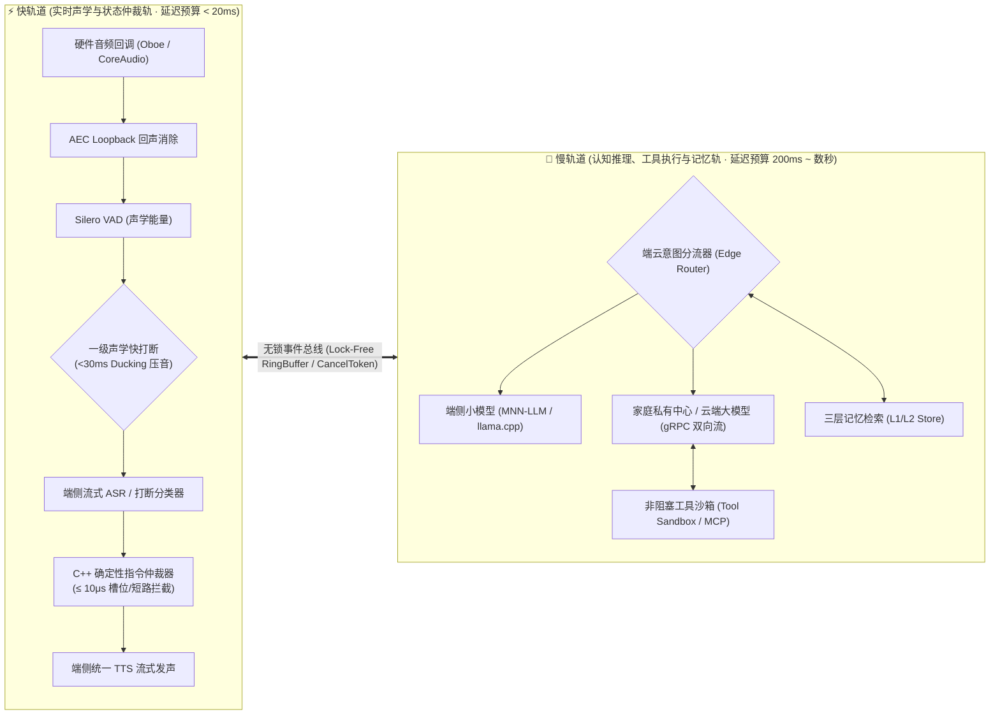
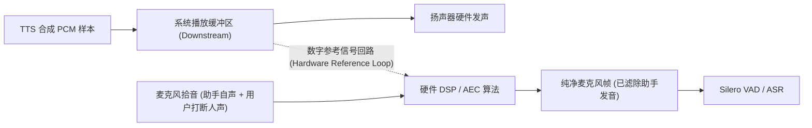
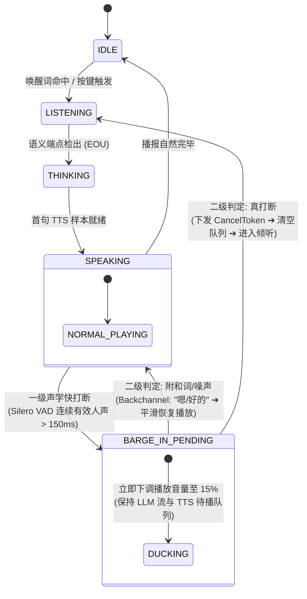
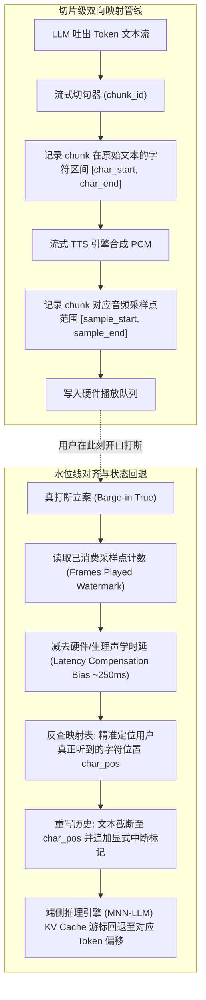
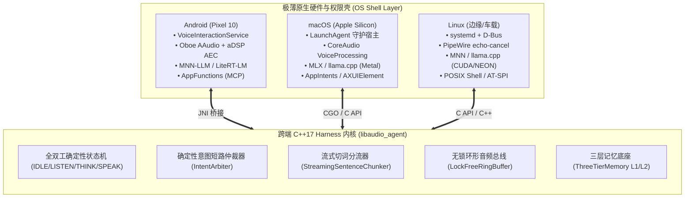
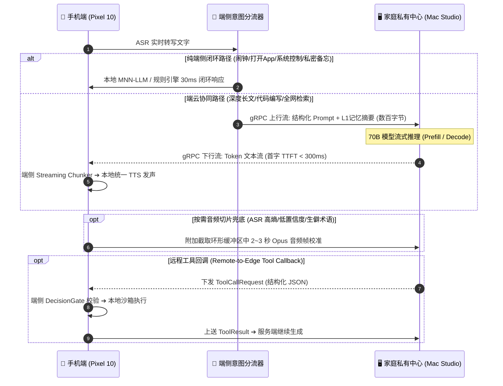
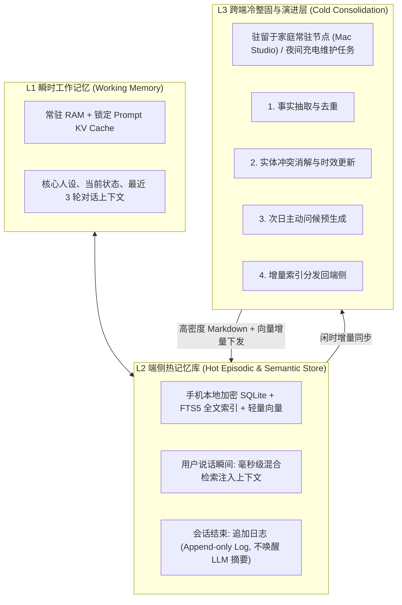
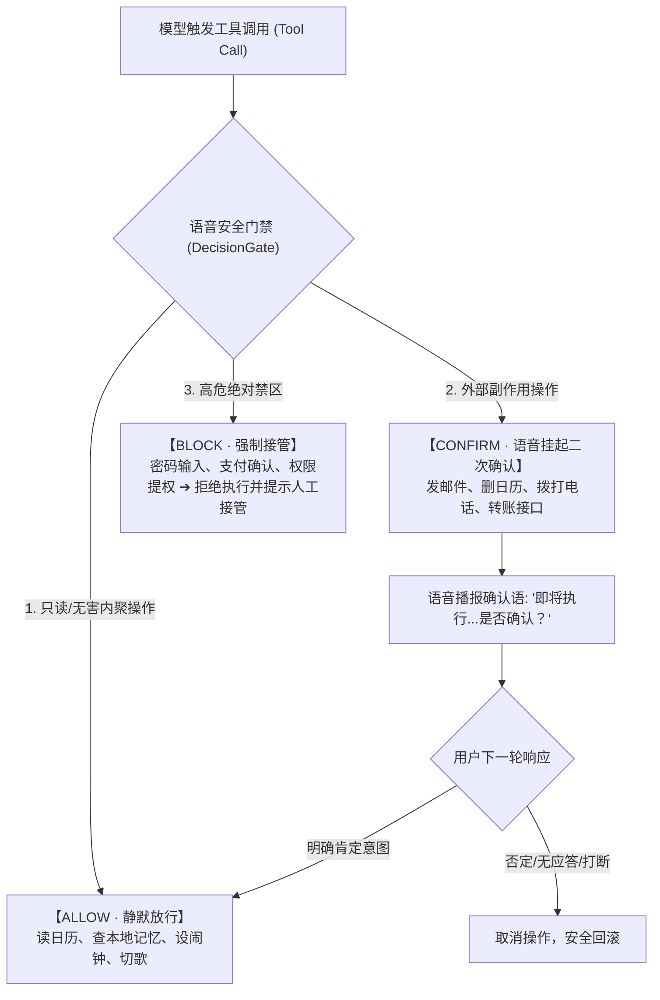

# 02 个人语音助手 Harness 与跨端端云架构设计规范

> **承接关系**：承接《01 通用 Agent 端云协同 Harness 架构与技术实现白皮书》（[`docs/ai-agent-harness-architecture.md`](ai-agent-harness-architecture.md)），本规范聚焦于**个人语音助手运行时（Personal Voice Assistant Harness）**与**跨端端云协同体系**。  
> **适用范围**：macOS Desktop (Apple Silicon)、Android Mobile (Pixel 10 等参考样机)、Linux 边缘/车载节点、家庭常驻私有算力节点 (Mac Studio) 以及 C++17 跨平台原生运行时 (`core/`)。

---

## 1. 架构演进：从离散文本循环到全双工流式状态机

在通用 Agent 的“离散同步 ReAct 循环”（Text Input ➔ LLM Think ➔ Tool Call ➔ Final Response）中，所有输入输出均被离散阻塞式轮次（Turn-based）所割裂。而在个人语音助手场景下，核心任务是将这种离散同步循环重构为**事件驱动的全双工流式有向无环图（Event-driven Full-Duplex DAG）+ 确定性有限状态机（Deterministic FSM）**。

参考业界实时语音编排框架（TEN Framework 与 Pipecat）的系统哲学，语音助手 Harness 将整个运行时切分为两条并行不悖、通过无锁消息总线（Lock-Free RingBuffer / SPSC Queue）协同的双轨道：

* **快轨道（实时声学与状态仲裁轨，延迟预算 $\le$ 20ms）**：
  * **技术栈**：纯 C++17 原生常驻线程（绑定 CPU Affinity 核心，零堆内存分配）。
  * **核心职责**：直接绑定底层硬件音频回调（Audio Callback），负责全双工音频 I/O、声学回声消除（AEC）、关键词唤醒（KWS）、语音活动检测（VAD）、流式语音识别（ASR）、流式语音合成（TTS）以及毫秒级打断（Barge-in）状态机仲裁。
* **慢轨道（认知推理、工具执行与记忆轨，延迟预算 200ms ~ 数秒）**：
  * **技术栈**：C++ / Go / Kotlin 协同层，异步事件驱动并发。
  * **核心职责**：负责端云混合推理路由、上下文组装、非阻塞工具沙箱执行（Tool Sandbox）、外部 API 调度以及分层记忆检索与整固。

---

## 2. 语音助手 Harness 的五大专属核心机制

### 2.1 全双工声学隔离与硬件级回声消除（AEC Loopback）

语音助手在处于播报状态（`SPEAKING`）时必须保持麦克风持续全开监听，才能支持用户随时自然打断。Harness 必须在音频硬件抽象层建立严密的参考信号回路（Reference Loop）：

1. **硬件 DSP 优先**：
   * **移动端（Android）**：优先使用 Google Oboe（AAudio 流），将输入与输出流绑定至同一个 `VoiceCommunication` 模式音频会话，强制底层音频 HAL 将下行播放缓冲区的数字信号实时旁路（Loopback）给片上硬件 DSP/aDSP 芯片执行声学回声消除。
   * **桌面端（macOS）**：启用 `AVAudioEngine` 或 CoreAudio 的 `VoiceProcessing` 聚合音频模式，调用 Apple 芯片内置的硬件级 AEC 与降噪单元。
2. **轻量软件 AEC3 兜底**：
   * 针对部分 Android 硬件 AEC 失效或蓝牙耳机（Bluetooth A2DP/HFP）声学时延动态漂移的场景，在 C++ 音频管线入口按需挂载剥离的 `webrtc-audio-processing`（约 1.5MB 纯 C++ 算法库，完全剔除 WebRTC 复杂网络栈）。通过延迟估计器动态对齐下行 TTS 帧与上行麦克风帧，彻底滤除自激回声。

### 2.2 语义轮次检测（EOU）与双级打断仲裁状态机

为了根除传统纯静音阈值 VAD“用户停顿半秒就被抢话”与“微弱环境杂音/咳嗽误打断播报”两大顽疾，Harness 维护包含 5 个核心状态的确定性状态机（FSM）：`IDLE`（守候）、`LISTENING`（倾听）、`THINKING`（思考/工具执行）、`SPEAKING`（播报）与 `BARGE_IN_PENDING`（疑似打断待确认）。

借鉴 `ten-turn-detection` 哲学，引入**双级打断仲裁机制**：

1. **一级声学快打断（Acoustic Fast Ducking，响应 $\le$ 30ms）**：
   * 当状态机处于 `SPEAKING` 时，一旦内置 Silero VAD 检测到连续 150ms 有效人声能量，状态机立即跃迁至 `BARGE_IN_PENDING`；
   * **第一时间平滑压低（Ducking）底层音频播放流音量（降至 15%~20%）**，但**暂不销毁**后台正在生成的 LLM Token 流与待播 TTS 队列。
2. **二级语义慢确认（Semantic Confirmation，响应 150ms ~ 300ms）**：
   * 端侧流式 ASR / 打断分类器实时解码该突发人声切片：
     * **误触发或附和词恢复**：若解码为短噪点，或命中倾听反馈词库（Backchannel：“嗯”、“好的”、“明白了”等），状态机自动切回 `SPEAKING`，平滑渐变恢复 TTS 播放，用户听感连贯不突兀；
     * **真打断清场**：若解码为明确问题或纠偏短语（“停一下”、“换个说法”、“不对”），Harness 立即广播带当前 `turn_id` 的全局取消令牌（`CancelToken`），瞬间掐断本地/远端 LLM 推理、清空 TTS 待播环形缓冲，并正式跃迁至 `LISTENING` 接收新指令。

### 2.3 被中断后的上下文对齐（Interrupted Context Reconciliation）

当助手连续播报至第 3 秒被用户插话打断时，后台 LLM 往往已经在第 1 秒预先生成了 15 秒的文本。为消除“大模型认知记忆”与“用户耳朵实际听感”的时空割裂，Harness 实行**严格的水位线因果对齐协议**：

* **历史截断与 KV Cache 游标指针回退**：
  * 将对话历史中当轮助手的 Assistant 消息物理截断至实际听到的文字处，并追加 `[已打断]` 语义标记；
  * 端侧推理引擎（MNN-LLM / llama.cpp）将 KV Cache 序列指针直接回退至截断处的 Token 偏移，避免下一轮重算 Prompt Prefill，实现毫秒级因果衔接。

### 2.4 流式标点切句与双轨分流器（Streaming Chunker & Dual-Track Router）

为确保端到端首包发声时延（TTFA: Time-to-First-Audio）严格控制在 $\le$ 400ms，Harness 在 LLM Token 输出端部署流式状态机切句器：

* **有声播报轨（Vocal Track）**：
  * 对自然语言回复，首句遇到首个标点（逗号、顿号、分号、句号）且达到 4~6 字阈值时，立即触发原子切分（Chunk 0）并投递给 TTS 线程合成，确保首字快速发声；
  * 后续切句动态放宽至 15~25 字，利用前序句子的播报时间窗口作为缓冲，以保障长句语音合成的语调自然起伏。
* **静默控制轨（Silent Control Track）**：
  * 一旦状态机解析出模型输出了工具调用协议前缀（如 `<tool_call>` 或 `{"name":`）或内部思考链标签（`<think>`），分流器立即切断向 TTS 的字符供给；
  * 后续结构化 JSON 流被旁路沉降至后台沙箱解析器，TTS 保持绝对静音，杜绝系统标记被误读出声。

### 2.5 异步工具执行的语音掩蔽（Filler Speech Masking）

当模型触发耗时操作（如跨端检索、长链条推理、GUI 自动化，预计耗时 $\ge$ 1.2 秒）时，为防止持续静默引发用户怀疑系统死机，Harness 在分流工具调用的同时驱动轻量过渡机制：

* **分级掩蔽策略**：
  * **轻量操作（300ms ~ 800ms）**：严禁播报冗长的自然语言口语句；统一播放毫秒级、非侵入式的轻微交互声效（Earcon 音效，如低音微鸣或水滴声）；
  * **深度操作（$\ge$ 1.2s）**：并发触发一句贴合当前上下文的极短过渡语（如“正在帮您查询日程…”）送入 TTS 播报，利用播报的时间窗口（约 1.5s）完全掩盖后台沙箱执行与网络 RTT 延迟。

---

## 3. Android / macOS / Linux 跨平台分层架构设计

系统采用 **“纯 C++17 跨端 Harness 内核 (`libaudio_agent`) + 极薄 OS 原生硬件与权限宿主壳”** 的二元架构：

### 3.1 跨平台三端系统底座映射矩阵

| 架构分层 | Android 移动端 (如 Pixel 10) | macOS 桌面端 (Apple Silicon) | Linux 边缘 / 车载 / 桌面端 |
| :--- | :--- | :--- | :--- |
| **系统常驻宿主** | `VoiceInteractionService` + 硬件唤醒中断 | `LaunchAgent` 守护进程 + 菜单栏常驻 | `systemd` 用户级服务 + D-Bus 总线 |
| **全双工音频与 AEC** | Google Oboe (`VoiceCommunication` 硬件 AEC + webrtc-audio-processing 兜底) | `AVAudioEngine` (`VoiceProcessing` 硬件 AEC 与降噪) | PipeWire (`module-echo-cancel` WebRTC 模块) |
| **流式语音感知与合成** | `sherpa-onnx` Native (Silero VAD + KWS + Paraformer + Kokoro/VITS) | `sherpa-onnx` (可接入 CoreML / ANE 神经加速) | `sherpa-onnx` (ONNX Runtime ARM NEON / CUDA) |
| **端侧大模型引擎** | MNN-LLM (CPU KleidiAI / OpenCL / Vulkan) 或 LiteRT-LM | MLX / llama.cpp (Metal GPU 统一内存零拷贝) | MNN-LLM 或 llama.cpp (Vulkan / CUDA) |
| **系统工具沙箱** | Android AppFunctions (原生 MCP) + Intent | 本地 MCP Server + macOS AppIntents / Shortcuts | 本地 MCP Server + 受控 Shell + `gdbus` |
| **存量应用 GUI 自动化** | AccessibilityService (无障碍树，仅在用户授权后兜底) | macOS `AXUIElement` 辅助功能树解析与事件注入 | Wayland / X11 AT-SPI 接口 |

---

## 4. 去 WebRTC 化的极简端云协同架构

彻底废弃高耗电、建连繁琐且弱网抖动的 WebRTC 音视频传输栈。声学管线完全在端侧闭环，端云协同全部收敛为**单通道 gRPC 双向流（基于 HTTP/2 或 HTTP/3 QUIC）**。

### 4.1 单通道端云协议四大核心支柱

1. **端侧意图分流器（Edge Router）**：
   * 采用“规则短路 + 端侧轻量意图分类器”，在 $\le$ 30ms 内完成决策。
   * 本地工具控制、隐私记忆读写 100% 留端；开放认知与长文本分析上送家庭 Mac Studio 节点。
2. **按需音频切片兜底（On-Demand Audio Fallback）**：
   * 平常网络信道零音频流。仅当端侧 ASR 输出置信度低于阈值（如生僻外文、嘈杂环境）时，端侧才截取环形缓冲中的 Opus 音频切片随 gRPC 文本帧上送，由远端大模型做听写补正。
3. **跨网远程工具回调（Remote-to-Edge Tool Callback）**：
   * 当远端模型推理过程中需要获取手机状态或操控手机 App 时，通过 gRPC 下行流下发 `ToolCallRequest`；手机端执行完毕后将 `ToolResult` 沿同一双向流回传。
4. **弱网超时抢占与投机掩蔽（Speculative Fallback）**：
   * 若远端 gRPC 连接因弱网在 400ms 内未返回首包 Token，端侧判定超时并无缝切换至手机本地伴生小模型；
   * 针对已识别的高耗时远端推理，端侧小模型先行合成一句简短承接语，利用 1.5 秒的发声窗口完全掩盖网络往返延迟。

### 4.2 技术选型辩证：WebRTC / LiveKit 的核心价值与不可替代业务场景

> 深入评估报告详见：[`docs/webrtc-livekit-vs-grpc-transport.md`](webrtc-livekit-vs-grpc-transport.md)。

尽管 FastAvatar 在个人专属伴生体场景下坚定执行“去 WebRTC 化”，但这并不意味着 WebRTC / LiveKit 失去价值。相反，在以下五大核心业务场景下，**WebRTC（尤其是 LiveKit SFU 架构）是业界无可替代的唯一工业标准**：

1. **原生端到端 Speech-to-Speech 大模型（如 OpenAI Realtime / Gemini 2.0 Live）**：
   * 模型无分立的 ASR/TTS 阶段，直接输入/输出连续声学 Token（捕捉语气、哭腔、呼吸与情绪）；
   * 原始双向音频流传输必须依赖 WebRTC 的 RTP over UDP + 动态 Jitter Buffer，TCP 队头阻塞在此类场景下会导致秒级不可恢复卡顿。
2. **零安装 Web 浏览器端与超轻量 IoT 设备（Thin Clients & Web SDK）**：
   * 网页端 AI 客服 / AI 面试官：用户通过浏览器直接语音交互，免除几百兆原生运行时安装；
   * 低成本 MCU 硬件（如 ESP32-S3、智能门铃）：芯片 RAM 仅数兆，无法在本地运行神经网络，必须由云端 LiveKit Agent Worker 全托管 VAD/ASR/LLM/TTS。
3. **多人多轨协同会议与虚拟空间（Multi-Party Collaboration & Spatial Audio）**：
   * N 对 N 的多人会议（AI 参会同传、狼人杀法官、空间音频）：单连接点对点 gRPC 无法处理复杂的发布-订阅（Pub/Sub）多音轨矩阵，必须依赖 LiveKit SFU 实施音轨选择性转发与声纹隔离。
4. **云端渲染的高拟真 3D/2.5D 数字人（Cloud-Rendered Video Avatars）**：
   * 虚幻引擎 5（Pixel Streaming）等云端渲染数字人包含 1080P/4K 视频流，必须依赖 RTP 协议的 PTS 时间戳在传输层实现硬性**音画同步（Lip-Sync 唇形对齐）**，并依托 GCC/BWE 动态拥塞降码率。
5. **企业级严苛防火墙穿透与极端弱网对抗（NAT Traversal & QoS）**：
   * 依托 ICE/STUN/TURN 协议族保证对称型 NAT 与专网 99.9% 连通率，结合 FEC（前向纠错）在 30% 丢包下无需重传即时还原音频。

**技术选型决策准则**：
* **个人设备、端侧具备算力、追求极致省电/隐私/断网可用** ➔ **坚持 FastAvatar 路线（端侧 C++ + gRPC 文本流）**；
* **网页免装、低算力硬件、原生音频 Omni 模型、多人协同会议、云端渲染视频** ➔ **坚决引入 WebRTC + LiveKit 基础设施**。
---

## 5. 三层记忆架构与跨端闲时整固（Tiered Memory & Consolidation）

1. **L1 瞬时工作记忆（Working Memory）**：常驻内存与 KV Cache，维系当轮对话与角色核心设定；
2. **L2 端侧热记忆库（Hot Store）**：本地加密 SQLite，用户发话毫秒级检索，对话结束仅做追加写入（Append-only），严禁在对话间隙唤醒端侧大模型做摘要（保护 LPDDR5 带宽与电量）；
3. **L3 跨端冷整固（Cold Consolidation）**：手机夜间充电或同步至家庭 Mac Studio 时异步触发，执行事实提炼、冲突消解、次日主动关怀预生成，并将紧凑上下文增量同步回端侧。

---

## 6. 安全门控（DecisionGate）与移动端功耗温控治理

### 6.1 语音态三态安全门控（Voice-Native DecisionGate）

在工具执行沙箱前端设立强制策略拦截层，防止口语误识别或声音注入引发越权操作：

### 6.2 移动端四级功耗与 ADPF 温控联动状态机

为保障在 Android 旗舰设备（如 Pixel 10）实现全天候待机无感伴随，Harness 根据硬件热状态（Thermal Status）与交互活跃度在四个功耗档位间弹性流转：

| 功耗档位 | 触发与驻留条件 | 硬件与模型激活状态 | 功耗治理与降级行为 |
| :--- | :--- | :--- | :--- |
| **S0 极低功耗守候态** | 屏幕关闭且无语音交互满 30 秒 | 主 CPU/NPU 深度休眠；音频回调完全释放；仅保留系统 `VoiceInteractionService` 硬件 DSP 唤醒中断 | 毫瓦级待机；大模型权重通过 `mmap` 保留在内存映射中，释放物理驻留显存 |
| **S1 全双工热交互态** | 唤醒词命中 / 按键激活 | 拉起 Google Oboe 低延迟流；通过 `mlock` 锁定模型推理权重与 KV Cache | 端侧 ASR + SLM + TTS 全速流水线，确保 TTFA $\le$ 400ms |
| **S2 温控保护降级态** | Android ADPF 上报温度达到 `MODERATE` / `SEVERE` 或电量 < 15% | 立即挂起端侧本地 LLM 推理线程，释放 GPU/NPU 算力 | 手机仅保留轻量 VAD 与 TTS 播放，将所有大模型认知推理 100% 透明卸载至家庭 Mac Studio 或云端 |
| **S3 闲时维护态** | 连接充电器 + 接入 Wi-Fi + 夜间息屏 | 调度 Android WorkManager 周期性唤醒维护工作 | 重建本地 SQLite 向量索引、端云记忆全量同步、离线模型包更新 |

---

## 7. 生产级工程壁垒与实施补丁（Engineering Hardening & Invariants）

为避免规范停留在理论推演层面，在实际工程实现中必须强制遵循以下六项底层约束：

### 7.1 物理声学时延补偿模型（Latency Compensation Bias）
* **硬性物理约束**：声卡已消费采样点计数（Watermark）必然超前于用户入耳听感。
* **时延链路公式**：
  $$\Delta t_{\text{total}} = \Delta t_{\text{HAL}} + \Delta t_{\text{Driver/DAC}} + \Delta t_{\text{Air/BT}} + \Delta t_{\text{Physiology}} + \Delta t_{\text{VAD\_Window}}$$
* **实现强制规范**：
  * 水位线反查时，反查的时间点必须减去 $\Delta t_{\text{total}}$ 估计值（扬声器直放保守扣减 200~250ms；蓝牙 HFP/A2DP 动态扣减 350~450ms）；
  * 文本截断必须向左做保守词边界对齐，宁可少截断 1~2 个词，严禁多截断造成信息缺失。

### 7.2 微短音频分类器前置，杜绝单一 ASR 仲裁
* **硬性物理约束**：150ms 的超短音频无法支撑流式 ASR（CTC/Transducer）输出高置信度文本。
* **实现强制规范**：
  * 二级打断仲裁严禁单独依赖 ASR 解码结果；
  * 必须在 VAD 后前置一个参数量 $< 1\text{MB}$ 的端侧声学打断特征分类器（结合音高/能量变化曲线），并并行挂载特定 KWS 模型（专门捕获“停”、“别说了”、“等等”），在 150ms 窗口内完成粗分类。

### 7.3 端云分布式 KV Cache 因果保护
* **硬性约束**：在端云协同慢轨被远端承载时，向历史追加显式中断标记会击穿服务端 Prefix Caching。
* **实现强制规范**：
  * 端云协同模式下，中断信息作为独立元数据随下一轮 Prompt 上送，保留前序 Token 序列的因果完整性，避免破坏远端 PagedAttention 缓存哈希。

### 7.4 听觉掩蔽分级（Earcon 优先于口语过渡）
* **硬性约束**：短耗时工具（300~800ms）插播口语过渡句会导致“为了掩蔽 0.5 秒延迟，反而引入 1.5 秒无意义播报”。
* **实现强制规范**：
  * 耗时 $< 1.2$ 秒的操作**绝对严禁**生成任何口语过渡句；统一播放极微弱的 Earcon 交互音效；
  * 仅在操作耗时确定性超过 1.2 秒时，才允许端侧投机播报简短口语过渡。

### 7.5 跨端工具调用的全局 `turn_id` 与幂等租约
* **分布式并发约束**：400ms 超时抢占可能导致远端工具已派发、本地又重新执行同一副作用操作。
* **实现强制规范**：
  * 所有带副作用的工具调用必须由全局单调递增的 `turn_id` + `call_id` 施加分布式租约；
  * 超时降级接管时，端侧本地小模型在未收到远端明确 Cancel ACK 之前，严禁重新执行相同的外部状态写入工具。

### 7.6 移动端权限合规与常驻生命周期治理
* **平台约束**：现代 Android 严禁后台长开麦克风流，且 AccessibilityService 面临严重风控与功耗审查。
* **实现强制规范**：
  * S0 守候态必须调用 `oboe::AudioStream::stop()` 释放硬件，仅通过 `VoiceInteractionService` 系统的 `HotwordDetector` 进行低功耗 DSP 监听；
  * GUI 操控优先调用系统标准化 MCP（AppFunctions），无障碍服务仅作为兜底，且在未获用户显式授权前处于惰性休眠状态。

---

## 8. FastAvatar 代码库落地映射与集成清单

本规范对应的核心工程实现已深度植入 FastAvatar 代码底座：

| 规范章节 | 核心职责 | C++ 底座 (`core/`) | 宿主与网关实现 |
| :--- | :--- | :--- | :--- |
| **2.1 全双工声学管线** | 硬件 I/O 绑定、无锁缓冲 | `core/src/FullDuplexAudioIO.cpp` `core/include/LockFreeRingBuffer.hpp` | `android/.../AudioAgentNative.kt` `cmd/avatar-asr/main.swift` |
| **2.2 打断状态机与仲裁** | Ducking 压音、双级打断判定 | `core/src/AudioAgentPipeline.cpp` `core/src/IntentArbiter.cpp` | `internal/interaction/manager.go` `android/.../SessionStateMachine.kt` |
| **2.3 水位线对齐与断句** | 流式微切句、字符-采样点双向映射 | `core/src/StreamingSentenceChunker.cpp` | `internal/splitter/splitter.go` `internal/audioagent/chunker.go` |
| **3.1 跨平台感知与推理** | Sherpa-onnx 感知 + MNN 本地推理 | `core/src/SherpaOnnxPerceptionEngine.cpp` `core/src/MnnLlmEngine.cpp` | `internal/tts/sherpa.go` `android/.../LocalCompanionEngine.kt` |
| **4.1 单通道端云协议** | 意图分流与文本流协同 | `core/src/TinyIntentClassifier.cpp` | `internal/dispatcher/dispatcher.go` `server/server.go` (:8088 SSE/gRPC) |
| **5.1 三层记忆底座** | L1/L2 检索与闲时追加日志 | `core/src/ThreeTierMemory.cpp` | `internal/memory/command.go` `android/.../MemorySheet.kt` |
| **6.1 看门狗与安全互锁** | 反死循环、超时熔断、副作用拦截 | `core/src/WatchdogAndRepetition.cpp` `core/src/CpuAffinity.cpp` | `internal/task/runner.go` |
