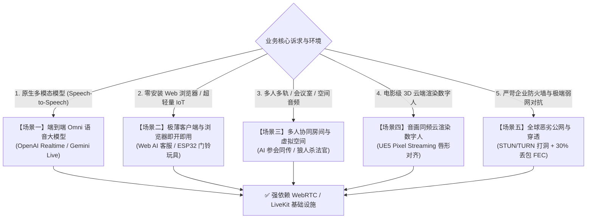
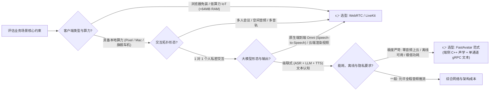

# AI Agent 实时音视频通信协议选型架构评估：WebRTC / LiveKit vs gRPC 双向流

> **文档性质**：架构决策报告（ADR / Technical Evaluation Report）  
> **适用范围**：实时语音助手、数字人交互、多人协同 AI 会议、IoT 边缘端、端到端 Omni 多模态模型通信层选型。  
> **关联规范**：[`docs/personal-voice-agent-harness-spec.md`](personal-voice-agent-harness-spec.md)（第 4 节“端云协同架构”）

---

## 1. 背景与核心分歧

在构建实时语音交互智能体（Voice Agent）与多模态交互系统时，通信协议层的技术选型存在两种主流范式：

1. **以 WebRTC / LiveKit 为代表的流媒体实时传输范式**：基于 UDP (RTP/RTCP)，依托 SFU（选择性转发单元）服务器中继，将原始音频/视频流实时双向推拉。
2. **以 gRPC / WebSocket 为代表的文本与控制流优先范式**：基于 HTTP/2 或 HTTP/3 (QUIC/TCP)，声学处理完全沉降在端侧，网络层仅传输紧凑的 Token 文本与控制信令。

FastAvatar 项目在个人语音助手场景下选择了**“去 WebRTC 化”的端侧 C++ + 单通道 gRPC 文本流**路线。然而，**WebRTC（尤其是 LiveKit 生态）绝非被淘汰的技术，而在许多特定场景下是无可替代的工业标准**。

本文旨在全面剖析：**在哪些具体业务场景下，系统必须使用 WebRTC / LiveKit？两者的技术权衡与决策边界何在？**

---

## 2. 必须使用 WebRTC / LiveKit 的五大核心业务场景

### 场景一：原生端到端“音频进、音频出”的真多模态大模型（Native Speech-to-Speech）

* **代表技术**：OpenAI GPT-4o Realtime API、Google Gemini 2.0 Live、Kyutai Moshi、MiniCPM-o。
* **业务特征**：
  * 系统摒弃了离散的 `ASR ➔ 文本 LLM ➔ TTS` 级联链路；
  * 模型直接输入原始梅尔频谱/连续声学 Token，直接解码输出连续音频波形；
  * 模型具备对**语调起伏、语气停顿、叹气、抽泣、笑声、耳语**的原生理解与生成能力。
* **为什么必须用 WebRTC / LiveKit**：
  * 此类模型无法运行在消费级移动端或轻量车机端，必须部署在云端重型 GPU 集群；
  * 客户端必须将麦克风采集的原始音频帧（Opus/PCM）以 $\le 50\text{ms}$ 的超低时延持续推流至云端；云端生成的原始声学流也必须实时下行推回播放；
  * **TCP/HTTP 的致命死穴**：若使用基于 TCP 的 gRPC/WebSocket 传输实时连续音频流，一旦公网出现轻微抖动丢包，TCP 的队头阻塞（Head-of-Line Blocking）和拥塞重传会导致音频产生秒级卡顿。WebRTC 的 RTP over UDP + 动态 Jitter Buffer 是实时双向连续音频流传输的唯一工业级事实标准。

---

### 场景二：零安装 Web 浏览器端与低算力 IoT 设备（Thin Clients & Web SDK）

* **代表技术**：网页版 AI 客服、官网互动式 AI 销售、在线 AI 面试官、ESP32 智能门铃、低成本儿童玩具。
* **业务特征**：
  * **浏览器端（Web）**：用户通过 Chrome/Safari 扫码或点击链接即可交谈，**严禁要求用户预先下载安装数百兆的 C++ 原生运行时或模型文件**；
  * **超低算力硬件（IoT）**：设备主频仅几百 MHz，RAM 仅 8MB~32MB（如 ESP32-S3、低端行车记录仪），连离线 Silero-VAD 都无法流畅运行，仅能执行基础的音频编解码与网络发包。
* **为什么必须用 WebRTC / LiveKit**：
  * **浏览器原生支持**：WebRTC 是现代全平台浏览器中唯一免安装插件的原生实时通信能力（JavaScript 原生 `RTCPeerConnection`）；
  * **云端全托管感知与合成**：依托 LiveKit 提供的 `livekit-agents` 框架，所有重型计算（VAD 状态机、ASR 转写、TTS 合成）全在云端 Agent Worker 闭环处理，端侧仅需维持一条轻量媒体流通道。

---

### 场景三：多人多轨协同会议、虚拟圆桌与空间交互（Multi-Party Collaboration & Spatial Audio）

* **代表技术**：AI 参会的远程协同会议（类 Zoom / 飞书妙记）、在线双师课堂、多人桌游/狼人杀 AI 法官、元宇宙空间语音。
* **业务特征**：
  * 交互拓扑从“1 对 1”升级为 **N 对 N（多人、多音轨、多角色）**；
  * AI 作为一个虚拟参会者进入房间，需要实时且分别监听张三、李四两条独立的音频 Track，执行声纹分离、实时同传或定向答疑；
  * 涉及空间音频（Spatial Audio，玩家感知到 AI 在左侧发声）。
* **为什么必须用 LiveKit（SFU 架构）**：
  * gRPC/WebSocket 是典型的点对点流，无法原生管理“多路音视频轨的发布-订阅（Pub/Sub）拓扑”；
  * LiveKit 本质上是现代高性能 **SFU（Selective Forwarding Unit，选择性转发单元）**：
    - 支持服务端按需转发音轨，避免客户端上传多份媒体流；
    - 具备音轨动态混音、静音控制与服务端广播能力；
    - 支持服务端并发抓取任意参会者的原始音频流供 AI Agent 消费。

---

### 场景四：云端渲染的高拟真 3D/2.5D 数字人（Cloud-Rendered Video Avatars）

* **代表技术**：虚幻引擎 5（UE5 Pixel Streaming）高精超写实 3D 数字人、实时 2.5D 照片级唇形驱动视频流（HeyGen / D-ID 实时版）。
* **业务特征**：
  * 不仅包含实时语音，还包含 **1080P/4K 60FPS 的高码率视频流**；
  * 要求极其严苛的**音画同步（Lip-Sync 唇形与发音逐毫秒对齐）**；
  * 移动端与轻薄本的 GPU 算力无法本地实时运行光线追踪与毛发渲染，渲染任务必须 100% 部署在云端 GPU 服务器。
* **为什么必须用 WebRTC**：
  * **时间戳硬件级对齐**：视频帧与音频帧必须依靠 RTP 协议的 PTS（Presentation Time Stamp）在传输层硬性时间对齐，杜绝“声音播完了嘴型还在动”；
  * **自适应带宽与拥塞控制（BWE / GCC）**：高码率视频在移动蜂窝网络下传输，必须依赖 WebRTC 的 Google Congestion Control (GCC) 算法，随网络带宽动态降帧、降分辨率或降码率，防止画面花屏死锁。

---

### 场景五：企业级严苛防火墙穿透与极端弱网对抗（NAT Traversal & QoS）

* **代表技术**：大型企事业单位专网、跨国跨洲长途公网通信、高铁与地库高丢包蜂窝网络。
* **业务特征**：
  * 企业防火墙封闭了大部分非标端口，仅开放 80/443；局域网存在复杂的对称型 NAT（Symmetric NAT）；
  * 公网传输跨国 RTT 超过 200ms，偶发丢包率高达 20%~40%。
* **为什么依赖 WebRTC / LiveKit 基础设施**：
  * **成熟的 ICE/STUN/TURN 协议族**：具备完备的打洞与兜底中继机制，直连失败时自动平滑走全球分布式 TURN 节点（通过 443 端口伪装 TLS 流量），确保 99.9% 连通率；
  * **强大的 UDP 弱网丢包恢复能力**：
    - **FEC（前向纠错）**：带外冗余编码，在 30% 随机丢包下，接收端无需触发重传即可还原原始音频；
    - **NetEQ 与自适应 Jitter Buffer**：动态拉伸/压缩语音帧，抚平时延抖动，消除机械爆音。

---

## 3. 技术选型权衡矩阵：FastAvatar (gRPC) vs LiveKit (WebRTC)

| 评估维度 | **FastAvatar 范式 (端侧 C++ + gRPC 文本流)** | **WebRTC / LiveKit 范式 (流媒体推拉 + SFU)** |
| :--- | :--- | :--- |
| **主要定位** | 个人专属伴侣、智能座舱车机、离线隐私助理 | 网页 AI 客服、云端 3D 数字人、多人 AI 会议、智能对讲硬件 |
| **核心媒介** | **高密度 UTF-8 文本 Token** + 控制信令 | **原始音频流 (Opus/PCM)** + 视频流 (H.264/AV1) |
| **模型拓扑** | 级联式（Cascaded: ASR ➔ LLM ➔ TTS） | 原生 Omni 多模态 (Speech-to-Speech) 或云端级联 |
| **端侧算力要求** | **中高**：需本地运行 VAD、ASR 与 TTS 离线引擎 | **极低**：只需支持音频采集与播放（浏览器或极简 MCU） |
| **交互关系** | **1 对 1**（单用户与单助手） | **1 对 1、1 对 N、N 对 N**（多房间、多音轨管理） |
| **打断 (Barge-in) 延迟**| **极低且精准 ($\le 50\text{ms}$)**：本地清空音频硬件即可闭环 | **中等 ($\sim 200\text{ms}$)**：需上送打断信令，服务端静音并通知下行 |
| **网络流量消耗** | **极低**（每分钟仅消耗数 KB 文本流量） | **较高**（每分钟消耗数百 KB ~ 数十 MB 音视频流） |
| **移动端电量开销** | **极低**（无持续音视频编码推流） | **较高**（硬件编码器与网络射频持续处于活跃态） |
| **离线与弱网韧性** | **断网可用**（本地规则与小模型闭环） | **断网瘫痪**（完全依赖云端连接） |

---

## 4. 架构师决策结论

1. **坚持 FastAvatar 的极简路线不动摇**：
   对于本项目（FastAvatar：面向 Mac 桌面与 Pixel 手机的个人专属伴侣），**端侧完全具备神经推理与声学算力，且强诉求于离线可用、弱网零流量、极致省电与隐私绝不出端**。在此场景下，坚持“声学留在端侧、端云只走 gRPC 文本流”是最高效、最克制的设计。
2. **拥抱 WebRTC / LiveKit 的边界条件**：
   当后续 FastAvatar 衍生出以下业务分支时，系统架构应毫不犹豫地引入 LiveKit 基础设施：
   - 推出 **Web 官网试玩版**（用户无需下载任何客户端，打开网页即可与 Avatar 语音对聊）；
   - 推出 **百元级独立硬件桌面摆件**（基于 ESP32-S3 等超轻量芯片）；
   - 引入 **OpenAI Realtime 等原生 Speech-to-Speech 端到端模型**以获取更真实的情绪化发音；
   - 升级为 **多人远程协作空间的会议伴侣**。
